<p align="right">
  <strong>Language:</strong>
  <a href="README.md"><b>简体中文</b></a> |
  <a href="README.en.md"><b>English</b></a> |
  <a href="README.ko.md"><b>한국어</b></a> |
  <a href="README.ja.md"><b>日本語</b></a>
</p>

# WeChat Sticker Maker · Real-Person AI Sticker & Meme Pack Engine

> **Your Face, Your Vibe, Your Sticker Pack.**  
> An end-to-end ChatGPT / Codex skill and Python toolkit exclusively dedicated to **real-person (`human-portrait`)** sticker packs and memes (static PNG/WebP + multi-frame animated GIF/APNG/WebM). Strictly preserves your exact facial features, bone structure, skin texture, hairstyle, and outfit—**never turning real people into 2D anime or generic cartoons**—and exports across **WeChat and 23 global social platforms** in a single run.

<div align="center">

[](LICENSE)
[](#26-built-in-real-person-photographic-styles-referencesstyle-presetsjson)
[-blue.svg)](#108-built-in-real-person-photographic-styles-referencesstyle-presetsjson)
[-ff2d55.svg)](#168-two-person-real-portrait-duo-interaction-presets-referencesduo-presetsjson)
[](#22-real-person-expression-categories)
[](#7-speech-bubble-shapes--5-strict-single-language-packs)
[](#23-platform-export--social-media-covers)

</div>

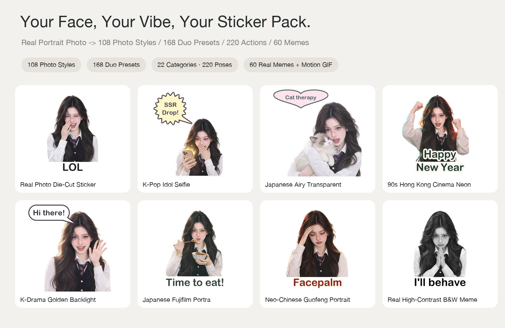

> **[Explore the Full Real-Person Visual Gallery (108 Styles / 168 Duo Presets / 60 Memes / 22 Categories · 220 Expressions) → `docs/gallery/README.en.md`](docs/gallery/README.en.md)**

Exports simultaneously to **WeChat and 23 major social & messaging platforms**: WeChat, QQ, Douyin/Kuaishou, Xiaohongshu (RED), Soul, Weibo, DingTalk, Feishu/Lark, Telegram, WhatsApp, LINE, KakaoTalk, Discord, Slack, iMessage, Signal, Viber, GIPHY (Instagram / TikTok / Snapchat sticker source), Instagram, TikTok, X (Twitter), Facebook, and Universal packs.

---

## Core Highlights

- **108 Real-Person Photographic Styles across 4 Series (General / Korean / Japanese / Chinese)**: Defaults to `real-cutout` with classic 4px die-cut white sticker borders. Changes lighting, color grading, and photographic mood while keeping your real face 100% authentic.
- **168 Two-Person Duo Interaction Presets across 6 Categories (`references/duo-presets.json`)**: Besties (`36`), Couple (`36`), Yuri / GL (`36`), Yaoi / Bromance (`20`), Playful Rivals (`20`), and Family / Siblings (`20`).
- **220 Single-Person Expressions across 22 Categories (`references/expression-presets.json`)**: Includes 8 new high-frequency chat categories: Gaming/Esports (`gaming`), Fandom/Idol (`fandom`), Wealth/Money (`wealth`), Boba/Foodie (`foodie`), Campus/Exams (`campus`), Sassy/Tea (`sassy`), Chaotic Mental State (`mental`), and Pet Collab (`pet_collab`).
- **60 Real-Person Meme & Abstract Templates (`references/meme-templates.json`)**: Includes AI "Thinking..." spinner, China IP Warning, Ban Hammer, MBTI ENFP/INTJ badges, Cyber Wooden Fish Karma +1, Social Battery 1%, WeChat ¥520 Transfer, 60s Voice Note Barrage, Behaving Stamp, Sanity 999%, Zundu Jiadu, Left on Read, Slacking Permit, and AI Confident Hallucination.
- **18 One-Click Theme Packs + 40 Real-Pet Presets + Zero-Cost Text Remix (`remix-text`) + Social Poster Generator (`collage`)**: Build themed packs via `--theme`, swap captions/bubbles in <2 seconds with 0 AI tokens via `remix-text`, and generate 3:4 Xiaohongshu / 9:16 Story posters + 4-language store submission copy via `collage`.

See [`references/text-bubbles-and-languages.md`](references/text-bubbles-and-languages.md), [`references/memes.md`](references/memes.md), and [`references/platform-export.md`](references/platform-export.md) for full details.

---

## 108 Built-In Real-Person Photographic Styles (`references/style-presets.json`)

Grouped into **General (18) / Korean (30) / Japanese (30) / Chinese (30)** series. Filter by region via CLI: `wechat-sticker-maker styles --region kr` (supports `general` / `kr` / `jp` / `cn`).

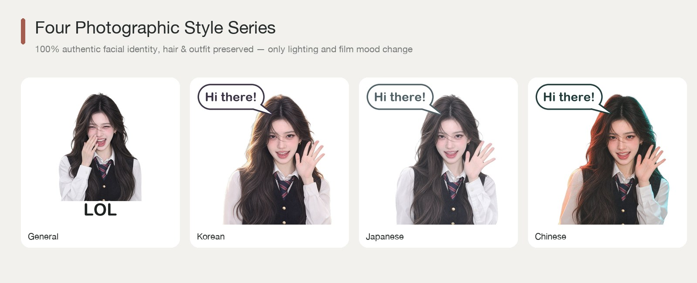

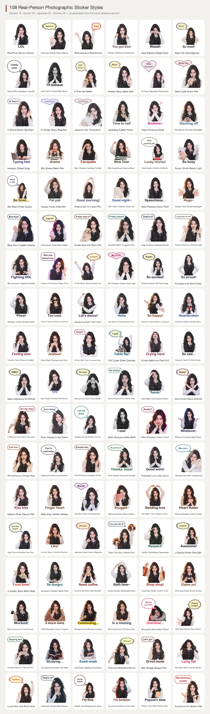

### General Series (18)
| # | Style ID (`--style`) | Style Name | Lighting Profile |
|---|---|---|---|
| 1 | `real-cutout` | **Real Photo Die-Cut Sticker (Default)** | `studio-portrait`|
| 2 | `real-bobblehead` | **Real Caricature Bobblehead** | `bright-studio`|
| 3 | `real-street-cool` | **Real Editorial Street Flash** | `editorial-flash`|
| 4 | `real-vintage-ccd` | **Real Y2K CCD Digicam** | `ccd-warm-flash`|
| 5 | `real-work-emo` | **Real Office Deadpan Candid** | `natural-candid`|
| 6 | `real-high-contrast` | **Real High-Contrast B&W Meme** | `high-contrast-studio`|
| 7 | `real-polaroid-instant` | **Polaroid SX-70 Instant Film** | `polaroid-instant`|
| 8 | `real-fisheye-y2k` | **Y2K 16mm Fisheye Close-Up** | `fisheye-y2k-flash`|
| 9 | `real-paparazzi-flash` | **Night Paparazzi Direct Flash** | `paparazzi-direct-flash`|
| 10 | `real-golden-hour` | **Golden Hour Sunset Backlight** | `golden-hour-sunset`|
| 11 | `real-blue-hour` | **Blue Hour Twilight Cinema** | `blue-hour-cinematic`|
| 12 | `real-cyber-neon` | **Cyberpunk Dual-Neon Night** | `cyber-dual-neon`|
| 13 | `real-film-kodak-gold` | **Kodak Gold 200 Warm Film** | `kodak-gold-200`|
| 14 | `real-film-cinestill-800t` | **CineStill 800T Tungsten Film** | `cinestill-800t`|
| 15 | `real-vogue-editorial` | **High-Fashion Editorial Studio** | `vogue-rembrandt-studio`|
| 16 | `real-french-effortless` | **Parisian Afternoon Window Light** | `french-afternoon-sun`|
| 17 | `real-american-yearbook` | **90s American Yearbook Studio** | `retro-yearbook-studio`|
| 18 | `real-thermal-ir` | **Festival UV Duotone Stage Glow** | `uv-festival-duo`|

### Korean Series (`kr` · 30)
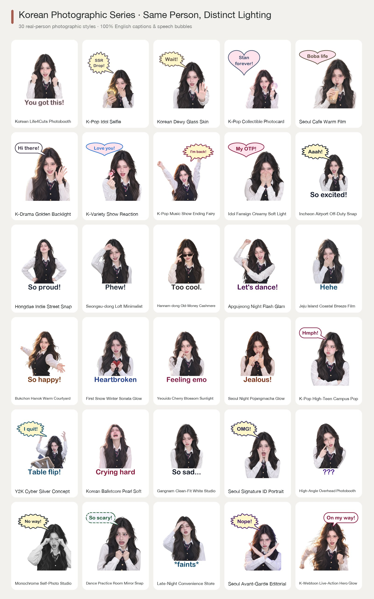

| # | Style ID (`--style`) | Style Name | Lighting Profile |
|---|---|---|---|
| 1 | `real-purikura` | **Korean Life4Cuts Photobooth** | `creamy-kbeauty`|
| 2 | `real-kr-idol-selfie` | **K-Pop Idol Selfie** | `kpop-ringlight`|
| 3 | `real-kr-glass-skin` | **Korean Dewy Glass Skin** | `kbeauty-dewy`|
| 4 | `real-kr-photocard` | **K-Pop Collectible Photocard** | `pastel-gradient-studio`|
| 5 | `real-kr-cafe-film` | **Seoul Cafe Warm Film** | `window-daylight`|
| 6 | `real-kr-drama` | **K-Drama Golden Backlight** | `kdrama-backlight`|
| 7 | `real-kr-variety` | **K-Variety Show Reaction** | `kvariety-highkey`|
| 8 | `real-kr-music-bank` | **K-Pop Music Show Ending Fairy** | `kpop-stage-ending`|
| 9 | `real-kr-fansign-soft` | **Idol Fansign Creamy Soft Light** | `kr-fansign-telephoto`|
| 10 | `real-kr-airport-snap` | **Incheon Airport Off-Duty Snap** | `kr-airport-daylight`|
| 11 | `real-kr-hongdae-street` | **Hongdae Indie Street Snap** | `kr-hongdae-overcast`|
| 12 | `real-kr-seongsu-industrial` | **Seongsu-dong Loft Minimalist** | `kr-seongsu-concrete`|
| 13 | `real-kr-hannam-oldmoney` | **Hannam-dong Old-Money Cashmere** | `kr-hannam-cashmere`|
| 14 | `real-kr-apgujeong-glam` | **Apgujeong Night Flash Glam** | `kr-apgujeong-flash`|
| 15 | `real-kr-jeju-breeze` | **Jeju Island Coastal Breeze Film** | `kr-jeju-coastal-sun`|
| 16 | `real-kr-hanok-sunlight` | **Bukchon Hanok Warm Courtyard** | `kr-hanok-warm-wood`|
| 17 | `real-kr-winter-snow` | **First Snow Winter Sonata Glow** | `kr-first-snow-soft`|
| 18 | `real-kr-cherry-blossom` | **Yeouido Cherry Blossom Sunlight** | `kr-yeouido-blossom`|
| 19 | `real-kr-rainy-pocha` | **Seoul Night Pojangmacha Glow** | `kr-pocha-warm-amber`|
| 20 | `real-kr-high-teen` | **K-Pop High-Teen Campus Pop** | `kr-highteen-pop`|
| 21 | `real-kr-y2k-metallic` | **Y2K Cyber Silver Concept** | `kr-y2k-silver-frost`|
| 22 | `real-kr-balletcore` | **Korean Balletcore Pearl Soft** | `kr-balletcore-pearl`|
| 23 | `real-kr-clean-fit` | **Gangnam Clean-Fit White Studio** | `kr-cleanfit-cyclorama`|
| 24 | `real-kr-id-photo` | **Seoul Signature ID Portrait** | `kr-id-butterfly-light`|
| 25 | `real-kr-high-angle-booth` | **High-Angle Overhead Photobooth** | `kr-high-angle-booth`|
| 26 | `real-kr-bw-fourcut` | **Monochrome Self-Photo Studio** | `kr-mono-photobooth`|
| 27 | `real-kr-practice-mirror` | **Dance Practice Room Mirror Snap** | `kr-practice-room-bright`|
| 28 | `real-kr-convenience-night` | **Late-Night Convenience Store** | `kr-convenience-fluorescent`|
| 29 | `real-kr-magazine-dazed` | **Seoul Avant-Garde Editorial** | `kr-avant-garde-gel`|
| 30 | `real-kr-webtoon-real` | **K-Webtoon Live-Action Hero Glow** | `kr-webtoon-hero-glow`|

### Japanese Series (`jp` · 30)
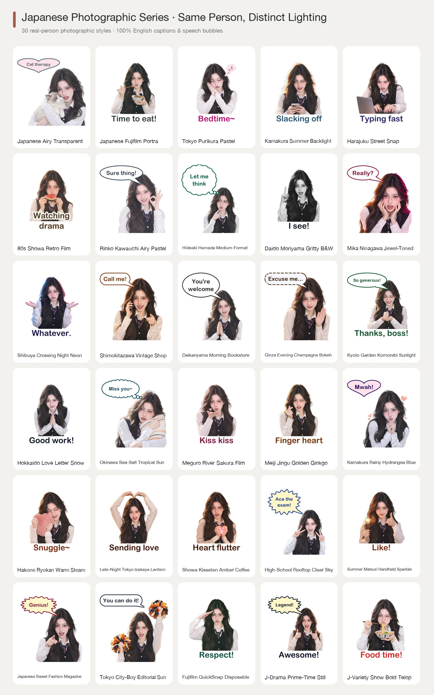

| # | Style ID (`--style`) | Style Name | Lighting Profile |
|---|---|---|---|
| 1 | `real-jp-airy` | **Japanese Airy Transparent** | `airy-overexposed`|
| 2 | `real-jp-fuji-film` | **Japanese Fujifilm Portra** | `fuji-film`|
| 3 | `real-jp-purikura` | **Tokyo Purikura Pastel** | `purikura-booth`|
| 4 | `real-jp-summer` | **Kamakura Summer Backlight** | `summer-backlight`|
| 5 | `real-jp-harajuku` | **Harajuku Street Snap** | `street-flash`|
| 6 | `real-jp-showa` | **80s Showa Retro Film** | `showa-retro`|
| 7 | `real-jp-rinko-pastel` | **Rinko Kawauchi Airy Pastel** | `jp-rinko-highkey-pastel`|
| 8 | `real-jp-hideaki-clean` | **Hideaki Hamada Medium-Format** | `jp-hideaki-medium-format`|
| 9 | `real-jp-moriyama-bw` | **Daido Moriyama Gritty B&W** | `jp-moriyama-gritty-bw`|
| 10 | `real-jp-ninagawa-vivid` | **Mika Ninagawa Jewel-Toned** | `jp-ninagawa-saturated`|
| 11 | `real-jp-shibuya-neon` | **Shibuya Crossing Night Neon** | `jp-shibuya-night-neon`|
| 12 | `real-jp-shimokita-vintage` | **Shimokitazawa Vintage Shop** | `jp-shimokita-warm-film`|
| 13 | `real-jp-daikanyama-morning` | **Daikanyama Morning Bookstore** | `jp-daikanyama-morning`|
| 14 | `real-jp-ginza-luxury` | **Ginza Evening Champagne Bokeh** | `jp-ginza-champagne-glow`|
| 15 | `real-jp-kyoto-komorebi` | **Kyoto Garden Komorebi Sunlight** | `jp-kyoto-komorebi`|
| 16 | `real-jp-hokkaido-snow` | **Hokkaido Love Letter Snow** | `jp-hokkaido-snow-bounce`|
| 17 | `real-jp-okinawa-sun` | **Okinawa Sea-Salt Tropical Sun** | `jp-okinawa-sea-salt`|
| 18 | `real-jp-sakura-film` | **Meguro River Sakura Film** | `jp-sakura-spring-film`|
| 19 | `real-jp-autumn-icho` | **Meiji Jingu Golden Ginkgo** | `jp-autumn-ginkgo-gold`|
| 20 | `real-jp-rainy-hydrangea` | **Kamakura Rainy Hydrangea Blue** | `jp-kamakura-rainy-blue`|
| 21 | `real-jp-onsen-steam` | **Hakone Ryokan Warm Steam** | `jp-onsen-warm-mist`|
| 22 | `real-jp-izakaya-warm` | **Late-Night Tokyo Izakaya Lantern** | `jp-izakaya-lantern`|
| 23 | `real-jp-kissaten-retro` | **Showa Kissaten Amber Coffee** | `jp-kissaten-amber`|
| 24 | `real-jp-school-rooftop` | **High-School Rooftop Clear Sky** | `jp-rooftop-clear-sky`|
| 25 | `real-jp-matsuri-fireworks` | **Summer Matsuri Handheld Sparkler** | `jp-sparkler-warm-glow`|
| 26 | `real-jp-nonno-magazine` | **Japanese Sweet Fashion Magazine** | `jp-sweet-magazine-studio`|
| 27 | `real-jp-popeye-cityboy` | **Tokyo City-Boy Editorial Sun** | `jp-popeye-cityboy-sun`|
| 28 | `real-jp-utsurundesu` | **Fujifilm QuickSnap Disposable** | `jp-quicksnap-disposable`|
| 29 | `real-jp-drama-subtitle` | **J-Drama Prime-Time Still** | `jp-prime-drama-cinematic`|
| 30 | `real-jp-variety-telop` | **J-Variety Show Bold Telop** | `jp-variety-tv-bright`|

### Chinese Series (`cn` · 30)
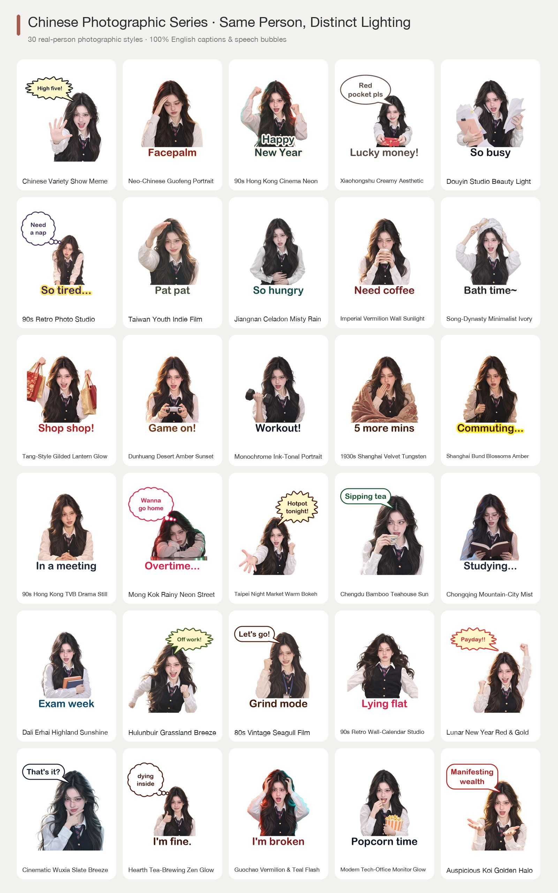

| # | Style ID (`--style`) | Style Name | Lighting Profile |
|---|---|---|---|
| 1 | `real-variety-meme` | **Chinese Variety Show Meme** | `high-key-tv`|
| 2 | `real-cn-new-chinese` | **Neo-Chinese Guofeng Portrait** | `oriental-warm`|
| 3 | `real-cn-hk-retro` | **90s Hong Kong Cinema Neon** | `hk-neon-film`|
| 4 | `real-cn-xhs-vibe` | **Xiaohongshu Creamy Aesthetic** | `creamy-soft`|
| 5 | `real-cn-douyin` | **Douyin Studio Beauty Light** | `ringlight-bright`|
| 6 | `real-cn-studio-retro` | **90s Retro Photo Studio** | `retro-studio-softfocus`|
| 7 | `real-cn-tw-youth` | **Taiwan Youth Indie Film** | `afternoon-sun`|
| 8 | `real-cn-jiangnan-mist` | **Jiangnan Celadon Misty Rain** | `cn-jiangnan-celadon-mist`|
| 9 | `real-cn-palace-redwall` | **Imperial Vermilion Wall Sunlight** | `cn-crimson-wall-sun`|
| 10 | `real-cn-song-minimal` | **Song-Dynasty Minimalist Ivory** | `cn-song-ruyao-minimal`|
| 11 | `real-cn-tang-splendor` | **Tang-Style Gilded Lantern Glow** | `cn-tang-gilded-lantern`|
| 12 | `real-cn-dunhuang-sunset` | **Dunhuang Desert Amber Sunset** | `cn-dunhuang-amber-dusk`|
| 13 | `real-cn-ink-wash-light` | **Monochrome Ink-Tonal Portrait** | `cn-ink-studio-monochrome`|
| 14 | `real-cn-republican-velvet` | **1930s Shanghai Velvet Tungsten** | `cn-vintage-shanghai-tungsten`|
| 15 | `real-cn-shanghai-bund` | **Shanghai Bund Blossoms Amber** | `cn-bund-amber-cinema`|
| 16 | `real-cn-hk-tvb-90s` | **90s Hong Kong TVB Drama Still** | `cn-hk-tvb-90s-warm`|
| 17 | `real-cn-hk-cyber-rain` | **Mong Kok Rainy Neon Street** | `cn-mongkok-rain-neon`|
| 18 | `real-cn-tw-nightmarket` | **Taipei Night Market Warm Bokeh** | `cn-taipei-nightmarket`|
| 19 | `real-cn-chengdu-teahouse` | **Chengdu Bamboo Teahouse Sun** | `cn-chengdu-bamboo-sun`|
| 20 | `real-cn-chongqing-cyber` | **Chongqing Mountain-City Mist** | `cn-chongqing-fog-neon`|
| 21 | `real-cn-dali-sunshine` | **Dali Erhai Highland Sunshine** | `cn-dali-highland-sun`|
| 22 | `real-cn-hulunbuir-wind` | **Hulunbuir Grassland Breeze** | `cn-grassland-open-sky`|
| 23 | `real-cn-80s-factory` | **80s Vintage Seagull Film** | `cn-80s-seagull-film`|
| 24 | `real-cn-90s-calendar` | **90s Retro Wall-Calendar Studio** | `cn-90s-calendar-bright`|
| 25 | `real-cn-cny-festive` | **Lunar New Year Red & Gold** | `cn-lunar-new-year-gold`|
| 26 | `real-cn-wuxia-breeze` | **Cinematic Wuxia Slate Breeze** | `cn-wuxia-cinematic-cool`|
| 27 | `real-cn-tea-zen` | **Hearth Tea-Brewing Zen Glow** | `cn-tea-hearth-zen`|
| 28 | `real-cn-guochao-street` | **Guochao Vermilion & Teal Flash** | `cn-guochao-crimson-teal`|
| 29 | `real-cn-work-survival` | **Modern Tech-Office Monitor Glow** | `cn-office-monitor-glow`|
| 30 | `real-cn-bazi-lucky` | **Auspicious Koi Golden Halo** | `cn-auspicious-golden-halo`|

---

## 168 Two-Person Real-Portrait Duo Interaction Presets (`references/duo-presets.json`)

Pass two real portrait photos (`-i personA.jpg -p personB.jpg`) to generate two-person real-portrait stickers while preserving BOTH people's authentic facial identity (`wechat-sticker-maker duo --category besties|couple|yuri|yaoi|rivals|family --language en`).

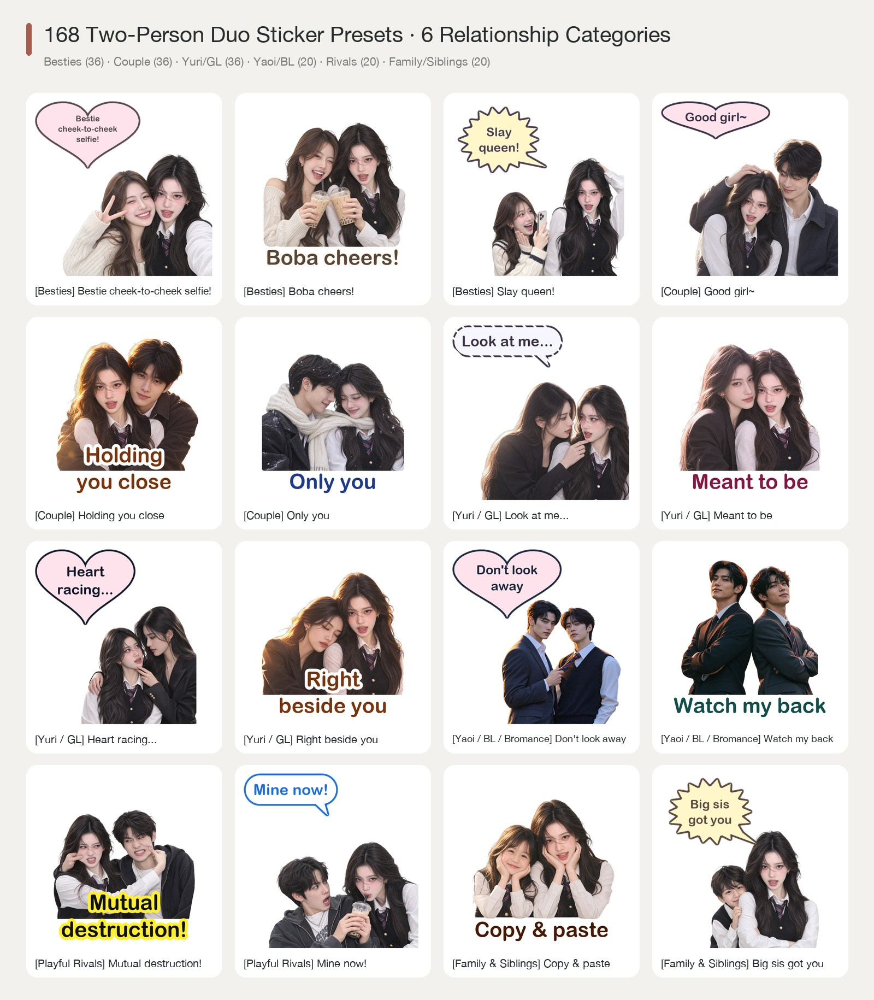

| Category (`--duo-category`) | Count | IDs | Signature Real-Person Interactions |
|---|---|---|---|
| **👯‍♀️ Besties (`besties`)** | **36** | `d01` – `d36` | Cheek-to-cheek selfie (`Besties`), Twin heart hands, Boba cheers (`Boba time`), Whispering gossip (`Hot tea!`), Protective hug (`Who bullied you?`), High-five (`Got me`) |
| **👩‍❤️‍👨 Couple (`couple`)** | **36** | `d37` – `d72` | Affectionate head pat (`Good girl`), Back hug (`Recharging`), Cheek pinch (`Adore you`), Forehead touch (`Only you`), Sleeve tug (`Stay with me`), Shared winter scarf |
| **🌸 Yuri / GL (`yuri`)** | **36** | `d73` – `d108` | Fingertip chin-lift gaze (`Look at me, Unnie`), Cinematic cheek touch (`Meant to be`), Cool unnie kabedon (`Heart racing`), Sleeping on shoulder (`Yours only`), Red thread of fate |
| **🥂 Yaoi / Bromance (`yaoi`)** | **20** | `d109` – `d128` | Tie-pull gaze (`Closer`), Back-to-back suits (`Got your back`), One-hand wall lean (`Listen to me`), Shared black umbrella in rain (`Come here`), Wrist grab (`Don't go`) |
| **⚡ Playful Rivals (`rivals`)** | **20** | `d129` – `d148` | Mutual cheek pull (`Fight me!`), Forehead flick (`Pay up`), Stealing a sip of boba (`Mine!`), Side-eye stare-off (`Hmph`), Instant truce over food (`Peace for now`) |
| **🧸 Family & Siblings (`family`)** | **20** | `d149` – `d168` | Mini-me synchronized chin rest (`Copy-paste`), Big sister protective hug (`Behind me`), Spoiling cheek squish (`Cutie pie`), Red envelope head pat (`Happy New Year`) |

---

## Codex AI Multi-Frame Animated GIFs (4-Frame Keyframe Storyboards)

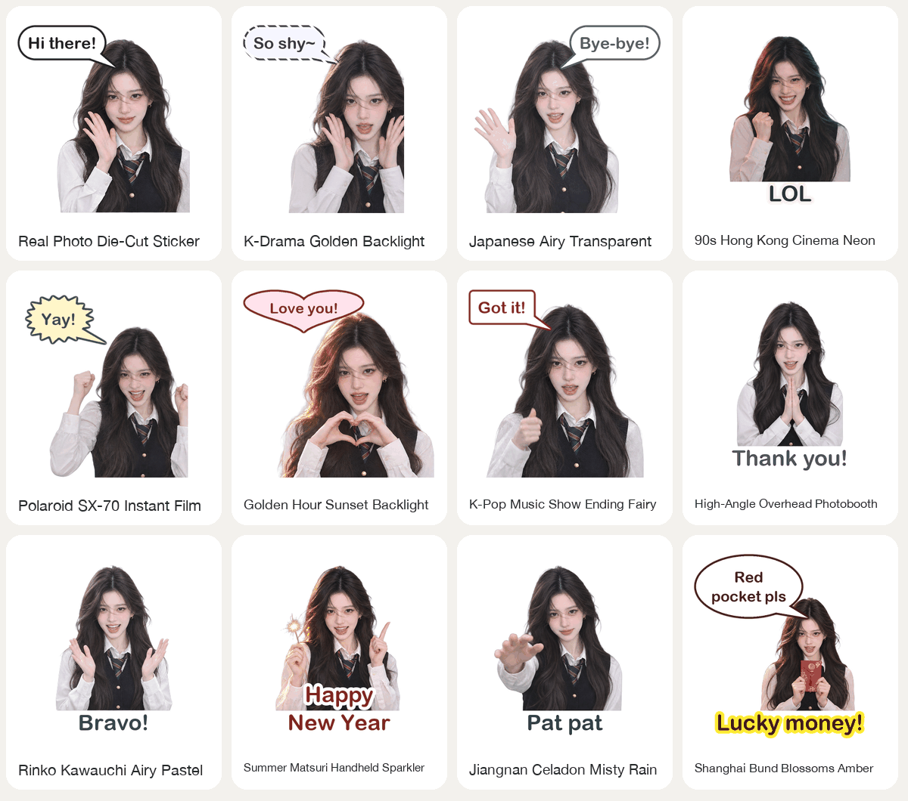

---

## 22 Real-Person Expression Categories (220 Expressions)

In addition to the 14 daily categories (Greeting, Polite, Agree, Refuse, Happy, Sad, Angry, Shocked, Tired, Work, Cute, Cheer, Sleep, Festival), includes **8 high-frequency vertical & subculture categories**:
- **🎮 Gaming & Esports (`gaming`)**: `GGWP`, `Carry me!`, `One more game`, `Lagging!!`, `MVP moment`, `AFK`
- **💖 Fandom & Idol (`fandom`)**: `My bias is unreal`, `Lightstick wave`, `Crying at concert`, `Photocard pull`, `Protect at all costs`
- **💰 Wealth & Luck (`wealth`)**: `Manifesting wealth`, `Payday glow`, `Red envelope magnet`, `Broke until Friday`, `Instant rich`
- **🧋 Boba & Foodie (`foodie`)**: `Boba saves lives`, `Late-night ramen`, `Diet starts tomorrow`, `First bite heaven`, `Iced Americano IV`
- **📚 Campus & Exams (`campus`)**: `8AM lecture zombie`, `Thesis survival`, `Passing prayer`, `Library all-nighter`, `Finally on break`
- **💅 Sassy & Tea (`sassy`)**: `Oh really?`, `Bombastic side-eye`, `Sipping tea`, `Polite fake smile`, `Not my problem`
- **🌀 Chaotic Mental State (`mental`)**: `Soul leaving body`, `Peacefully unhinged`, `Wooden fish karma +1`, `Brain buffering`, `Screaming internally`
- **🐾 Pet Collab (`pet_collab`)**: `Cat paw cuddle`, `Humble cat servant`, `Puppy kisses`, `Synchronized judging stare`

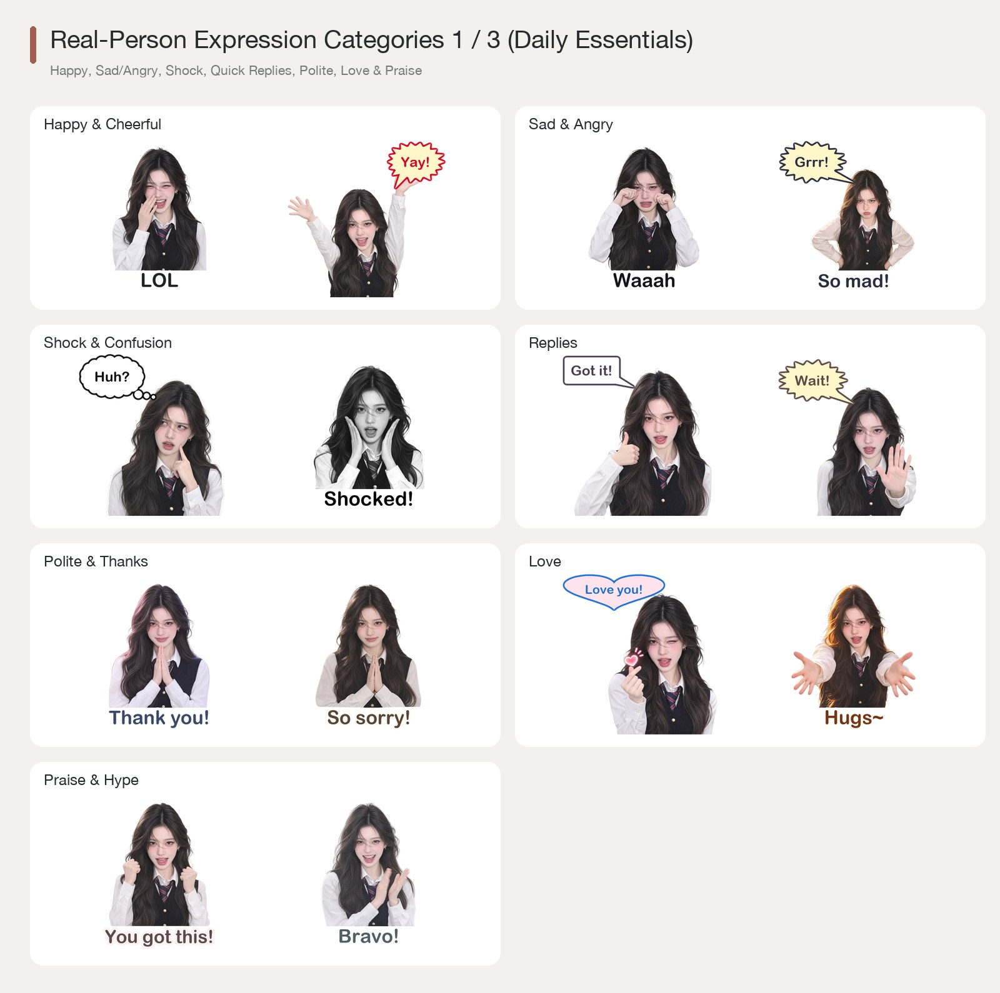
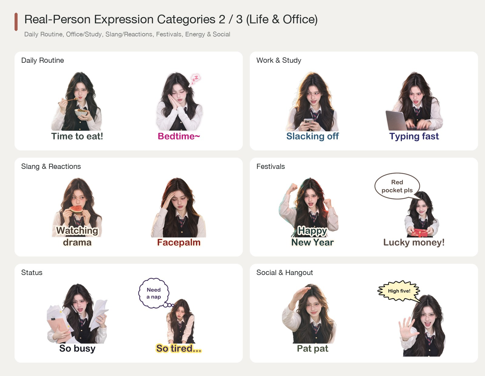
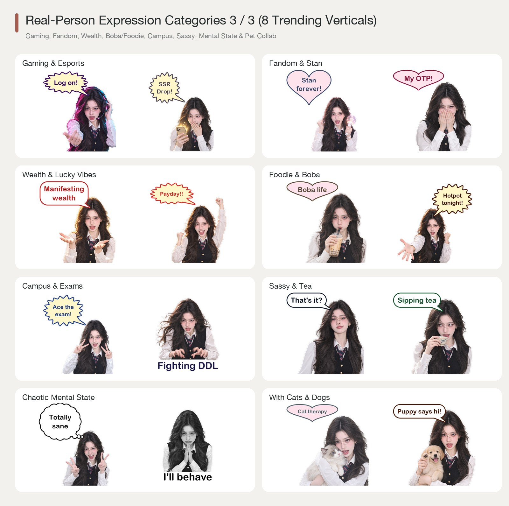

---

## 60 Real-Person Meme & Abstract Templates (6 Categories)

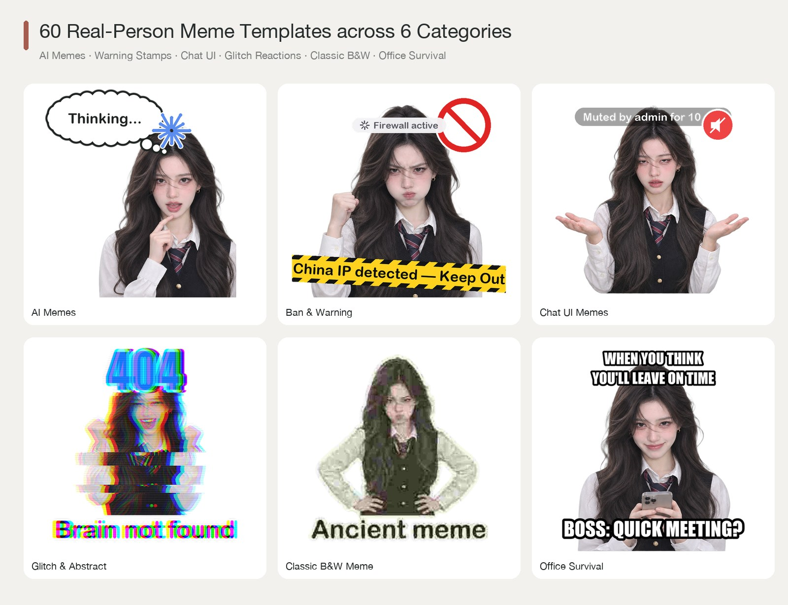

---

## 7 Speech Bubble Shapes & 5 Strict Single-Language Packs

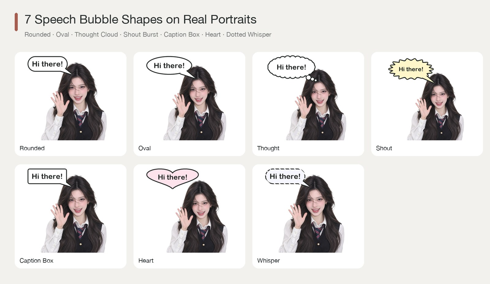
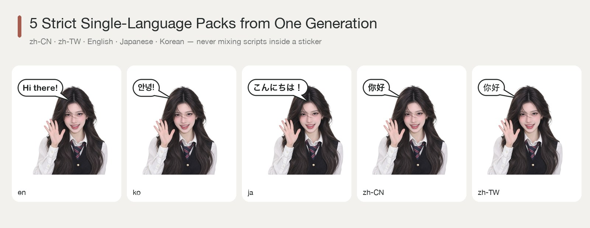

### Complete 100% English Sticker Pack Example


---

## 23-Platform Export & Social Media Covers

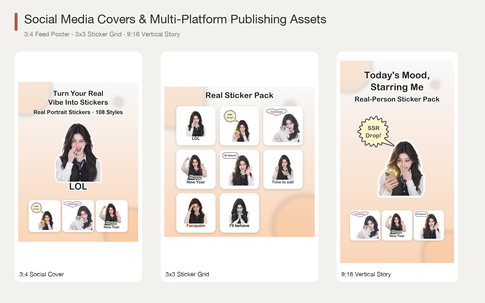

---

## Quick Start

```bash
# One-click installer (creates .venv and links Skill to ~/.claude/skills & ~/.codex/skills)
./install.sh
source .venv/bin/activate

# Inspect environment, 108 styles, 168 duo presets & 18 one-click theme packs
wechat-sticker-maker doctor
wechat-sticker-maker styles --region kr
wechat-sticker-maker duo --category yuri --language en
wechat-sticker-maker themes

# One-click themed pack (--theme auto-configures style, curated expressions & memes)
wechat-sticker-maker plan -i photo.jpg --theme gaming -o output/gamer-pack

# Zero-cost caption & bubble text remix (0 AI tokens, <2s in-place re-composition)
wechat-sticker-maker remix-text -j output/my-portrait-pack/job.json --set 01_hello="Wassup!" --bubble 05_shy="Stop looking~"

# Generate Xiaohongshu 3:4 / Story 9:16 / Grid 1:1 promotional posters + store copy
wechat-sticker-maker collage -o output/my-portrait-pack --title "My Real-Person Pack"

# Single-person pack (Generate AI cutouts ONCE -> output 4 single-language packs: zh-CN, en, ja, ko)
wechat-sticker-maker plan \
  --input photo.jpg \
  --output output/my-portrait-pack \
  --mode both \
  --count 16 \
  --style real-cutout \
  --language auto \
  --languages zh-CN,en,ja,ko \
  --platforms wechat,xiaohongshu,instagram,telegram

wechat-sticker-maker generate --job output/my-portrait-pack/job.json

# Two-person Duo pack (Besties / Couple / Yuri)
wechat-sticker-maker plan \
  --input personA.jpg \
  --partner personB.jpg \
  --duo-category yuri \
  --count 16 \
  --style real-kr-drama \
  --language en \
  --languages zh-CN,en,ja,ko \
  --output output/yuri-duo-pack

wechat-sticker-maker generate --job output/yuri-duo-pack/job.json

# Strict Anatomy & Facial-Proportion QA Gate (Zero 3rd Hands / Stretched Faces / Baked Checkerboards)
# Generates qa/strict-audit-sheet.jpg with 2x Face, Shoulder & Hand zoom panels (--vlm enables Vision API verification)
wechat-sticker-maker audit -o output/yuri-duo-pack --strict
wechat-sticker-maker regenerate -j output/yuri-duo-pack/job.json --item d03_bestie_hype_queen \
  --defect third_hand_or_extra_limb,stretched_or_warped_face,baked_checkerboard
```

## Testing

```bash
pytest -v
python scripts/smoke_test.py
```

## License

MIT License. See [`LICENSE`](LICENSE) for details.
