<p align="right">
  <strong>Language:</strong>
  <a href="README.md"><b>简体中文</b></a> |
  <a href="README.en.md"><b>English</b></a> |
  <a href="README.ko.md"><b>한국어</b></a> |
  <a href="README.ja.md"><b>日本語</b></a>
</p>

# WeChat Sticker Maker · 実写人物専用 AIスタンプ＆ミーム生成エンジン

> **Your Face, Your Vibe, Your Sticker Pack.**  
> **実写の人物写真（`human-portrait`）**専用に設計された、ChatGPT / Codex スキル＆Pythonスタンプ・ミーム一括生成エンジンです。ご本人の顔立ち、骨格、肌の質感、髪型、服装を忠実に保ち、**勝手に2Dアニメ風やデフォルメイラストに変えてしまうことはありません。** 一度の生成で LINE、WeChat、Instagram、TikTok、Telegram、Discord など**世界23種類の主要SNS・チャットアプリ**の規格へ同時に書き出せます。

<div align="center">

[](LICENSE)
[](#内蔵された108種類の実写フォトスタイル-referencesstyle-presetsjson)
[-blue.svg)](#内蔵された108種類の実写フォトスタイル-referencesstyle-presetsjson)
[-ff2d55.svg)](#内蔵された168種類の2人ペア実写スタンププリセット-親友--カップル--百合)
[](#22カテゴリーの実写表情カタログ)
[](#7種類の吹き出しデザインと5言語の単一言語出力)
[](#23プラットフォームへの一括書き出しとsnsカバー生成)

</div>

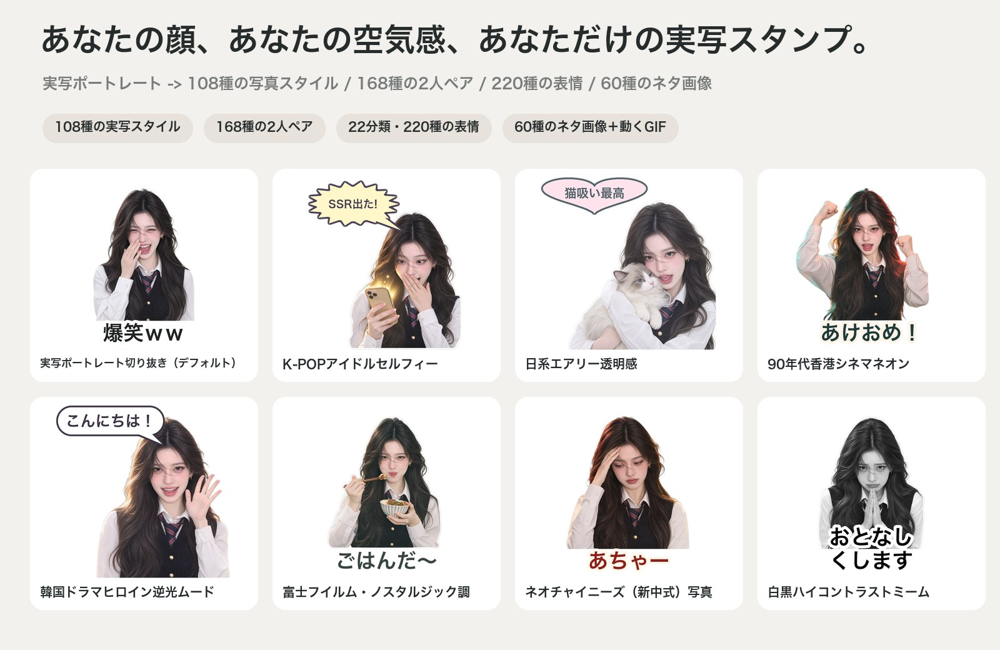

> **[実写スタンプギャラリー全文を見る（全108スタイル / 168種類の2人ペア / 60種類のミーム / 22カテゴリー・220種類の表情） → `docs/gallery/README.ja.md`](docs/gallery/README.ja.md)**

**対応する全23プラットフォーム**：LINE、Instagram、TikTok、X（旧Twitter）、Telegram、WhatsApp、Discord、Slack、KakaoTalk、iMessage、Signal、Viber、GIPHY、Facebook、WeChat（微信）、QQ、小紅書（RED）、Douyin、Weibo など。

---

## 主な特徴

- **全108種類の実写専用フォトスタイル（汎用 / 韓国系 / 日本系 / 中国系の4大シリーズ）**：デフォルトの `real-cutout` では美しい4pxの白フチ付きダイカットステッカーを生成。ライティングや色調、空気感のみを変化させ、本人の顔立ちを100%リアルに保ちます。
- **全168種類の2人ペア実写スタンププリセット（6カテゴリー・`references/duo-presets.json`）**：親友・女子会（`36種`）、カップル（`36種`）、百合・双女主（`36種`）、BL・双男主・相棒（`20種`）、喧嘩するほど仲がいい（`20種`）、家族・姉弟・キッズ（`20種`）。
- **22カテゴリー・220種類の表情＆4フレームモーションライブラリ**：日常14カテゴリーに加え、ゲーム・eスポーツ（`gaming`）、推し活・アイドル応援（`fandom`）、金運・開運（`wealth`）、タピ活・グルメ（`foodie`）、キャンパス・試験（`campus`）、辛口・あおり（`sassy`）、メンタル崩壊・悟り（`mental`）、ペットとの共演（`pet_collab`）の8カテゴリーを新設。
- **60種類の実写ミーム＆ネタ画像テンプレート（`references/meme-templates.json`）**：AI「思考中...」スピナー、中国IP接近禁止、BAN警告スタンプ、MBTI（ENFP/INTJ）バッジ、サイバー木魚「功徳+1」、社交バッテリー1%、WeChat 520元送金画面、60秒ボイスメッセージ連打、おとなしくなりました印鑑、既読スルー、有給サボり許可証など60種類を内蔵。
- **15種類のワンクリックテーマパック（`--theme`）＋ トークン消費ゼロのセリフ差し替え（`remix-text`）＋ SNS告知ポスター生成（`collage`）**：AI再生成（0トークン）なしで2秒で文字・吹き出しを差し替え、3:4 / 9:16 告知ポスターと4言語のストア申請用テキストを自動出力します。

---

## 内蔵された108種類の実写フォトスタイル（`references/style-presets.json`）

**汎用（18種） / 韓国系（30種） / 日本系（30種） / 中国系（30種）** の計108スタイルを収録しており、CLIからシリーズ別に絞り込み可能です：`wechat-sticker-maker styles --region jp`。

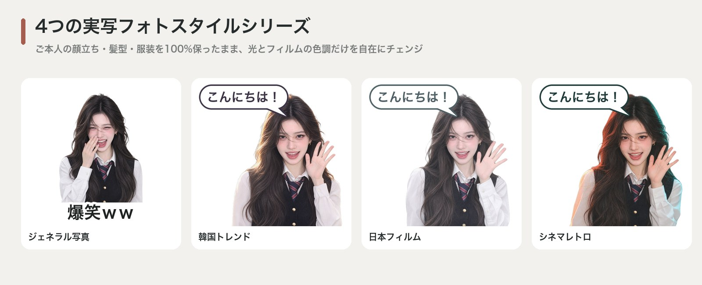

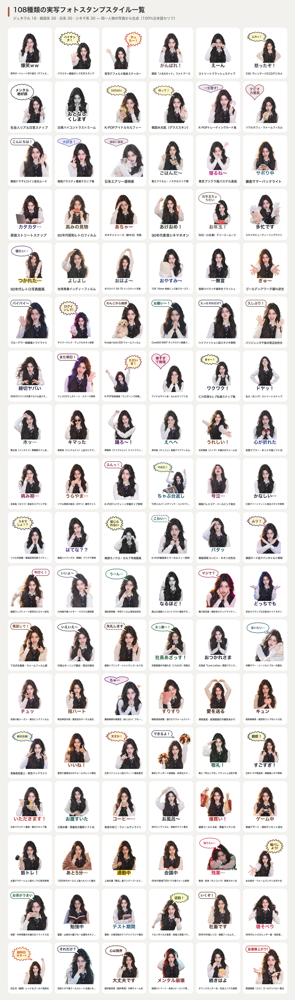

### 汎用シリーズ（18種）
| # | スタイルID (`--style`) | スタイル名 | ライティング＆プリセット名 |
|---|---|---|---|
| 1 | `real-cutout` | **実写ポートレート切り抜き（デフォルト）** | `studio-portrait`|
| 2 | `real-bobblehead` | **実写デフォルメ頭身ステッカー** | `bright-studio`|
| 3 | `real-street-cool` | **ストリートフラッシュスナップ** | `editorial-flash`|
| 4 | `real-vintage-ccd` | **Y2K ヴィンテージCCDデジカメ** | `ccd-warm-flash`|
| 5 | `real-work-emo` | **社会人リアル日常スナップ** | `natural-candid`|
| 6 | `real-high-contrast` | **白黒ハイコントラストミーム** | `high-contrast-studio`|
| 7 | `real-polaroid-instant` | **ポラロイド SX-70 インスタント写真** | `polaroid-instant`|
| 8 | `real-fisheye-y2k` | **Y2K 16mm 魚眼レンズ風クローズアップ** | `fisheye-y2k-flash`|
| 9 | `real-paparazzi-flash` | **夜間パパラッチ直焚きフラッシュ** | `paparazzi-direct-flash`|
| 10 | `real-golden-hour` | **ゴールデンアワー夕暮れ逆光** | `golden-hour-sunset`|
| 11 | `real-blue-hour` | **ブルーアワー映画風トワイライト** | `blue-hour-cinematic`|
| 12 | `real-cyber-neon` | **サイバーパンク・デュアルネオン夜景** | `cyber-dual-neon`|
| 13 | `real-film-kodak-gold` | **Kodak Gold 200 ウォームフィルム** | `kodak-gold-200`|
| 14 | `real-film-cinestill-800t` | **CineStill 800T タングステン映画フィルム** | `cinestill-800t`|
| 15 | `real-vogue-editorial` | **ハイファッション誌スタジオ照明** | `vogue-rembrandt-studio`|
| 16 | `real-french-effortless` | **パリジェンヌ午後の窓辺自然光** | `french-afternoon-sun`|
| 17 | `real-american-yearbook` | **90年代アメリカ卒業アルバム風スタジオ** | `retro-yearbook-studio`|
| 18 | `real-thermal-ir` | **フェスUVデュオトーン・ステージ照明** | `uv-festival-duo`|

### 韓国系シリーズ（`kr` · 30種）
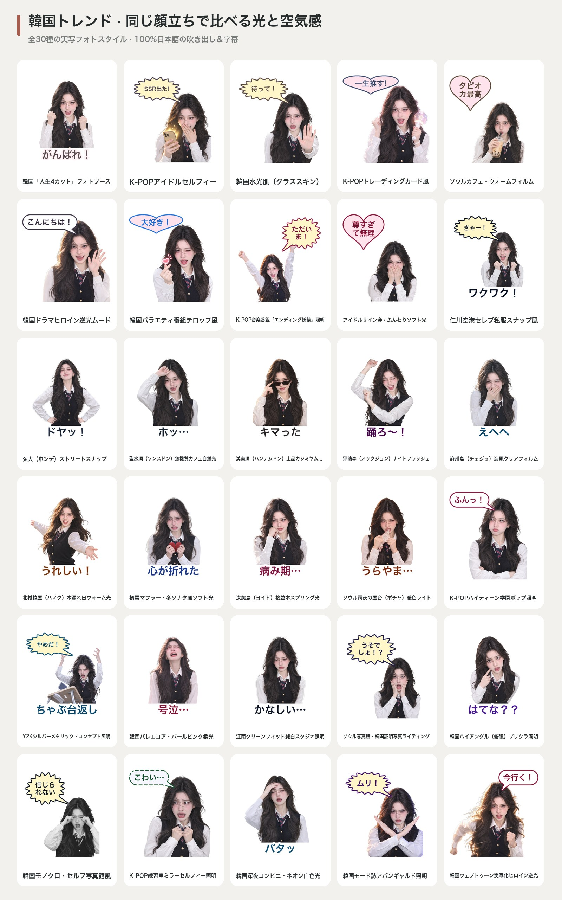

| # | スタイルID (`--style`) | スタイル名 | ライティング＆プリセット名 |
|---|---|---|---|
| 1 | `real-purikura` | **韓国「人生4カット」フォトブース** | `creamy-kbeauty`|
| 2 | `real-kr-idol-selfie` | **K-POPアイドルセルフィー** | `kpop-ringlight`|
| 3 | `real-kr-glass-skin` | **韓国水光肌（グラススキン）** | `kbeauty-dewy`|
| 4 | `real-kr-photocard` | **K-POPトレーディングカード風** | `pastel-gradient-studio`|
| 5 | `real-kr-cafe-film` | **ソウルカフェ・ウォームフィルム** | `window-daylight`|
| 6 | `real-kr-drama` | **韓国ドラマヒロイン逆光ムード** | `kdrama-backlight`|
| 7 | `real-kr-variety` | **韓国バラエティ番組テロップ風** | `kvariety-highkey`|
| 8 | `real-kr-music-bank` | **K-POP音楽番組「エンディング妖精」照明** | `kpop-stage-ending`|
| 9 | `real-kr-fansign-soft` | **アイドルサイン会・ふんわりソフト光** | `kr-fansign-telephoto`|
| 10 | `real-kr-airport-snap` | **仁川空港セレブ私服スナップ風** | `kr-airport-daylight`|
| 11 | `real-kr-hongdae-street` | **弘大（ホンデ）ストリートスナップ** | `kr-hongdae-overcast`|
| 12 | `real-kr-seongsu-industrial` | **聖水洞（ソンスドン）無機質カフェ自然光** | `kr-seongsu-concrete`|
| 13 | `real-kr-hannam-oldmoney` | **漢南洞（ハンナムドン）上品カシミヤムード** | `kr-hannam-cashmere`|
| 14 | `real-kr-apgujeong-glam` | **狎鴎亭（アックジョン）ナイトフラッシュ** | `kr-apgujeong-flash`|
| 15 | `real-kr-jeju-breeze` | **済州島（チェジュ）海風クリアフィルム** | `kr-jeju-coastal-sun`|
| 16 | `real-kr-hanok-sunlight` | **北村韓屋（ハノク）木漏れ日ウォーム光** | `kr-hanok-warm-wood`|
| 17 | `real-kr-winter-snow` | **初雪マフラー・冬ソナタ風ソフト光** | `kr-first-snow-soft`|
| 18 | `real-kr-cherry-blossom` | **汝矣島（ヨイド）桜並木スプリング光** | `kr-yeouido-blossom`|
| 19 | `real-kr-rainy-pocha` | **ソウル雨夜の屋台（ポチャ）暖色ライト** | `kr-pocha-warm-amber`|
| 20 | `real-kr-high-teen` | **K-POPハイティーン学園ポップ照明** | `kr-highteen-pop`|
| 21 | `real-kr-y2k-metallic` | **Y2Kシルバーメタリック・コンセプト照明** | `kr-y2k-silver-frost`|
| 22 | `real-kr-balletcore` | **韓国バレエコア・パールピンク柔光** | `kr-balletcore-pearl`|
| 23 | `real-kr-clean-fit` | **江南クリーンフィット純白スタジオ照明** | `kr-cleanfit-cyclorama`|
| 24 | `real-kr-id-photo` | **ソウル写真館・韓国証明写真ライティング** | `kr-id-butterfly-light`|
| 25 | `real-kr-high-angle-booth` | **韓国ハイアングル（俯瞰）プリクラ照明** | `kr-high-angle-booth`|
| 26 | `real-kr-bw-fourcut` | **韓国モノクロ・セルフ写真館風** | `kr-mono-photobooth`|
| 27 | `real-kr-practice-mirror` | **K-POP練習室ミラーセルフィー照明** | `kr-practice-room-bright`|
| 28 | `real-kr-convenience-night` | **韓国深夜コンビニ・ネオン白色光** | `kr-convenience-fluorescent`|
| 29 | `real-kr-magazine-dazed` | **韓国モード誌アバンギャルド照明** | `kr-avant-garde-gel`|
| 30 | `real-kr-webtoon-real` | **韓国ウェブトゥーン実写化ヒロイン逆光** | `kr-webtoon-hero-glow`|

### 日本系シリーズ（`jp` · 30種）
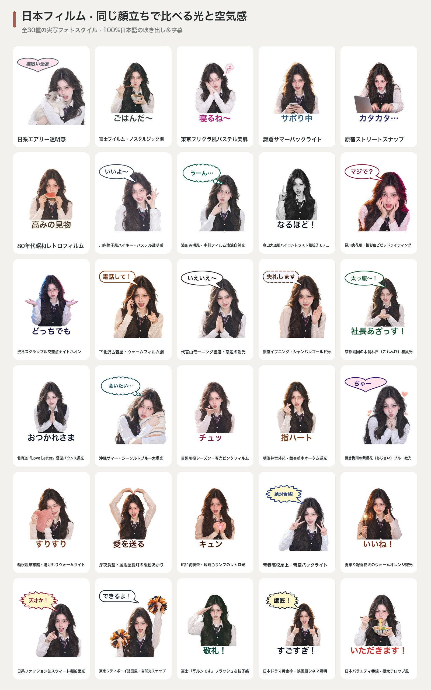

| # | スタイルID (`--style`) | スタイル名 | ライティング＆プリセット名 |
|---|---|---|---|
| 1 | `real-jp-airy` | **日系エアリー透明感** | `airy-overexposed`|
| 2 | `real-jp-fuji-film` | **富士フイルム・ノスタルジック調** | `fuji-film`|
| 3 | `real-jp-purikura` | **東京プリクラ風パステル美肌** | `purikura-booth`|
| 4 | `real-jp-summer` | **鎌倉サマーバックライト** | `summer-backlight`|
| 5 | `real-jp-harajuku` | **原宿ストリートスナップ** | `street-flash`|
| 6 | `real-jp-showa` | **80年代昭和レトロフィルム** | `showa-retro`|
| 7 | `real-jp-rinko-pastel` | **川内倫子風ハイキー・パステル透明感** | `jp-rinko-highkey-pastel`|
| 8 | `real-jp-hideaki-clean` | **濱田英明風・中判フィルム清涼自然光** | `jp-hideaki-medium-format`|
| 9 | `real-jp-moriyama-bw` | **森山大道風ハイコントラスト粗粒子モノクロ** | `jp-moriyama-gritty-bw`|
| 10 | `real-jp-ninagawa-vivid` | **蜷川実花風・極彩色ビビッドライティング** | `jp-ninagawa-saturated`|
| 11 | `real-jp-shibuya-neon` | **渋谷スクランブル交差点ナイトネオン** | `jp-shibuya-night-neon`|
| 12 | `real-jp-shimokita-vintage` | **下北沢古着屋・ウォームフィルム調** | `jp-shimokita-warm-film`|
| 13 | `real-jp-daikanyama-morning` | **代官山モーニング書店・窓辺の朝光** | `jp-daikanyama-morning`|
| 14 | `real-jp-ginza-luxury` | **銀座イブニング・シャンパンゴールド光** | `jp-ginza-champagne-glow`|
| 15 | `real-jp-kyoto-komorebi` | **京都庭園の木漏れ日（こもれび）和風光** | `jp-kyoto-komorebi`|
| 16 | `real-jp-hokkaido-snow` | **北海道『Love Letter』雪原バウンス柔光** | `jp-hokkaido-snow-bounce`|
| 17 | `real-jp-okinawa-sun` | **沖縄サマー・シーソルトブルー太陽光** | `jp-okinawa-sea-salt`|
| 18 | `real-jp-sakura-film` | **目黒川桜シーズン・春光ピンクフィルム** | `jp-sakura-spring-film`|
| 19 | `real-jp-autumn-icho` | **明治神宮外苑・銀杏並木オータム逆光** | `jp-autumn-ginkgo-gold`|
| 20 | `real-jp-rainy-hydrangea` | **鎌倉梅雨の紫陽花（あじさい）ブルー微光** | `jp-kamakura-rainy-blue`|
| 21 | `real-jp-onsen-steam` | **箱根温泉旅館・湯けむりウォームライト** | `jp-onsen-warm-mist`|
| 22 | `real-jp-izakaya-warm` | **深夜食堂・居酒屋提灯の暖色あかり** | `jp-izakaya-lantern`|
| 23 | `real-jp-kissaten-retro` | **昭和純喫茶・琥珀色ランプのレトロ光** | `jp-kissaten-amber`|
| 24 | `real-jp-school-rooftop` | **青春高校屋上・青空バックライト** | `jp-rooftop-clear-sky`|
| 25 | `real-jp-matsuri-fireworks` | **夏祭り線香花火のウォームオレンジ微光** | `jp-sparkler-warm-glow`|
| 26 | `real-jp-nonno-magazine` | **日系ファッション誌スウィート棚拍柔光** | `jp-sweet-magazine-studio`|
| 27 | `real-jp-popeye-cityboy` | **東京シティボーイ誌面風・自然光スナップ** | `jp-popeye-cityboy-sun`|
| 28 | `real-jp-utsurundesu` | **富士『写ルンです』フラッシュ＆粒子感** | `jp-quicksnap-disposable`|
| 29 | `real-jp-drama-subtitle` | **日本ドラマ黄金枠・映画風シネマ照明** | `jp-prime-drama-cinematic`|
| 30 | `real-jp-variety-telop` | **日本バラエティ番組・極太テロップ風** | `jp-variety-tv-bright`|

### 中国系シリーズ（`cn` · 30種）
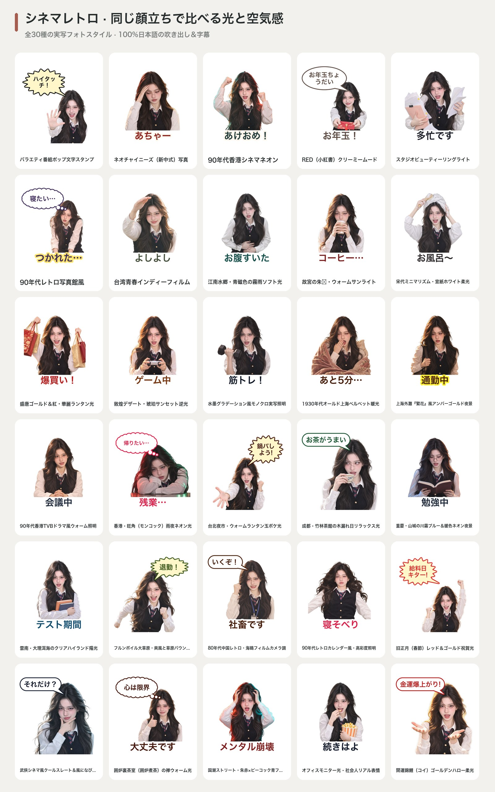

| # | スタイルID (`--style`) | スタイル名 | ライティング＆プリセット名 |
|---|---|---|---|
| 1 | `real-variety-meme` | **バラエティ番組ポップ文字スタンプ** | `high-key-tv`|
| 2 | `real-cn-new-chinese` | **ネオチャイニーズ（新中式）写真** | `oriental-warm`|
| 3 | `real-cn-hk-retro` | **90年代香港シネマネオン** | `hk-neon-film`|
| 4 | `real-cn-xhs-vibe` | **RED（小紅書）クリーミームード** | `creamy-soft`|
| 5 | `real-cn-douyin` | **スタジオビューティーリングライト** | `ringlight-bright`|
| 6 | `real-cn-studio-retro` | **90年代レトロ写真館風** | `retro-studio-softfocus`|
| 7 | `real-cn-tw-youth` | **台湾青春インディーフィルム** | `afternoon-sun`|
| 8 | `real-cn-jiangnan-mist` | **江南水郷・青磁色の霧雨ソフト光** | `cn-jiangnan-celadon-mist`|
| 9 | `real-cn-palace-redwall` | **故宮の朱벽・ウォームサンライト** | `cn-crimson-wall-sun`|
| 10 | `real-cn-song-minimal` | **宋代ミニマリズム・宣紙ホワイト柔光** | `cn-song-ruyao-minimal`|
| 11 | `real-cn-tang-splendor` | **盛唐ゴールド＆紅・華麗ランタン光** | `cn-tang-gilded-lantern`|
| 12 | `real-cn-dunhuang-sunset` | **敦煌デザート・琥珀サンセット逆光** | `cn-dunhuang-amber-dusk`|
| 13 | `real-cn-ink-wash-light` | **水墨グラデーション風モノクロ実写照明** | `cn-ink-studio-monochrome`|
| 14 | `real-cn-republican-velvet` | **1930年代オールド上海ベルベット暖光** | `cn-vintage-shanghai-tungsten`|
| 15 | `real-cn-shanghai-bund` | **上海外灘『繁花』風アンバーゴールド夜景** | `cn-bund-amber-cinema`|
| 16 | `real-cn-hk-tvb-90s` | **90年代香港TVBドラマ風ウォーム照明** | `cn-hk-tvb-90s-warm`|
| 17 | `real-cn-hk-cyber-rain` | **香港・旺角（モンコック）雨夜ネオン光** | `cn-mongkok-rain-neon`|
| 18 | `real-cn-tw-nightmarket` | **台北夜市・ウォームランタン玉ボケ光** | `cn-taipei-nightmarket`|
| 19 | `real-cn-chengdu-teahouse` | **成都・竹林茶館の木漏れ日リラックス光** | `cn-chengdu-bamboo-sun`|
| 20 | `real-cn-chongqing-cyber` | **重慶・山城の川霧ブルー＆暖色ネオン夜景** | `cn-chongqing-fog-neon`|
| 21 | `real-cn-dali-sunshine` | **雲南・大理洱海のクリアハイランド陽光** | `cn-dali-highland-sun`|
| 22 | `real-cn-hulunbuir-wind` | **フルンボイル大草原・爽風と草原バウンス光** | `cn-grassland-open-sky`|
| 23 | `real-cn-80s-factory` | **80年代中国レトロ・海鴎フィルムカメラ調** | `cn-80s-seagull-film`|
| 24 | `real-cn-90s-calendar` | **90年代レトロカレンダー風・高彩度照明** | `cn-90s-calendar-bright`|
| 25 | `real-cn-cny-festive` | **旧正月（春節）レッド＆ゴールド祝賀光** | `cn-lunar-new-year-gold`|
| 26 | `real-cn-wuxia-breeze` | **武侠シネマ風クールスレート＆風になびく髪** | `cn-wuxia-cinematic-cool`|
| 27 | `real-cn-tea-zen` | **囲炉裏茶室（囲炉煮茶）の禅ウォーム光** | `cn-tea-hearth-zen`|
| 28 | `real-cn-guochao-street` | **国潮ストリート・朱赤×ピーコック青フラッシュ** | `cn-guochao-crimson-teal`|
| 29 | `real-cn-work-survival` | **オフィスモニター光・社会人リアル表情** | `cn-office-monitor-glow`|
| 30 | `real-cn-bazi-lucky` | **開運錦鯉（コイ）ゴールデンハロー柔光** | `cn-auspicious-golden-halo`|

---

## 内蔵された168種類の2人ペア実写スタンププリセット（全6カテゴリー · `references/duo-presets.json`）

2枚の人物写真（`-i personA.jpg -p personB.jpg`）を入力し、2人それぞれの本物の顔立ち・骨格・雰囲気を100%保ったペアスタンプを生成します（`wechat-sticker-maker duo --category besties|couple|yuri|yaoi|rivals|family --language ja`）。

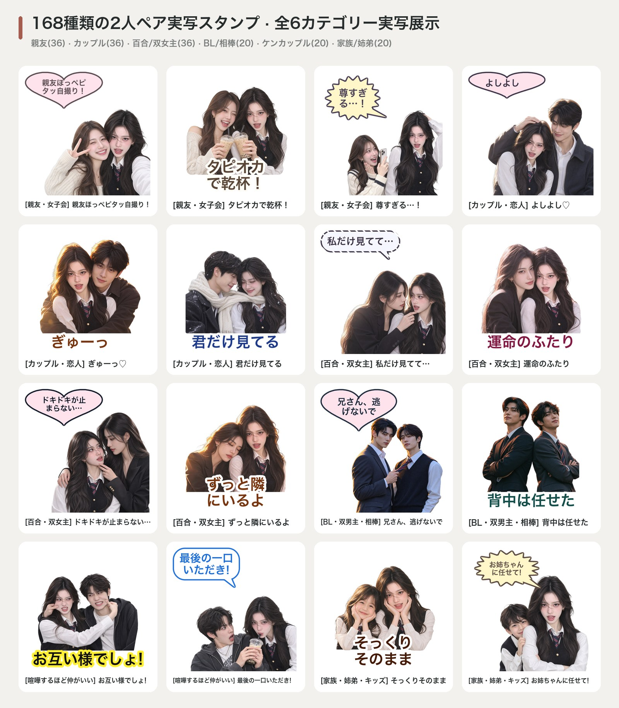

| カテゴリー (`--duo-category`) | 収録数 | ID範囲 | 代表的な2人アクション＆日本語単一言語セリフ例 |
|---|---|---|---|
| **👯‍♀️ 親友・女子会 (`besties`)** | **36種** | `d01` – `d36` | ほっぺ密着ピース自撮り (`最高の親友`)、2人でハートポーズ (`ぎゅっ`)、タピオカ乾杯 (`タピ活最高`)、ひそひそ恋バナ (`ここだけの話!`)、全力味方ハグ (`うちの子に何するの`) |
| **👩‍❤️‍👨 カップル・恋人 (`couple`)** | **36種** | `d37` – `d72` | 頭ぽんぽん (`いい子いい子`)、バックハグ (`充電中`)、ほっぺむにゅ (`大好きだよ`)、おでこコツン (`君だけ見てる`)、袖クイ甘え (`一緒にいて`)、マフラー半分こ |
| **🌸 百合・双女主 (`yuri`)** | **36種** | `d73` – `d108` | 指先顎クイ見つめ合い (`お姉さま、私だけ見て`)、双女主の宿命感ほっぺ寄せ (`運命のふたり`)、クールお姉さま壁ドン (`ドキドキが止まらない...`)、肩借りうたた寝 (`ずっとそばにいるよ`) |
| **🥂 BL・双男主・相棒 (`yaoi`)** | **20種** | `d109` – `d128` | ネクタイ引き寄せ視線ロック (`こっち見て`)、スーツで背中合わせ (`背中は任せた`)、片手壁ドン耳打ち (`いいから聞いて`)、雨夜の相合傘 (`濡れるぞ、こっち来い`) |
| **⚡ 喧嘩するほど仲がいい (`rivals`)** | **20種** | `d129` – `d148` | お互いのほっぺ引っ張り合い (`やんのか!?`)、じゃんけんデコピン (`罰ゲームね`)、タピオカつまみ飲み (`ひとくち頂戴!`)、ジト目にらめっこ (`ふんっ`)、美味しいもので即仲直り |
| **🧸 家族・姉弟・キッズ (`family`)** | **20種** | `d149` – `d168` | 大小おそろい頬杖ポーズ (`そっくりでしょ`)、お姉ちゃんが全力ガード (`うちの子に手出さないで`)、ほっぺむぎゅー溺愛 (`可愛すぎ`)、お年玉＆頭なでなで (`あけおめ！`) |

---

## Codex AI 4フレームアニメーションGIFショーケース

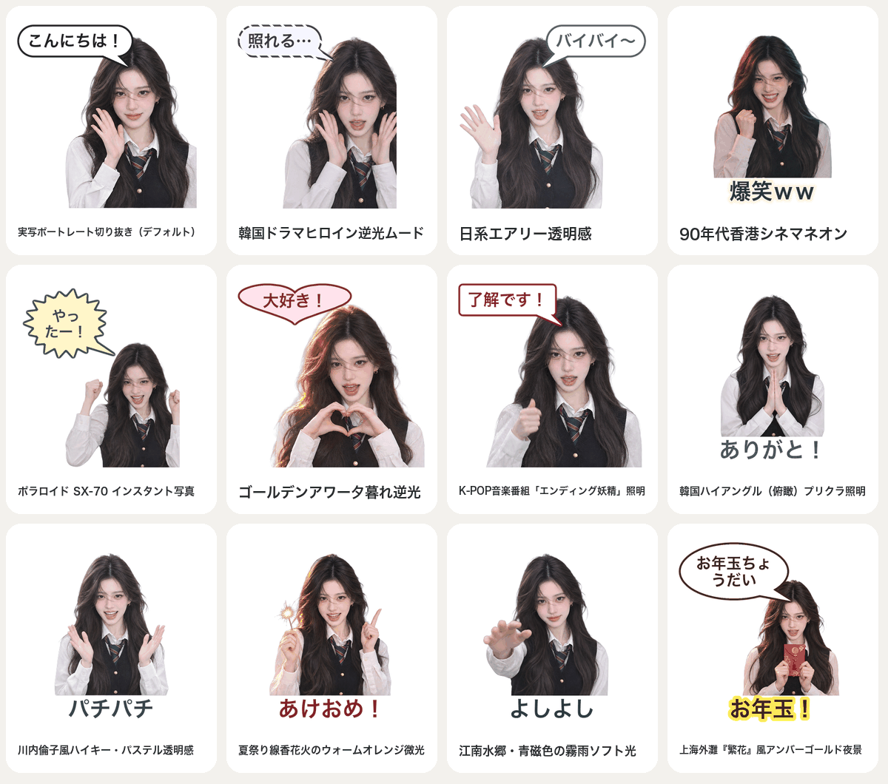

---

## 22カテゴリーの実写表情カタログ（全220種類）

日常14カテゴリーに加え、**8つのトレンド＆サブカルチャーカテゴリー**を収録：ゲーム・eスポーツ（`gaming`）、推し活・アイドル応援（`fandom`）、金運・開運（`wealth`）、タピ活・グルメ（`foodie`）、キャンパス・試験（`campus`）、辛口・あおり（`sassy`）、メンタル状態（`mental`）、ペット共演（`pet_collab`）。

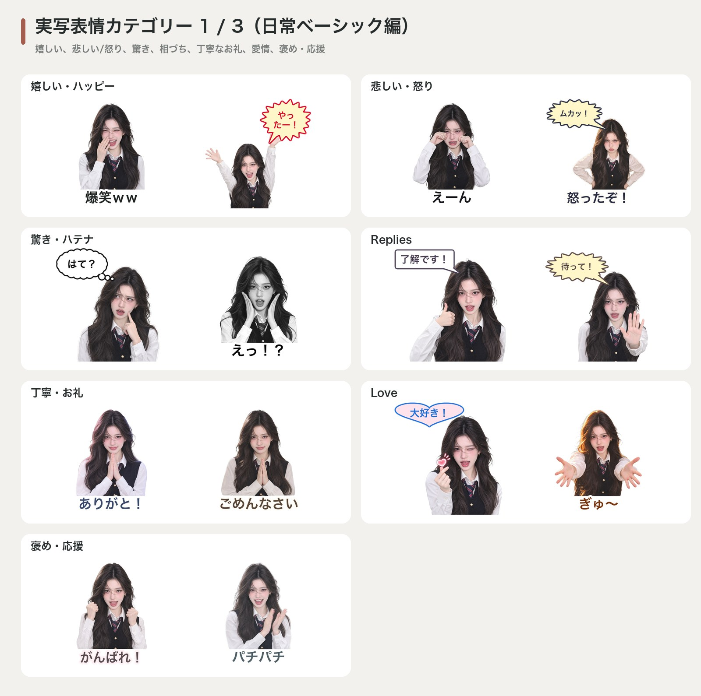
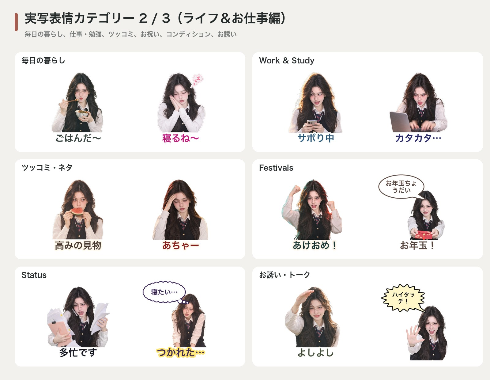
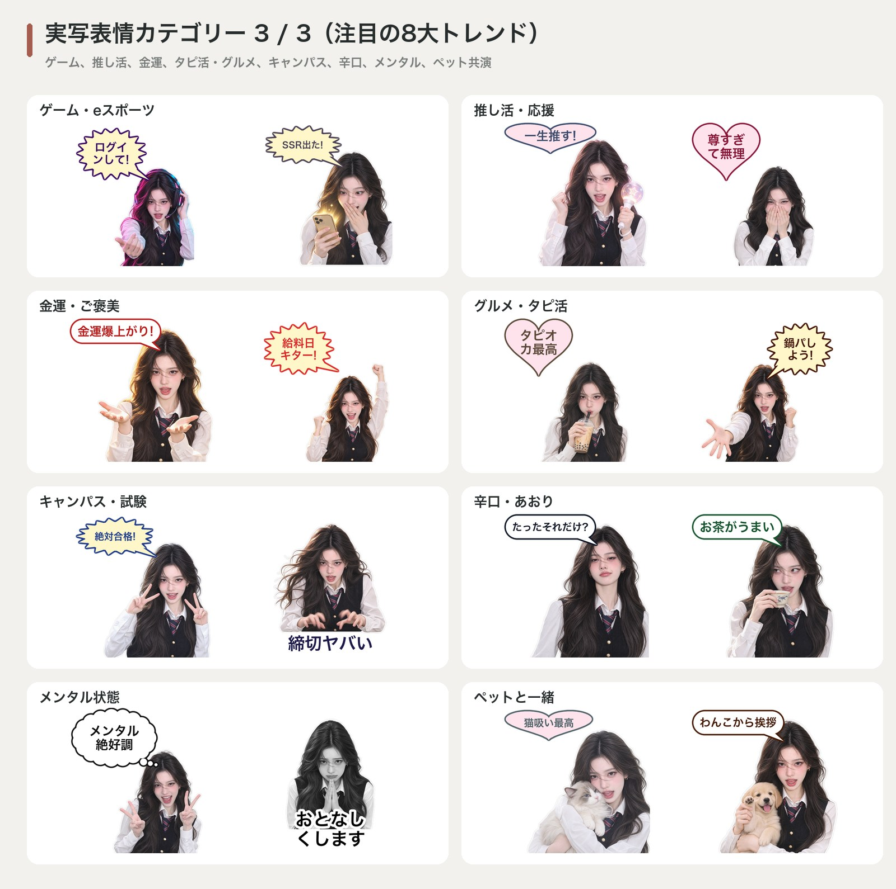

---

## 60種類の実写ミーム＆ネタ画像テンプレート（全6カテゴリー）

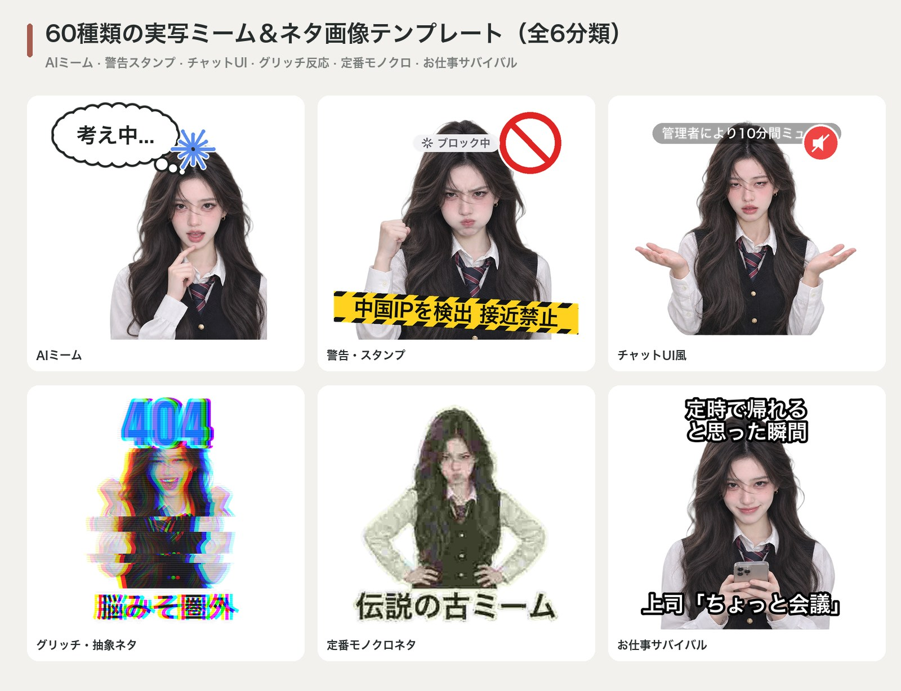

---

## 7種類の吹き出しデザインと5言語の単一言語出力

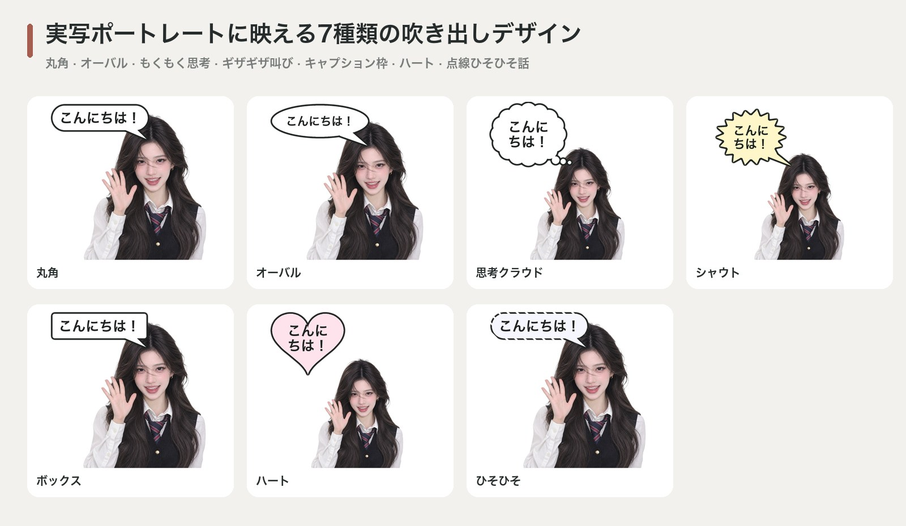
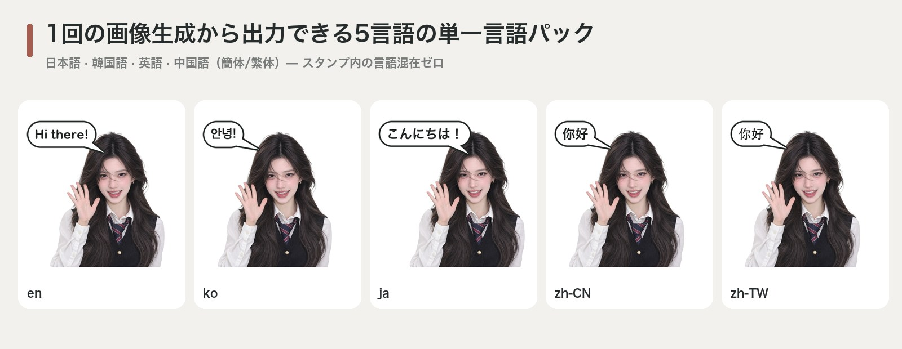

### 100%日本語の単一言語スタンプセット例


---

## 23プラットフォームへの一括書き出しとSNSカバー生成

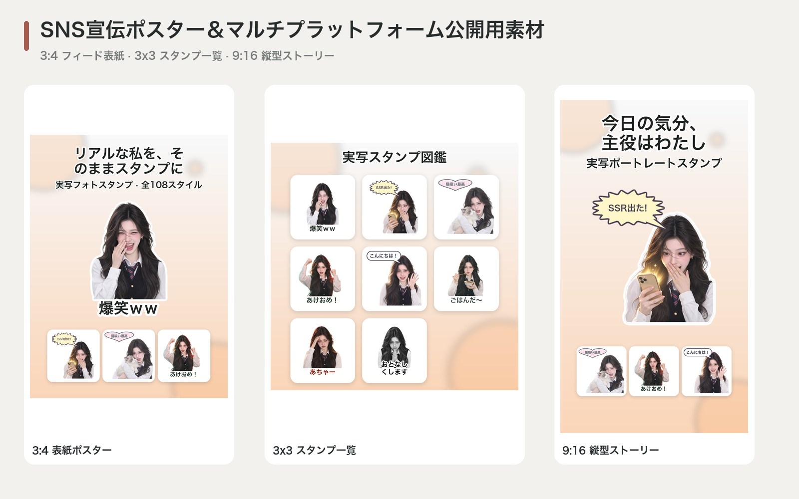

---

## クイックスタート（Quick Start）

```bash
# ワンクリックインストール（.venv作成＆Claude Code / Codexスキル自動リンク）
./install.sh
source .venv/bin/activate

# 環境チェック＆108種類のフォトスタイル / 108種類の2人ペアスタンプ一覧を確認
wechat-sticker-maker doctor
wechat-sticker-maker styles --region jp
wechat-sticker-maker duo --category yuri --language ja

# 1回のAI画像生成から日/中/英/韓の4言語別100%単一言語スタンプパックを同時出力
wechat-sticker-maker plan \
  --input photo.jpg \
  --output output/my-jp-pack \
  --mode both \
  --count 16 \
  --style real-jp-airy \
  --language auto \
  --languages ja,zh-CN,en,ko \
  --platforms line,instagram,telegram,wechat

wechat-sticker-maker generate --job output/my-jp-pack/job.json

# 2人ペア実写スタンプ（親友 / カップル / 百合）の生成
wechat-sticker-maker plan \
  --input personA.jpg \
  --partner personB.jpg \
  --duo-category yuri \
  --count 16 \
  --style real-jp-sakura-film \
  --language ja \
  --languages ja,zh-CN,en,ko \
  --output output/yuri-duo-pack

wechat-sticker-maker generate --job output/yuri-duo-pack/job.json
```

## テスト

```bash
pytest -v
python scripts/smoke_test.py
```

## ライセンス（License）

MIT License. 詳細は [`LICENSE`](LICENSE) をご覧ください。
