<p align="right">
  <strong>Language:</strong>
  <a href="README.md"><b>简体中文</b></a> |
  <a href="README.en.md"><b>English</b></a> |
  <a href="README.ko.md"><b>한국어</b></a> |
  <a href="README.ja.md"><b>日本語</b></a>
</p>

# WeChat Sticker Maker · 실사 인물 전용 AI 이모티콘 & 짤 생성 엔진

> **Your Face, Your Vibe, Your Sticker Pack.**  
> **실제 인물 사진(`human-portrait`)**만을 위해 설계된 올인원 ChatGPT / Codex 스킬 및 Python 이모티콘·짤 생성 엔진입니다. 본인의 실제 이목구비, 얼굴형, 피부결, 헤어스타일과 착장을 그대로 유지하며 **절대 2D 애니메이션이나 어색한 만화 캐릭터로 변형하지 않습니다.** 한 번의 생성으로 위챗(WeChat), 카카오톡(KakaoTalk), 라인(LINE), 인스타그램, 틱톡 등 **전 세계 23개 메신저 및 소셜 플랫폼** 규격으로 동시 내보내기를 지원합니다.

<div align="center">

[](LICENSE)
[](#108가지-실사-전용-사진-스타일-referencesstyle-presetsjson)
[-blue.svg)](#108가지-실사-전용-사진-스타일-referencesstyle-presetsjson)
[-ff2d55.svg)](#168가지-2인-실사-케미-이모티콘-프리셋-절친--커플--백합)
[](#22대-실사-표정-카테고리)
[](#7가지-말풍선-디자인--5개국어-단일-언어-엄격-분리)
[](#23개-소셜-플랫폼-자동-변환-및-커버-생성)

</div>

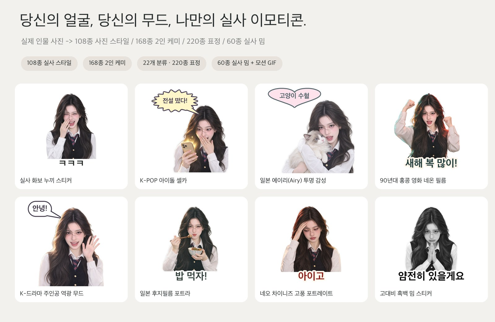

> **[전체 실사 이모티콘 갤러리 보기 (108종 스타일 / 168종 2인 케미 / 60종 밈 템플릿 / 22개 표정 분류 · 220종) → `docs/gallery/README.ko.md`](docs/gallery/README.ko.md)**

**지원되는 23개 플랫폼**: 카카오톡(KakaoTalk), 라인(LINE), 인스타그램(Instagram), 틱톡(TikTok), 텔레그램(Telegram), 왓츠앱(WhatsApp), 디스코드(Discord), 슬랙(Slack), iMessage, Signal, Viber, GIPHY, X(트위터), 페이스북, 위챗(WeChat), QQ, 샤오홍슈(RED), 더우인, 웨이보 등.

---

## 핵심 기능

- **108가지 실사 전용 사진 스타일 (기본 / 한국 감성 / 일본 감성 / 중국 감성 4대 시리즈)**: 기본값 `real-cutout`으로 깔끔한 4px 다이컷 화이트 스티커 테두리를 생성합니다. 조명과 색감, 분위기만 바꾸며 실제 얼굴을 만화로 왜곡하지 않습니다.
- **168가지 2인 실사 케미 프리셋 (6대 카테고리 · `references/duo-presets.json`)**: 절친(`36종`), 커플(`36종`), 백합/트윈여주(`36종`), 벨/브로맨스(`20종`), 앙숙/티격태격(`20종`), 가족/남매/귀요미(`20종`).
- **22개 카테고리 220종 단인 표정 & 4프레임 모션 라이브러리**: 기본 14대 일상 카테고리 외에 게이밍/e스포츠(`gaming`), 아이돌 덕질(`fandom`), 부자/재물운(`wealth`), 먹방/밀크티(`foodie`), 캠퍼스/시험(`campus`), 팩폭/티타임(`sassy`), 멘붕/정신상태(`mental`), 반려동물 케미(`pet_collab`) 8대 신규 카테고리 추가.
- **60종 실사 밈(Meme) & 추상 짤 템플릿 (`references/meme-templates.json`)**: AI "생각 중..." 로딩 스피너, 중국 IP 차단 경고, 차단 도장, MBTI ENFP/INTJ 배지, 사이버 목탁 공덕+1, 소셜 배터리 1%, 위챗 520위안 송금창, 60초 음성 폭격, 얌전해짐 도장, 읽씹, 유급 농땡이 허가증 등 60종 제공.
- **15종 원클릭 테마 팩(`--theme`) + 무비용 대사 교체(`remix-text`) + 홍보 포스터 생성(`collage`)**: AI 재생성(0 토큰) 없이 2초 만에 자막·말풍선 텍스트를 교체하고, 샤오홍슈 3:4 / 인스타 스토리 9:16 포스터 및 4개국어 스토어 심사 문구를 자동 생성합니다.

---

## 108가지 실사 전용 사진 스타일 (`references/style-presets.json`)

**기본(18종) / 한국 감성(30종) / 일본 감성(30종) / 중국 감성(30종)** 총 108가지 실사 전용 사진 스타일로 구성되며, CLI에서 시리즈별 조회가 가능합니다: `wechat-sticker-maker styles --region kr`.

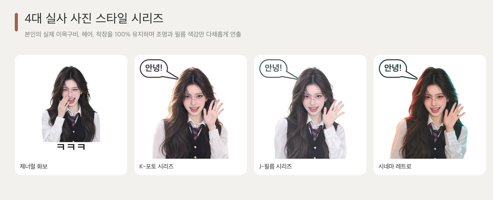

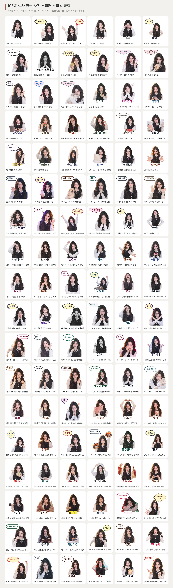

### 기본 시리즈 (18종)
| # | 스타일 ID (`--style`) | 스타일 이름 | 조명 프로필 & 프리셋 |
|---|---|---|---|
| 1 | `real-cutout` | **실사 화보 누끼 스티커 (기본값)** | `studio-portrait`|
| 2 | `real-bobblehead` | **실사 대두 캐리커처 스티커** | `bright-studio`|
| 3 | `real-street-cool` | **매거진 스트릿 직광 스냅** | `editorial-flash`|
| 4 | `real-vintage-ccd` | **Y2K 빈티지 CCD 디카** | `ccd-warm-flash`|
| 5 | `real-work-emo` | **직장인 리얼 공감 짤** | `natural-candid`|
| 6 | `real-high-contrast` | **고대비 흑백 밈 스티커** | `high-contrast-studio`|
| 7 | `real-polaroid-instant` | **폴라로이드 SX-70 즉석사진** | `polaroid-instant`|
| 8 | `real-fisheye-y2k` | **Y2K 16mm 어안렌즈 클로즈업** | `fisheye-y2k-flash`|
| 9 | `real-paparazzi-flash` | **야간 파파라치 직광 플래시** | `paparazzi-direct-flash`|
| 10 | `real-golden-hour` | **골든아워 노을 역광** | `golden-hour-sunset`|
| 11 | `real-blue-hour` | **블루아워 새벽 시네마틱** | `blue-hour-cinematic`|
| 12 | `real-cyber-neon` | **사이버펑크 듀얼 네온 야경** | `cyber-dual-neon`|
| 13 | `real-film-kodak-gold` | **코닥 골드 200 따뜻한 필름** | `kodak-gold-200`|
| 14 | `real-film-cinestill-800t` | **씨네스틸 800T 텅스텐 필름** | `cinestill-800t`|
| 15 | `real-vogue-editorial` | **하이패션 매거진 화보 조명** | `vogue-rembrandt-studio`|
| 16 | `real-french-effortless` | **파리지앵 오후 자연광 스냅** | `french-afternoon-sun`|
| 17 | `real-american-yearbook` | **90년대 하이틴 졸업앨범 스튜디오** | `retro-yearbook-studio`|
| 18 | `real-thermal-ir` | **페스티벌 UV 듀오톤 컬러 조명** | `uv-festival-duo`|

### 한국 감성 시리즈 (`kr` · 30종)
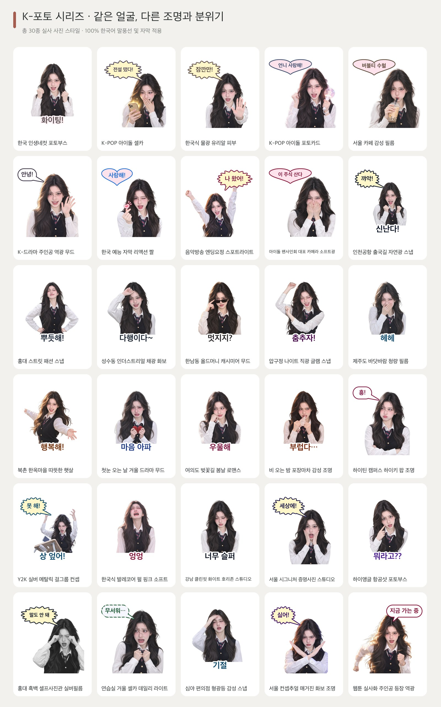

| # | 스타일 ID (`--style`) | 스타일 이름 | 조명 프로필 & 프리셋 |
|---|---|---|---|
| 1 | `real-purikura` | **한국 인생네컷 포토부스** | `creamy-kbeauty`|
| 2 | `real-kr-idol-selfie` | **K-POP 아이돌 셀카** | `kpop-ringlight`|
| 3 | `real-kr-glass-skin` | **한국식 물광 유리알 피부** | `kbeauty-dewy`|
| 4 | `real-kr-photocard` | **K-POP 아이돌 포토카드** | `pastel-gradient-studio`|
| 5 | `real-kr-cafe-film` | **서울 카페 감성 필름** | `window-daylight`|
| 6 | `real-kr-drama` | **K-드라마 주인공 역광 무드** | `kdrama-backlight`|
| 7 | `real-kr-variety` | **한국 예능 자막 리액션 짤** | `kvariety-highkey`|
| 8 | `real-kr-music-bank` | **음악방송 엔딩요정 스포트라이트** | `kpop-stage-ending`|
| 9 | `real-kr-fansign-soft` | **아이돌 팬사인회 대포 카메라 소프트광** | `kr-fansign-telephoto`|
| 10 | `real-kr-airport-snap` | **인천공항 출국길 자연광 스냅** | `kr-airport-daylight`|
| 11 | `real-kr-hongdae-street` | **홍대 스트릿 패션 스냅** | `kr-hongdae-overcast`|
| 12 | `real-kr-seongsu-industrial` | **성수동 인더스트리얼 채광 화보** | `kr-seongsu-concrete`|
| 13 | `real-kr-hannam-oldmoney` | **한남동 올드머니 캐시미어 무드** | `kr-hannam-cashmere`|
| 14 | `real-kr-apgujeong-glam` | **압구정 나이트 직광 글램 스냅** | `kr-apgujeong-flash`|
| 15 | `real-kr-jeju-breeze` | **제주도 바닷바람 청량 필름** | `kr-jeju-coastal-sun`|
| 16 | `real-kr-hanok-sunlight` | **북촌 한옥마을 따뜻한 햇살** | `kr-hanok-warm-wood`|
| 17 | `real-kr-winter-snow` | **첫눈 오는 날 겨울 드라마 무드** | `kr-first-snow-soft`|
| 18 | `real-kr-cherry-blossom` | **여의도 벚꽃길 봄날 로맨스** | `kr-yeouido-blossom`|
| 19 | `real-kr-rainy-pocha` | **비 오는 밤 포장마차 감성 조명** | `kr-pocha-warm-amber`|
| 20 | `real-kr-high-teen` | **하이틴 캠퍼스 하이키 팝 조명** | `kr-highteen-pop`|
| 21 | `real-kr-y2k-metallic` | **Y2K 실버 메탈릭 걸그룹 컨셉** | `kr-y2k-silver-frost`|
| 22 | `real-kr-balletcore` | **한국식 발레코어 펄 핑크 소프트** | `kr-balletcore-pearl`|
| 23 | `real-kr-clean-fit` | **강남 클린핏 화이트 호리존 스튜디오** | `kr-cleanfit-cyclorama`|
| 24 | `real-kr-id-photo` | **서울 시그니처 증명사진 스튜디오** | `kr-id-butterfly-light`|
| 25 | `real-kr-high-angle-booth` | **하이앵글 항공샷 포토부스** | `kr-high-angle-booth`|
| 26 | `real-kr-bw-fourcut` | **홍대 흑백 셀프사진관 실버필름** | `kr-mono-photobooth`|
| 27 | `real-kr-practice-mirror` | **연습실 거울 셀카 데일리 라이트** | `kr-practice-room-bright`|
| 28 | `real-kr-convenience-night` | **심야 편의점 형광등 감성 스냅** | `kr-convenience-fluorescent`|
| 29 | `real-kr-magazine-dazed` | **서울 컨셉추얼 매거진 화보 조명** | `kr-avant-garde-gel`|
| 30 | `real-kr-webtoon-real` | **웹툰 실사화 주인공 등장 역광** | `kr-webtoon-hero-glow`|

### 일본 감성 시리즈 (`jp` · 30종)
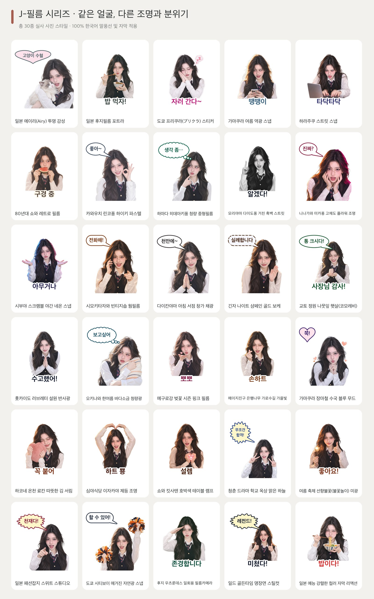

| # | 스타일 ID (`--style`) | 스타일 이름 | 조명 프로필 & 프리셋 |
|---|---|---|---|
| 1 | `real-jp-airy` | **일본 에이리(Airy) 투명 감성** | `airy-overexposed`|
| 2 | `real-jp-fuji-film` | **일본 후지필름 포트라** | `fuji-film`|
| 3 | `real-jp-purikura` | **도쿄 프리쿠라(プリクラ) 스티커** | `purikura-booth`|
| 4 | `real-jp-summer` | **가마쿠라 여름 역광 스냅** | `summer-backlight`|
| 5 | `real-jp-harajuku` | **하라주쿠 스트릿 스냅** | `street-flash`|
| 6 | `real-jp-showa` | **80년대 쇼와 레트로 필름** | `showa-retro`|
| 7 | `real-jp-rinko-pastel` | **카와우치 린코풍 하이키 파스텔** | `jp-rinko-highkey-pastel`|
| 8 | `real-jp-hideaki-clean` | **하마다 히데아키풍 청량 중형필름** | `jp-hideaki-medium-format`|
| 9 | `real-jp-moriyama-bw` | **모리야마 다이도풍 거친 흑백 스트릿** | `jp-moriyama-gritty-bw`|
| 10 | `real-jp-ninagawa-vivid` | **니나가와 미카풍 고채도 플라워 조명** | `jp-ninagawa-saturated`|
| 11 | `real-jp-shibuya-neon` | **시부야 스크램블 야간 네온 스냅** | `jp-shibuya-night-neon`|
| 12 | `real-jp-shimokita-vintage` | **시모키타자와 빈티지숍 웜필름** | `jp-shimokita-warm-film`|
| 13 | `real-jp-daikanyama-morning` | **다이칸야마 아침 서점 창가 채광** | `jp-daikanyama-morning`|
| 14 | `real-jp-ginza-luxury` | **긴자 나이트 샴페인 골드 보케** | `jp-ginza-champagne-glow`|
| 15 | `real-jp-kyoto-komorebi` | **교토 정원 나뭇잎 햇살(코모레비)** | `jp-kyoto-komorebi`|
| 16 | `real-jp-hokkaido-snow` | **홋카이도 러브레터 설원 반사광** | `jp-hokkaido-snow-bounce`|
| 17 | `real-jp-okinawa-sun` | **오키나와 한여름 바다소금 청량광** | `jp-okinawa-sea-salt`|
| 18 | `real-jp-sakura-film` | **메구로강 벚꽃 시즌 핑크 필름** | `jp-sakura-spring-film`|
| 19 | `real-jp-autumn-icho` | **메이지진구 은행나무 가로수길 가을빛** | `jp-autumn-ginkgo-gold`|
| 20 | `real-jp-rainy-hydrangea` | **가마쿠라 장마철 수국 블루 무드** | `jp-kamakura-rainy-blue`|
| 21 | `real-jp-onsen-steam` | **하코네 온천 료칸 따뜻한 김 서림** | `jp-onsen-warm-mist`|
| 22 | `real-jp-izakaya-warm` | **심야식당 이자카야 제등 조명** | `jp-izakaya-lantern`|
| 23 | `real-jp-kissaten-retro` | **쇼와 킷사텐 호박색 테이블 램프** | `jp-kissaten-amber`|
| 24 | `real-jp-school-rooftop` | **청춘 드라마 학교 옥상 맑은 하늘** | `jp-rooftop-clear-sky`|
| 25 | `real-jp-matsuri-fireworks` | **여름 축제 선향불꽃(불꽃놀이) 미광** | `jp-sparkler-warm-glow`|
| 26 | `real-jp-nonno-magazine` | **일본 패션잡지 스위트 스튜디오** | `jp-sweet-magazine-studio`|
| 27 | `real-jp-popeye-cityboy` | **도쿄 시티보이 매거진 자연광 스냅** | `jp-popeye-cityboy-sun`|
| 28 | `real-jp-utsurundesu` | **후지 우츠룬데스 일회용 필름카메라** | `jp-quicksnap-disposable`|
| 29 | `real-jp-drama-subtitle` | **일드 골든타임 명장면 스틸컷** | `jp-prime-drama-cinematic`|
| 30 | `real-jp-variety-telop` | **일본 예능 강렬한 컬러 자막 리액션** | `jp-variety-tv-bright`|

### 중국 감성 시리즈 (`cn` · 30종)
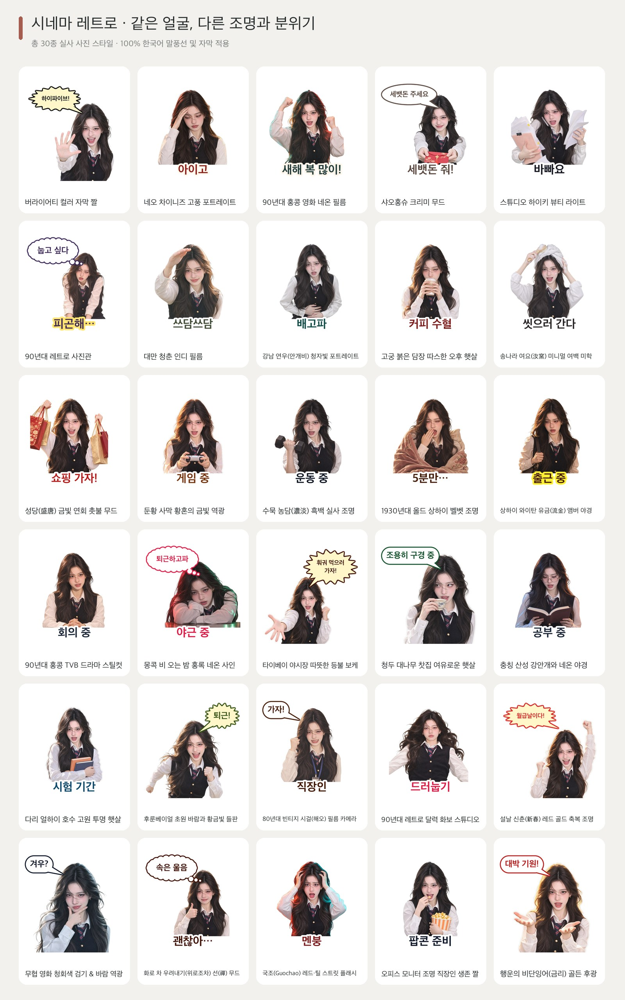

| # | 스타일 ID (`--style`) | 스타일 이름 | 조명 프로필 & 프리셋 |
|---|---|---|---|
| 1 | `real-variety-meme` | **버라이어티 컬러 자막 짤** | `high-key-tv`|
| 2 | `real-cn-new-chinese` | **네오 차이니즈 고풍 포트레이트** | `oriental-warm`|
| 3 | `real-cn-hk-retro` | **90년대 홍콩 영화 네온 필름** | `hk-neon-film`|
| 4 | `real-cn-xhs-vibe` | **샤오홍슈 크리미 무드** | `creamy-soft`|
| 5 | `real-cn-douyin` | **스튜디오 하이키 뷰티 라이트** | `ringlight-bright`|
| 6 | `real-cn-studio-retro` | **90년대 레트로 사진관** | `retro-studio-softfocus`|
| 7 | `real-cn-tw-youth` | **대만 청춘 인디 필름** | `afternoon-sun`|
| 8 | `real-cn-jiangnan-mist` | **강남 연우(안개비) 청자빛 포트레이트** | `cn-jiangnan-celadon-mist`|
| 9 | `real-cn-palace-redwall` | **고궁 붉은 담장 따스한 오후 햇살** | `cn-crimson-wall-sun`|
| 10 | `real-cn-song-minimal` | **송나라 여요(汝窯) 미니멀 여백 미학** | `cn-song-ruyao-minimal`|
| 11 | `real-cn-tang-splendor` | **성당(盛唐) 금빛 연회 촛불 무드** | `cn-tang-gilded-lantern`|
| 12 | `real-cn-dunhuang-sunset` | **둔황 사막 황혼의 금빛 역광** | `cn-dunhuang-amber-dusk`|
| 13 | `real-cn-ink-wash-light` | **수묵 농담(濃淡) 흑백 실사 조명** | `cn-ink-studio-monochrome`|
| 14 | `real-cn-republican-velvet` | **1930년대 올드 상하이 벨벳 조명** | `cn-vintage-shanghai-tungsten`|
| 15 | `real-cn-shanghai-bund` | **상하이 와이탄 유금(流金) 앰버 야경** | `cn-bund-amber-cinema`|
| 16 | `real-cn-hk-tvb-90s` | **90년대 홍콩 TVB 드라마 스틸컷** | `cn-hk-tvb-90s-warm`|
| 17 | `real-cn-hk-cyber-rain` | **몽콕 비 오는 밤 홍록 네온 사인** | `cn-mongkok-rain-neon`|
| 18 | `real-cn-tw-nightmarket` | **타이베이 야시장 따뜻한 등불 보케** | `cn-taipei-nightmarket`|
| 19 | `real-cn-chengdu-teahouse` | **청두 대나무 찻집 여유로운 햇살** | `cn-chengdu-bamboo-sun`|
| 20 | `real-cn-chongqing-cyber` | **충칭 산성 강안개와 네온 야경** | `cn-chongqing-fog-neon`|
| 21 | `real-cn-dali-sunshine` | **다리 얼하이 호수 고원 투명 햇살** | `cn-dali-highland-sun`|
| 22 | `real-cn-hulunbuir-wind` | **후룬베이얼 초원 바람과 황금빛 들판** | `cn-grassland-open-sky`|
| 23 | `real-cn-80s-factory` | **80년대 빈티지 시걸(해오) 필름 카메라** | `cn-80s-seagull-film`|
| 24 | `real-cn-90s-calendar` | **90년대 레트로 달력 화보 스튜디오** | `cn-90s-calendar-bright`|
| 25 | `real-cn-cny-festive` | **설날 신춘(新春) 레드 골드 축복 조명** | `cn-lunar-new-year-gold`|
| 26 | `real-cn-wuxia-breeze` | **무협 영화 청회색 검기 & 바람 역광** | `cn-wuxia-cinematic-cool`|
| 27 | `real-cn-tea-zen` | **화로 차 우려내기(위로조차) 선(禪) 무드** | `cn-tea-hearth-zen`|
| 28 | `real-cn-guochao-street` | **국조(Guochao) 레드·틸 스트릿 플래시** | `cn-guochao-crimson-teal`|
| 29 | `real-cn-work-survival` | **오피스 모니터 조명 직장인 생존 짤** | `cn-office-monitor-glow`|
| 30 | `real-cn-bazi-lucky` | **행운의 비단잉어(금리) 골든 후광** | `cn-auspicious-golden-halo`|

---

## 168가지 2인 실사 케미 이모티콘 프리셋 (6대 분류 · `references/duo-presets.json`)

두 사람의 실제 사진(`-i personA.jpg -p personB.jpg`)을 입력하여 두 사람 모두의 실제 이목구비와 분위기를 보존한 2인 케미 이모티콘을 생성합니다 (`wechat-sticker-maker duo --category besties|couple|yuri|yaoi|rivals|family --language ko`).

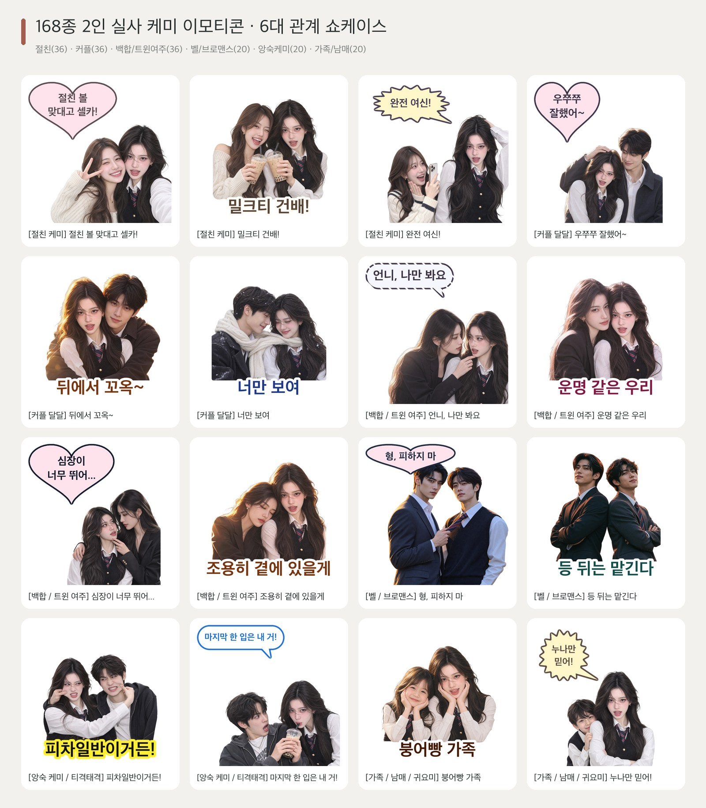

| 분류 (`--duo-category`) | 수량 | ID 범위 | 대표 2인 인터랙션 및 한국어 단일 언어 대사 예시 |
|---|---|---|---|
| **👯‍♀️ 절친 케미 (`besties`)** | **36종** | `d01` – `d36` | 볼맞대기 브이 셀카 (`찐친 케미`), 합체 손하트 (`딱 붙어있자`), 버블티 건배 (`당 충전 완료`), 귓속말 폭풍 수다 (`대박 사건!`), 내 편 들어주기 (`누가 내 친구 괴롭혀`) |
| **👩‍❤️‍👨 커플 달달 (`couple`)** | **36종** | `d37` – `d72` | 다정한 쓰담쓰담 (`우리 애기 착하지`), 백허그 (`충전 중`), 양볼 콕 집기 (`너무 좋아해`), 이마 맞대기 (`너만 보여`), 소매 잡고 애교 (`같이 있자`), 겨울 목도리 함께 두르기 |
| **🌸 백합 / 트윈 여주 (`yuri`)** | **36종** | `d73` – `d108` | 손끝 턱들기 아이컨택 (`언니, 나만 봐요`), 쌍여주 운명적 볼맞대기 (`운명 같은 우리`), 냉미녀 언니 벽치기 (`심장이 너무 뛰어...`), 어깨 기대 잠들기 (`조용히 곁에 있을게`) |
| **🥂 벨 / 브로맨스 (`yaoi`)** | **20종** | `d109` – `d128` | 넥타이 당기며 아이컨택 (`가까이 와`), 수트 등 맞대기 (`등 뒤는 맡겨`), 한 손 벽 짚고 귓속말 (`내 말 들어`), 빗속 검은 우산 함께 쓰기 (`이리 와`) |
| **⚡ 앙숙 케미 / 티격태격 (`rivals`)** | **20종** | `d129` – `d148` | 서로 볼 꼬집기 (`한판 붙자!`), 가위바위보 딱밤 (`소원 들어주기`), 밀크티 몰래 뺏어 마시기 (`한 입만!`), 째려보기 대결 (`흥칫뿡`), 맛있는 거 앞에선 즉시 화해 |
| **🧸 가족 / 남매 / 귀요미 (`family`)** | **20종** | `d149` – `d168` | 붕어빵 꽃받침 포즈 (`복붙 수준`), 누나/언니가 지켜주기 (`내 동생 건들지 마`), 볼 말랑하게 쥐기 (`우리 귀요미`), 세뱃돈 주며 머리 쓰담쓰담 (`새해 복 많이 받아`) |

---

## Codex AI 4프레임 모션 GIF 쇼케이스

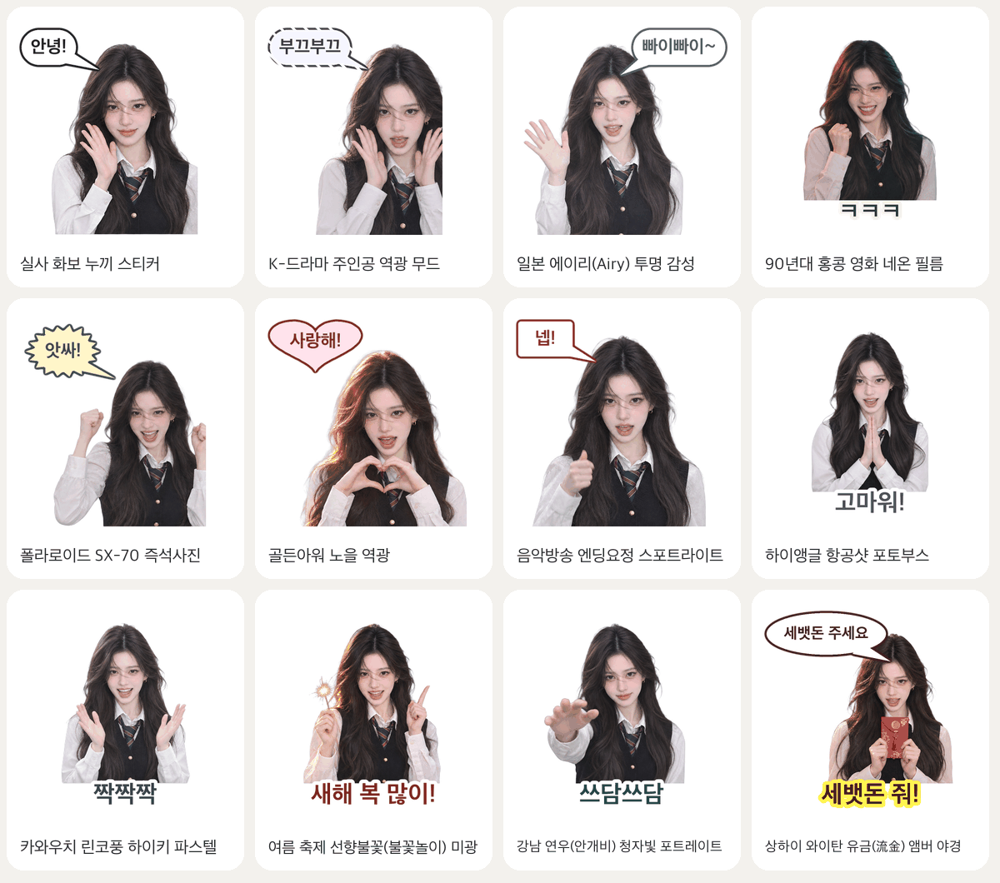

---

## 22대 실사 표정 카테고리 (총 220종)

기존 14개 일상 카테고리에 더해 **8대 고빈도 트렌드·서브컬처 카테고리**가 추가되었습니다: 게이밍/e스포츠(`gaming`), 아이돌 덕질/응원(`fandom`), 부자/재물운(`wealth`), 먹방/버블티(`foodie`), 캠퍼스/시험(`campus`), 팩폭/사이다(`sassy`), 멘붕/정신상태(`mental`), 반려동물 케미(`pet_collab`).

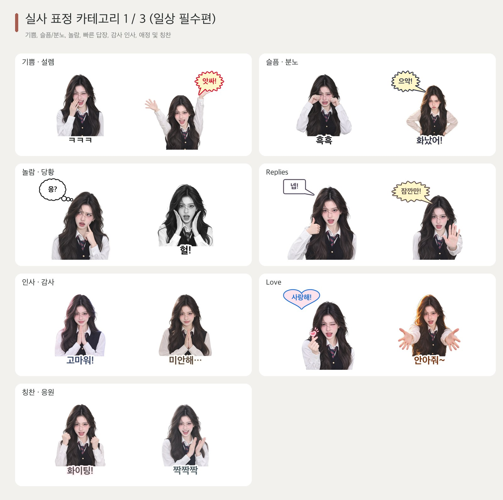
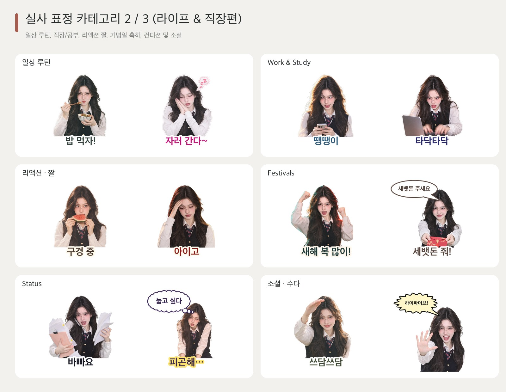
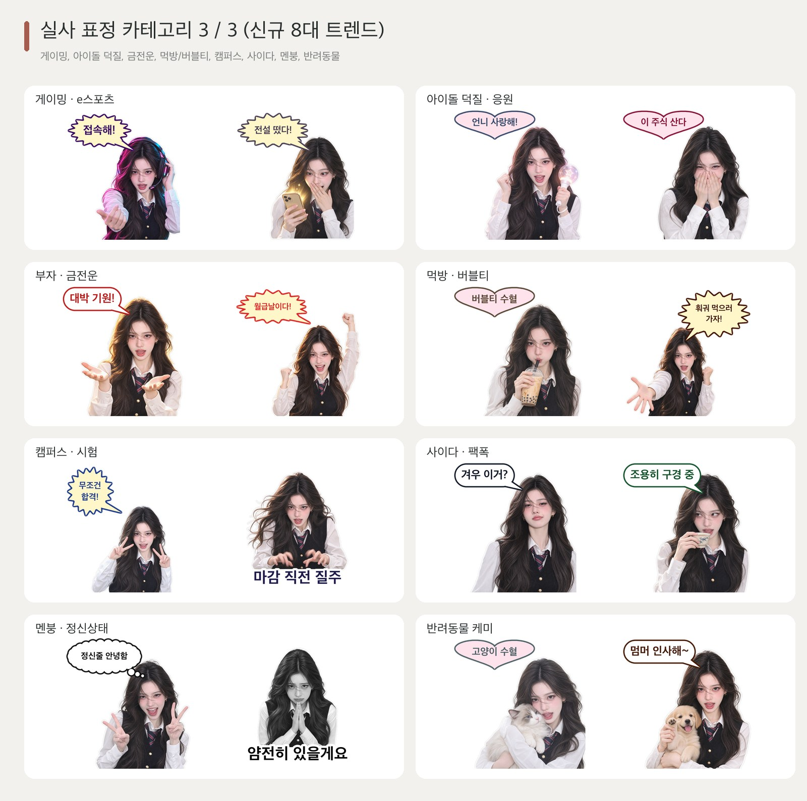

---

## 60종 실사 밈(Meme) & 추상 짤 템플릿 (6대 분류)

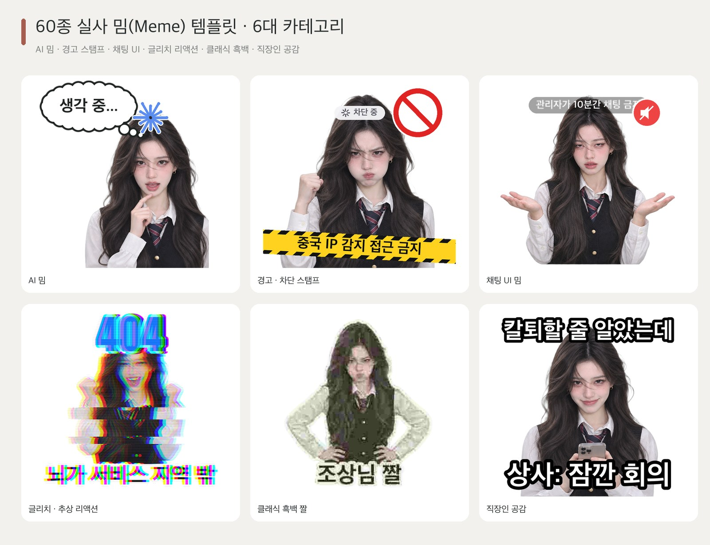

---

## 7가지 말풍선 디자인 & 5개국어 단일 언어 엄격 분리

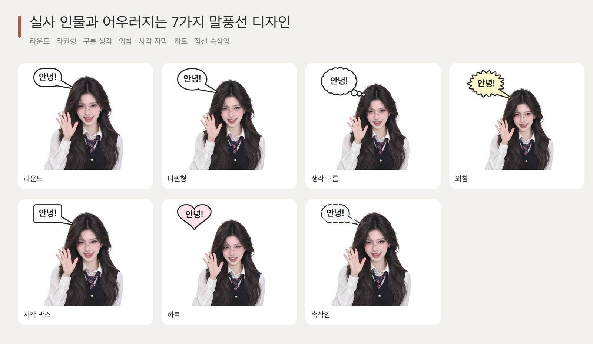
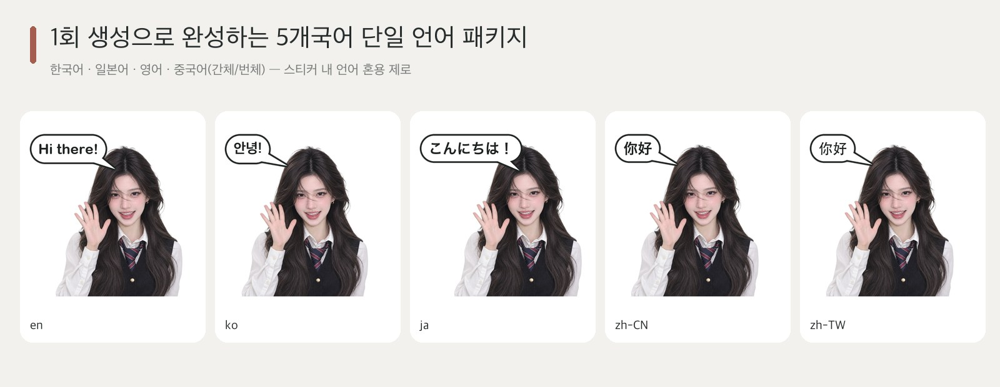

### 100% 한국어 단일 언어 이모티콘 세트 예시


---

## 23개 소셜 플랫폼 자동 변환 및 커버 생성

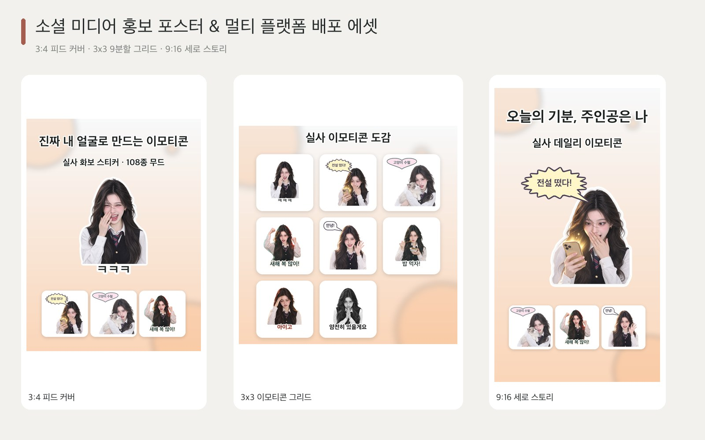

---

## 빠른 시작 (Quick Start)

```bash
# 원클릭 설치 (.venv 생성 및 Claude Code / Codex 스킬 자동 연결)
./install.sh
source .venv/bin/activate

# 환경 점검 및 108종 스타일 / 108종 2인 케미 프리셋 확인
wechat-sticker-maker doctor
wechat-sticker-maker styles --region kr
wechat-sticker-maker duo --category yuri --language ko

# 1회 AI 이미지 생성으로 한/중/영/일 4개국어 단독 언어 이모티콘 세트 동시 출력
wechat-sticker-maker plan \
  --input photo.jpg \
  --output output/my-kr-pack \
  --mode both \
  --count 16 \
  --style real-kr-idol-selfie \
  --language auto \
  --languages ko,zh-CN,en,ja \
  --platforms kakaotalk,instagram,telegram,wechat

wechat-sticker-maker generate --job output/my-kr-pack/job.json

# 2인 케미 이모티콘 (절친 / 커플 / 백합) 생성
wechat-sticker-maker plan \
  --input personA.jpg \
  --partner personB.jpg \
  --duo-category yuri \
  --count 16 \
  --style real-kr-drama \
  --language ko \
  --languages ko,zh-CN,en,ja \
  --output output/yuri-duo-pack

wechat-sticker-maker generate --job output/yuri-duo-pack/job.json

# 엄격한 인체 해부학 및 얼굴 비율 품질 검수 (제3의 손 / 얼굴 늘어남 / 가짜 체크무늬 배경 차단 + 2배 확대 검수 시트 생성)
wechat-sticker-maker audit -o output/yuri-duo-pack --strict
wechat-sticker-maker regenerate -j output/yuri-duo-pack/job.json --item d03_bestie_hype_queen \
  --defect third_hand_or_extra_limb,stretched_or_warped_face,baked_checkerboard
```

## 테스트

```bash
pytest -v
python scripts/smoke_test.py
```

## 라이선스 (License)

MIT License. 자세한 내용은 [`LICENSE`](LICENSE) 파일을 참고하세요.
