<p align="right">
  <strong>Language:</strong>
  <a href="README.md"><b>简体中文</b></a> |
  <a href="README.en.md"><b>English</b></a> |
  <a href="README.ko.md"><b>한국어</b></a> |
  <a href="README.ja.md"><b>日本語</b></a>
</p>

# WeChat Sticker Maker · 全平台真人 AI 表情包与梗图引擎

> **Your Face, Your Vibe, Your Sticker Pack.**  
> 专为**真人照片（`human-portrait`）**打造的一键成套 AI 表情包与梗图生成引擎（静态 + 多帧真动图），严格保留本人真实五官、骨相、肤质、发型与穿搭，**绝不二次元化或变成卡通假脸**，并一键分发至微信及全球 23 个主流社交平台。

<div align="center">

[](LICENSE)
[](#内置-26-款真人专属风格referencesstyle-presetsjson)
[-blue.svg)](#内置-26-款真人专属风格referencesstyle-presetsjson)
[](#14-大类真人表情分类)
[](#7-种对话气泡与-5-种独立单语种支持)
[](#全平台自动分发与社交封面导出)

</div>

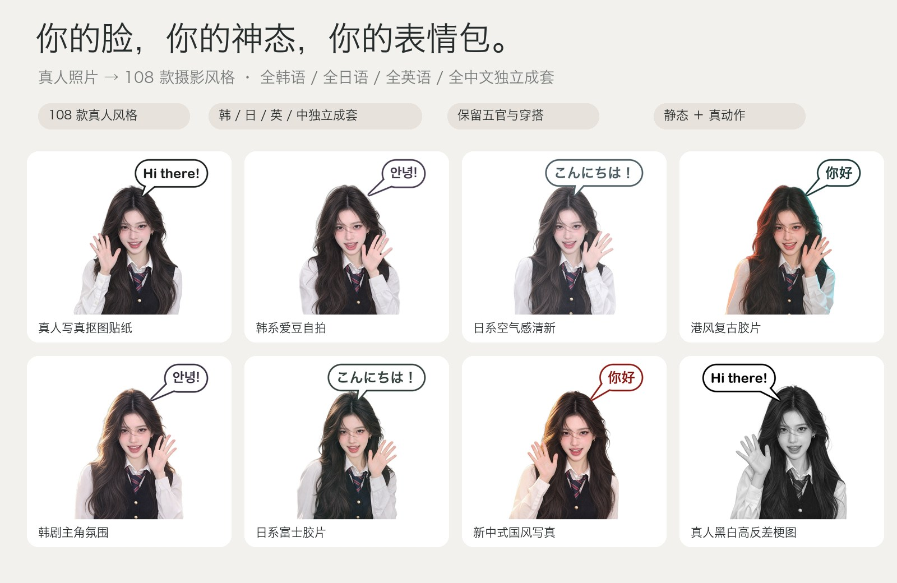

> **[查看完整真人图库（108 款风格 / 10 款真动图 / 38 款梗图 / 14 类表情） → `docs/gallery/README.md`](docs/gallery/README.md)**

支持同时导出到**微信及全部 23 个主流社交 / 聊天平台**：微信、QQ、抖音/快手、小红书、Soul、微博、钉钉、飞书、Telegram、WhatsApp、LINE、KakaoTalk、Discord、Slack、iMessage、Signal、Viber、GIPHY（Instagram / TikTok / Snapchat 贴纸来源）、Instagram、TikTok、X、Facebook 以及通用格式包。

---

## 核心能力与视觉预览

- **纯正真人专属风格（108 款，通用 / 韩系 / 日系 / 中式四大系列）**：默认 `real-cutout`，自动生成微信经典纯白立体模切白边，严禁把真人画成 2D 动漫或扁平卡通。
- **Codex 自带作图能力驱动真动图**：所有挥手、眨眼、歪头、表情变化均由 Codex 自带 AI 生图工具通过 `2×2` 四连拍动作图（`build_sprite_sheet_prompt`）或多帧参考关键帧绘制，Python 仅做非破坏性抠图、躯干基线对齐、加白边、叠字与编码。
- **全类型表情与动作**：132 个表情 × 14 大类，129 种动作库（`references/motion-library.json`），每个表情均配 4 帧 AI 动作分镜。
- **真人梗图 / 抽象图模式**：内置 38 个梗图模板（`references/meme-templates.json`），涵盖 AI 正在思考旋转星芒、检测到中国IP禁止靠近、再说话封你号、已深度思考 999 秒、请求过于频繁、CPU 干烧了、真人黑白高反差梗图等。
- **文字气泡 + 严格单语种**：支持 `caption` 底部字幕 / `bubble` 对话气泡 / `both` / `none` 及 7 种气泡形状；内置 `zh-CN` / `zh-TW` / `en` / `ja` / `ko` 五语口语化文案；**每张表情只用单一语言，绝不双语混排**。
- **全平台母版一键分发**：每个表情生成一次 720px 母版，自动导出 23 个平台的专属尺寸、格式、体积与社交展示图（小红书 3:4 封面、INS Story/Reels、抖音/TikTok 竖版视频、微博九宫格）。

详见 [`references/text-bubbles-and-languages.md`](references/text-bubbles-and-languages.md)、[`references/memes.md`](references/memes.md) 与 [`references/platform-export.md`](references/platform-export.md)。

---

## 内置 108 款真人专属风格（`references/style-presets.json`）

分 **通用（18 款） / 韩系（30 款） / 日系（30 款） / 中式（30 款）** 四大系列，全部只改变光影、色调、镜头质感与氛围，**本人五官、脸型、发型、穿搭一律不变**，也绝不画成卡通。按系列查看：`wechat-sticker-maker styles --region 韩系`（也可用 `kr` / `jp` / `cn` / `general`）。

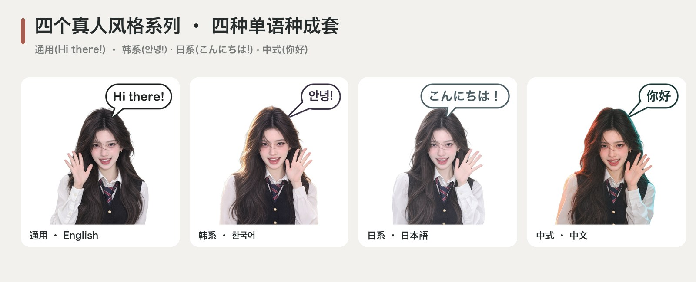

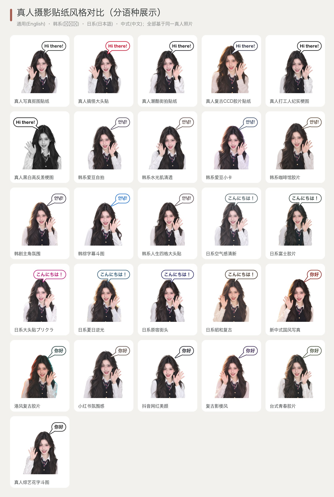

### 通用系列（18 款）
| # | 风格 ID (`--style`) | 名称 | 特色说明 |
|---|---|---|---|
| 1 | `real-cutout` | **真人写真抠图贴纸** | 保留真人真实五官、肤色与自然神态，外圈自动生成微信经典纯白立体模切贴纸白边（默认主推）。 |
| 2 | `real-bobblehead` | **真人搞怪大头贴** | 保留真人真实摄影面部五官神态，搭配夸张大头比例与剪纸白边，情侣、萌娃与朋友斗图神器。 |
| 3 | `real-street-cool` | **真人潮酷街拍贴纸** | 高质感潮流杂志闪光灯实拍人像抠图，立体光影与醒目模切白边，适合 INS / 潮人态度表达。 |
| 4 | `real-vintage-ccd` | **真人复古CCD胶片贴纸** | 千禧年复古 CCD 数码相机直出真人写真质感、柔和暖调胶片光感与经典贴纸白边。 |
| 5 | `real-work-emo` | **真人打工人纪实梗图** | 真实生活感/职场纪实抓拍人像神态（生无可恋、强颜欢笑、发疯精神状态）+ 醒目白边大字。 |
| 6 | `real-high-contrast` | **真人黑白高反差梗图** | 保留真人真实五官神态的黑白高对比实拍抠图质感 + 纯白模切边，经典斗图与抽象梗图首选。 |
| 7 | `real-polaroid-instant` | **真人拍立得即时相纸** | 经典 Polaroid SX-70 暖白相纸光泽与复古化学显影色彩，保留真人自然神态。 |
| 8 | `real-fisheye-y2k` | **真人千禧鱼眼大头贴** | 千禧年 16mm 超广角微鱼眼近景透视，俏皮搞怪但真实五官绝不崩坏。 |
| 9 | `real-paparazzi-flash` | **真人狗仔直闪抓拍** | 夜间硬朗机顶闪光灯抓拍，明星下班路透与街拍气场拉满。 |
| 10 | `real-golden-hour` | **真人落日夕阳逆光** | 暖金琥珀色落日余晖斜射，发丝透出迷人金边与温柔光晕。 |
| 11 | `real-blue-hour` | **真人蓝调时刻电影感** | 日落后十分钟冷冽静谧蓝调光影，兼具疏离故事感与柔和暗部。 |
| 12 | `real-cyber-neon` | **真人赛博霓虹夜景** | 都市夜间品红与青蓝双色霓虹轮廓光，潮酷未来感真人贴纸。 |
| 13 | `real-film-kodak-gold` | **真人柯达Gold200胶片** | 经典 Kodak Gold 200 暖黄阳光胶片色彩与细腻银盐颗粒感。 |
| 14 | `real-film-cinestill-800t` | **真人CineStill钨丝灯胶片** | 电影级 CineStill 800T 钨丝灯夜景胶片，标志性红晕高光与冷青暗部。 |
| 15 | `real-vogue-editorial` | **真人高定时尚杂志封面** | 经典伦勃朗立体商业棚拍布光，展现人物高级骨相与气场。 |
| 16 | `real-french-effortless` | **真人法式慵懒午后写真** | 巴黎左岸午后自然散射窗光，暖棕低对比度松弛感。 |
| 17 | `real-american-yearbook` | **真人美式复古毕业年鉴** | 90年代美式校园 Yearbook 经典影棚双灯布光与复古学院气息。 |
| 18 | `real-thermal-ir` | **真人潮流伪彩视觉** | 电子音乐节潮流紫外/冷暖撞色艺术打光，保留清晰真人五官与神态。 |

### 韩系系列（`kr` · 30 款）
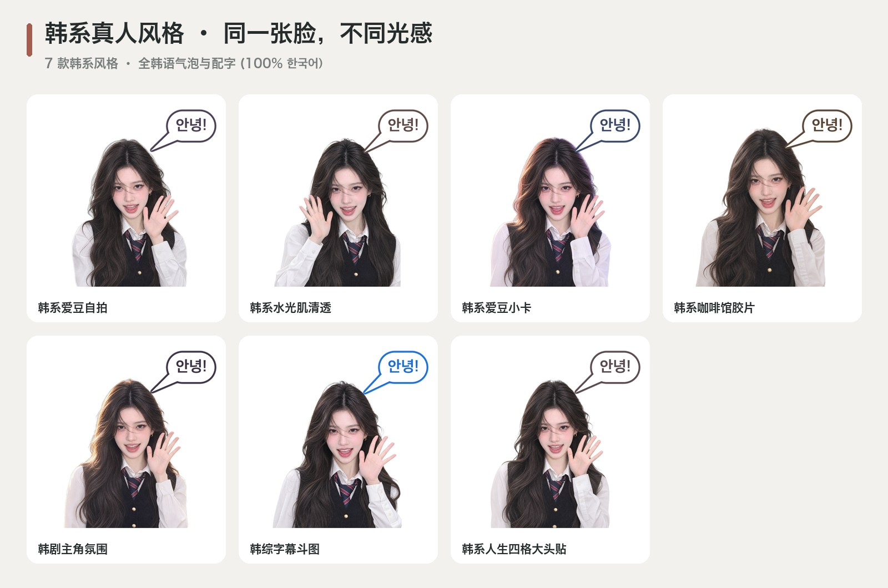

| # | 风格 ID (`--style`) | 名称 | 特色说明 |
|---|---|---|---|
| 1 | `real-purikura` | **韩系人生四格大头贴** | 清透韩系水光奶油肌真人写真，搭配柔和粉白描边与清甜拍立得人像质感。 |
| 2 | `real-kr-idol-selfie` | **韩系爱豆自拍** | 韩国爱豆自拍感：柔光美颜但不改五官，水润唇色、清透眼神，适合比心、wink、卖萌。 |
| 3 | `real-kr-glass-skin` | **韩系水光肌清透** | 韩系水光肌：通透奶油光泽、低饱和裸色调，干净高级的韩妆氛围。 |
| 4 | `real-kr-photocard` | **韩系爱豆小卡** | 韩国爱豆收藏小卡质感：粉蓝渐变柔光、清甜少女/少年感，适合追星同好斗图。 |
| 5 | `real-kr-cafe-film` | **韩系咖啡馆胶片** | 韩系咖啡馆日常胶片：奶茶米色调、窗边自然光、温柔慵懒的 ins 风日常感。 |
| 6 | `real-kr-drama` | **韩剧主角氛围** | 韩剧男女主氛围感：电影级柔逆光、浪漫光斑质感，深情、心动、委屈表情都很出片。 |
| 7 | `real-kr-variety` | **韩综字幕斗图** | 韩国综艺（Running Man 式）夸张反应抓拍 + 彩色粗描边字幕，搞笑反应满分。 |
| 8 | `real-kr-music-bank` | **韩系打歌舞台Ending妖精** | K-Pop 打歌舞台追光灯与呼吸感高光，定格舞台 Ending 妖精微表情。 |
| 9 | `real-kr-fansign-soft` | **韩系签售会奶油柔光** | 偶像签售会近距离长焦柔光镜头，眼神温柔互动、奶油粉白肤感。 |
| 10 | `real-kr-airport-snap` | **韩系仁川机场路透街拍** | 清晨机场自然天光高速快门抓拍，清冷松弛的明星私服氛围。 |
| 11 | `real-kr-hongdae-street` | **韩系弘大街头潮拍** | 弘大街头冷调银灰阴天散射光，酷飒街头潮流态度。 |
| 12 | `real-kr-seongsu-industrial` | **韩系圣水洞工业风写真** | 圣水洞水泥灰买手店自然侧光，极简冷淡高级感人像。 |
| 13 | `real-kr-hannam-oldmoney` | **韩系汉南洞千金氛围** | 汉南洞午后柔和暖白室内光，低饱和羊绒米金高级影调。 |
| 14 | `real-kr-apgujeong-glam` | **韩系狎鸥亭闪光夜拍** | 狎鸥亭都市夜拍机顶柔闪，水光唇釉与清透高光质感。 |
| 15 | `real-kr-jeju-breeze` | **韩系济州岛海风胶片** | 济州岛清透海边阳光与微风吹拂发丝，淡蓝薄荷青治愈色调。 |
| 16 | `real-kr-hanok-sunlight` | **韩系北村韩屋暖阳** | 首尔北村韩屋木质走廊暖调侧逆光，温婉静谧的东方光影。 |
| 17 | `real-kr-winter-snow` | **韩系初雪围巾恋歌** | 初雪漫反射纯净白光，脸颊与鼻尖微红的冬日韩剧恋爱感。 |
| 18 | `real-kr-cherry-blossom` | **韩系汝矣岛樱花柔光** | 春日樱花树下粉白漫反射阳光，温柔甜美初恋氛围。 |
| 19 | `real-kr-rainy-pocha` | **韩系雨夜布帐马车** | 首尔街头大排档暖橙灯串微光，微醺感性又接地气的斗图神态。 |
| 20 | `real-kr-high-teen` | **韩系High-Teen复古校园** | 千禧 High-Teen 青春校园明快布光，高饱和糖果色活力感。 |
| 21 | `real-kr-y2k-metallic` | **韩系Y2K千禧银光** | 冷银蓝金属反光板布光，千禧未来感女团概念照氛围。 |
| 22 | `real-kr-balletcore` | **韩系芭蕾风柔粉写真** | 丝带柔焦与珍珠母贝光泽，梦幻轻盈的韩系 Balletcore 写真。 |
| 23 | `real-kr-clean-fit` | **韩系Clean-Fit极简白棚** | 首尔江南无影白棚纯净漫射光，凸显立体骨相与清透肤质。 |
| 24 | `real-kr-id-photo` | **韩系最美证件照精修** | 首尔照相馆经典对称蝴蝶光，干净清透、体面大方的百搭贴纸。 |
| 25 | `real-kr-high-angle-booth` | **韩系俯拍高角度四格** | 流行头顶 45 度俯拍自助照相亭视角，俏皮灵动显脸小。 |
| 26 | `real-kr-bw-fourcut` | **韩系黑白胶片四格** | 弘大黑白自助照相馆柔光银盐质感，情绪细腻耐看。 |
| 27 | `real-kr-practice-mirror` | **韩系练习室对镜自拍** | 舞蹈练习室明亮日光灯感，随性自然、充满元气的日常抓拍。 |
| 28 | `real-kr-convenience-night` | **韩系深夜便利店霓虹** | 韩剧经典便利店冷白日光灯与夜色对比，真实又带点小情绪。 |
| 29 | `real-kr-magazine-dazed` | **韩系先锋画报冷冽光** | 韩版先锋时尚杂志冷调戏剧布光，高级厌世脸或冷幽默反差萌。 |
| 30 | `real-kr-webtoon-real` | **韩系漫改主角神颜光** | 如同韩漫男女主登场般的浪漫逆光光效，但 100% 保持真人照片真实五官。 |

### 日系系列（`jp` · 30 款）
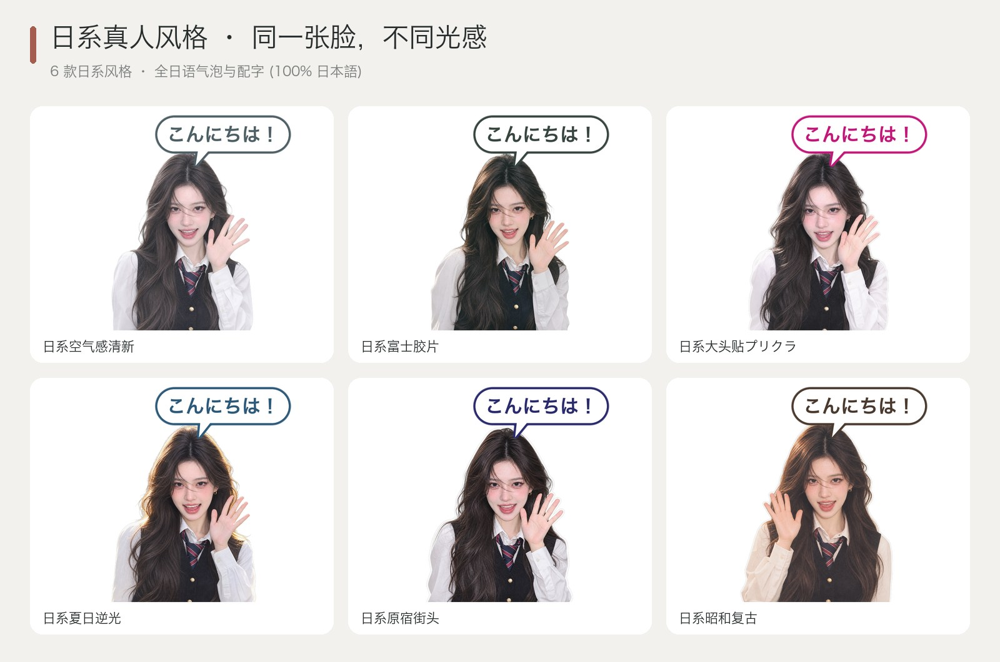

| # | 风格 ID (`--style`) | 名称 | 特色说明 |
|---|---|---|---|
| 1 | `real-jp-airy` | **日系空气感清新** | 日系空气感：微过曝、低对比、淡青淡粉色调，干净通透的清新写真。 |
| 2 | `real-jp-fuji-film` | **日系富士胶片** | 日系富士胶片色：青绿暗部、柔和肤色、细腻颗粒，文艺日常感。 |
| 3 | `real-jp-purikura` | **日系大头贴プリクラ** | 日本プリクラ大头贴：高亮美白、粉嫩边框感、可爱比 V 姿势（不放大眼睛、不改脸型）。 |
| 4 | `real-jp-summer` | **日系夏日逆光** | 日系夏日青春：金色逆光、发丝透光、蓝天感清爽色调，元气满满。 |
| 5 | `real-jp-harajuku` | **日系原宿街头** | 原宿街头潮人：高饱和撞色、直闪街拍、个性十足的态度表情。 |
| 6 | `real-jp-showa` | **日系昭和复古** | 昭和复古写真：80 年代暖黄褪色、柔焦与颗粒，老杂志封面感。 |
| 7 | `real-jp-rinko-pastel` | **日系川内伦子风淡彩** | 高调微过曝与梦幻低对比淡蓝淡粉影调，透明感拉满的治愈写真。 |
| 8 | `real-jp-hideaki-clean` | **日系滨田英明风清透** | 中画幅胶片清澈自然光与干净青白影调，温和宁静的生活呼吸感。 |
| 9 | `real-jp-moriyama-bw` | **日系森山大道粗颗粒黑白** | 高反差街头黑白银盐颗粒，极具张力与态度的冷酷/发疯表情贴纸。 |
| 10 | `real-jp-ninagawa-vivid` | **日系蜷川实花浓郁花影** | 绚丽浓郁的高饱和色彩光影衬托真实五官，华丽吸睛。 |
| 11 | `real-jp-shibuya-neon` | **日系涩谷十字路口霓虹** | 东京涩谷雨夜霓虹多色反光，潮流都市电影感人像。 |
| 12 | `real-jp-shimokita-vintage` | **日系下北泽古着胶片** | 下北泽古着店暖棕柔和灯光与复古胶片色调，文艺松弛感。 |
| 13 | `real-jp-daikanyama-morning` | **日系代官山晨光书店** | 蔦屋书店落地窗清透晨光，知性温和的浅米色自然写真。 |
| 14 | `real-jp-ginza-luxury` | **日系银座夜色流光** | 银座夜晚香槟金橱窗柔光，优雅精致的成熟都市氛围。 |
| 15 | `real-jp-kyoto-komorebi` | **日系京都木漏日和风** | 京都庭院树叶缝隙洒下的斑驳暖阳（木漏れ日），静谧温柔。 |
| 16 | `real-jp-hokkaido-snow` | **日系北海道情书雪景** | 小樽雪地纯净漫反射柔光，清冷通透、眼神清澈的冬日写真。 |
| 17 | `real-jp-okinawa-sun` | **日系冲绳盛夏海盐** | 冲绳晴空高明度阳光与清爽海盐蓝调，元气灿烂笑容抓拍。 |
| 18 | `real-jp-sakura-film` | **日系樱花季春光胶片** | 目黑川樱花季微风春光与富士胶片柔粉色彩，温柔治愈。 |
| 19 | `real-jp-autumn-icho` | **日系银杏大道秋日暖光** | 明治神宫外苑金黄银杏暖逆光，温暖怀旧的秋日胶片质感。 |
| 20 | `real-jp-rainy-hydrangea` | **日系镰仓梅雨紫阳花** | 梅雨季湿润阴天柔散射光，清冷蓝紫绣球花色调。 |
| 21 | `real-jp-onsen-steam` | **日系温泉旅馆暖雾** | 箱根温泉旅馆柔和暖黄木质灯光与微醺水雾柔焦，松弛惬意。 |
| 22 | `real-jp-izakaya-warm` | **日系深夜食堂居酒屋** | 暖橘色居酒屋灯笼微光，干杯、吐槽、吃货反应的真实烟火气。 |
| 23 | `real-jp-kissaten-retro` | **日系纯喫茶昭和咖啡** | 昭和纯喫茶琥珀色台灯与浓郁复古胶片暗部，怀旧文艺腔调。 |
| 24 | `real-jp-school-rooftop` | **日系青春天台晴空** | 午后校园天台清澈蓝天背光，清爽干净的青春日剧写真。 |
| 25 | `real-jp-matsuri-fireworks` | **日系夏日祭花火微光** | 夏日祭手持仙女棒暖橙火光映照脸庞，灵动浪漫夜景人像。 |
| 26 | `real-jp-nonno-magazine` | **日系甜美日杂画报** | 日系时尚杂志柔光棚拍，温柔豆沙粉与奶油米白配色。 |
| 27 | `real-jp-popeye-cityboy` | **日系CityBoy街头画报** | 《POPEYE》风阳光街头自然抓拍，干净清爽的东京日常质感。 |
| 28 | `real-jp-utsurundesu` | **日系写ルンです一次性胶片** | 富士 QuickSnap 一次性胶片机标志性直闪、微绿暗部与真实颗粒。 |
| 29 | `real-jp-drama-subtitle` | **日剧黄金档电影感剧照** | 经典日剧温暖自然光影与细腻情绪定格，故事感十足。 |
| 30 | `real-jp-variety-telop` | **日综夸张大字报斗图** | 日本综艺演播室高亮灯光 + 高饱和撞色字幕感，震惊与吐槽神器。 |

### 中式系列（`cn` · 30 款）
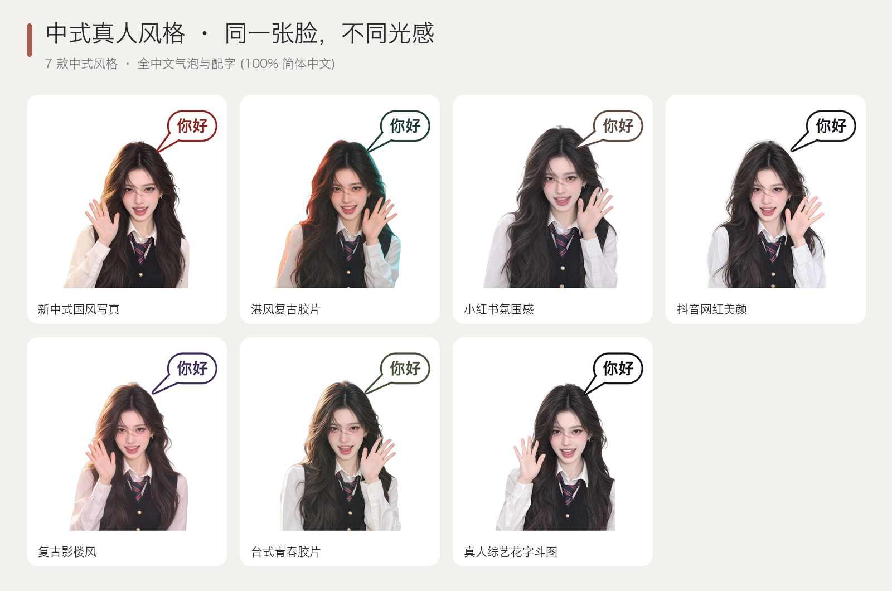

| # | 风格 ID (`--style`) | 名称 | 特色说明 |
|---|---|---|---|
| 1 | `real-variety-meme` | **真人综艺花字斗图** | 真人戏剧化实拍表情抓拍 + 国民综艺亮黄撞色花字描边，斗图表现力拉满。 |
| 2 | `real-cn-new-chinese` | **新中式国风写真** | 新中式东方美学：暖光柔影、朱红与金色点缀、温润雅致的氛围（保留本人原本穿搭）。 |
| 3 | `real-cn-hk-retro` | **港风复古胶片** | 90 年代港风电影：霓虹暖红绿调、王家卫式氛围、复古胶片颗粒。 |
| 4 | `real-cn-xhs-vibe` | **小红书氛围感** | 小红书氛围感博主风：奶油柔光、低饱和高级色、精致自然的生活方式质感。 |
| 5 | `real-cn-douyin` | **抖音网红美颜** | 抖音网红直播间质感：环形灯高光、元气活泼、表情夸张有梗（只提亮不改脸）。 |
| 6 | `real-cn-studio-retro` | **复古影楼风** | 90 年代老式影楼写真：柔焦光晕、艳丽撞色、土味又好笑，斗图梗图神器。 |
| 7 | `real-cn-tw-youth` | **台式青春胶片** | 台湾青春电影感：午后暖阳、淡绿柔调、校园初恋般清新怀旧。 |
| 8 | `real-cn-jiangnan-mist` | **中式江南烟雨清冷** | 江南青瓦白墙微雨柔雾漫射光，淡墨青瓷般温润清雅的真人写真。 |
| 9 | `real-cn-palace-redwall` | **中式红墙琉璃暖阳** | 古建朱红宫墙暖阳漫反光，衬托明朗红润气色与端庄大气神态。 |
| 10 | `real-cn-song-minimal` | **中式宋韵极简留白** | 宣纸米白柔光与宋代汝窑清冷雅致影调，尽显东方骨相清贵。 |
| 11 | `real-cn-tang-splendor` | **中式盛唐鎏金夜宴** | 暖金烛火与牡丹绛红交织的华丽柔光，明艳动人、贵气十足。 |
| 12 | `real-cn-dunhuang-sunset` | **中式敦煌大漠流沙** | 西北大漠落日赭石与泥金暖逆光，发丝飞扬、极具丝路电影感。 |
| 13 | `real-cn-ink-wash-light` | **中式水墨光影写真** | 东方水墨留白式黑白灰影棚光影（100%真人实拍质感，绝非水墨画）。 |
| 14 | `real-cn-republican-velvet` | **中式民国复古画报** | 老上海留声机年代暖黄钨丝灯光与天鹅绒暗部，摩登复古故事感。 |
| 15 | `real-cn-shanghai-bund` | **中式外滩流光夜色** | 《繁花》式流金琥珀色夜景光斑与戏剧侧光，海派腔调拉满。 |
| 16 | `real-cn-hk-tvb-90s` | **港风90年代TVB剧照** | 90年代经典港剧温暖电视柔光，适合搭配地道港式幽默反应。 |
| 17 | `real-cn-hk-cyber-rain` | **港风旺角雨夜霓虹** | 旺角街头高饱和红绿霓虹招牌夜雨反光，王家卫式冷酷抽离感。 |
| 18 | `real-cn-tw-nightmarket` | **台式夜市烟火霓虹** | 台北夜市暖黄灯牌背景光斑，生动亲切的吃货与日常互动抓拍。 |
| 19 | `real-cn-chengdu-teahouse` | **中式成都竹椅茶馆** | 老茶馆树荫暖阳与竹影光斑，松弛巴适、喝茶吃瓜的闲适神态。 |
| 20 | `real-cn-chongqing-cyber` | **中式重庆山城迷雾夜** | 山城江雾冷蓝与洪崖洞暖橙灯火交错，立体感十足的江湖夜色。 |
| 21 | `real-cn-dali-sunshine` | **中式大理洱海慢生活** | 云南高原澄澈通透阳光与苍山蓝调，自由治愈的旅拍写真。 |
| 22 | `real-cn-hulunbuir-wind` | **中式草原旷野清风** | 呼伦贝尔辽阔天光与暖金草地漫反射，发丝微扬、自由洒脱。 |
| 23 | `real-cn-80s-factory` | **中式80年代怀旧胶片** | 老式海鸥相机暖黄褪色胶片质感，淳朴年代感与怀旧幽默。 |
| 24 | `real-cn-90s-calendar` | **中式90年代挂历画报** | 90年代经典挂历明快高饱和影棚柔光，复古喜庆又自带反差萌。 |
| 25 | `real-cn-cny-festive` | **中式新春贺岁红金** | 春节喜庆红金暖调灯光，拜年、讨红包、暴富祝福专属真人贴纸。 |
| 26 | `real-cn-wuxia-breeze` | **中式武侠清风江湖** | 冷峻青灰电影色调与逆光微风，侠气凛然的抱拳/挑眉真人贴纸。 |
| 27 | `real-cn-tea-zen` | **中式围炉煮茶禅意** | 炭火暖橘微光与木质茶室静谧光影，佛系、随缘、平静喝茶神态。 |
| 28 | `real-cn-guochao-street` | **中式国潮街头撞色** | 中国红与孔雀青潮流杂志闪光灯撞色，酷飒张扬的国潮青年态度。 |
| 29 | `real-cn-work-survival` | **中式大厂打工人图鉴** | 写字楼工位冷白屏幕补光，精准拿捏早八困倦、收到、摸鱼真实神态。 |
| 30 | `real-cn-bazi-lucky` | **中式锦鲤好运玄学风** | 暖金柔光与吉祥红金配色，适合“功德+1、好运莲莲、退退退”斗图。 |
---

## Codex AI 驱动的真动图（4 帧关键帧分镜）

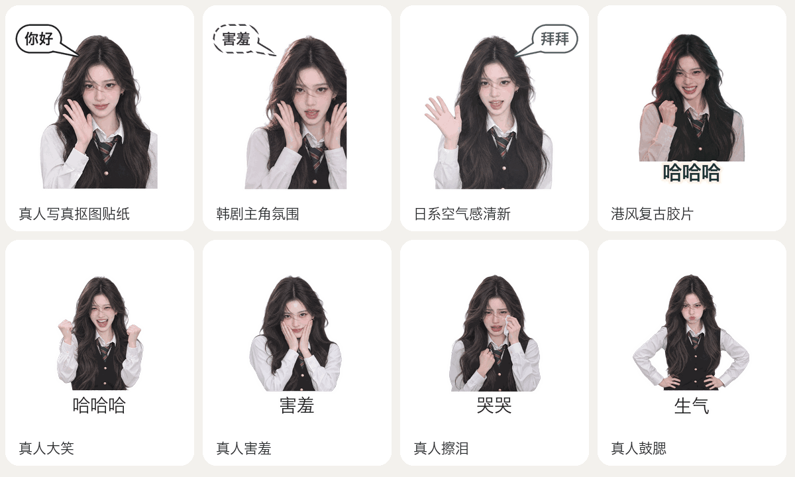

---

## 14 大类真人表情分类

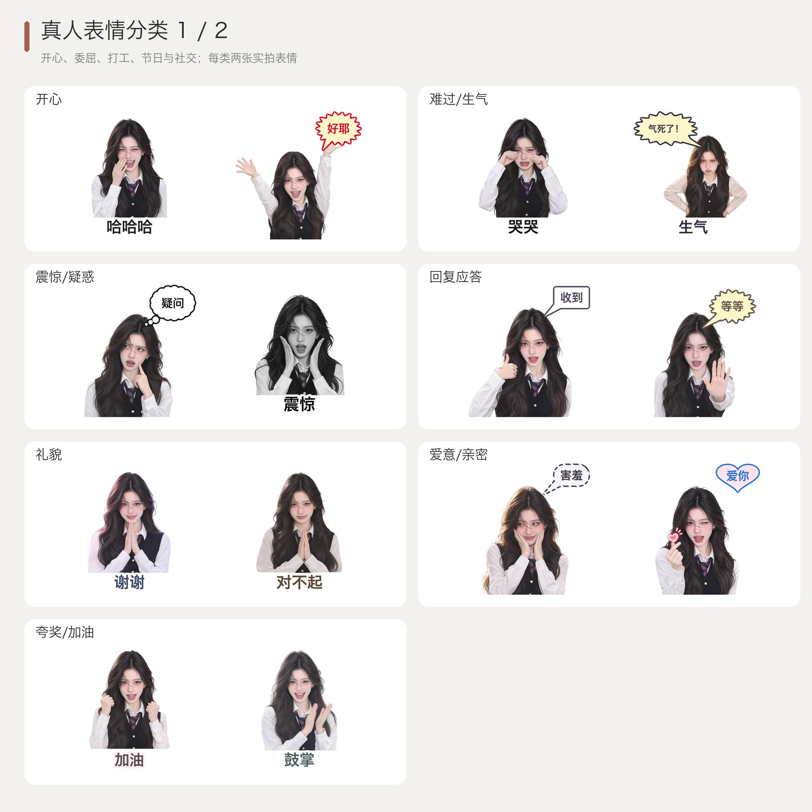
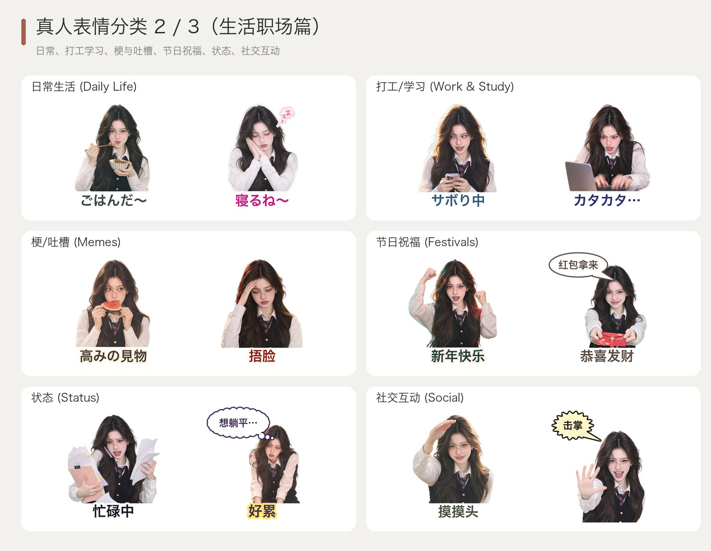

---

## 38 款真人梗图与抽象图（6 大类）

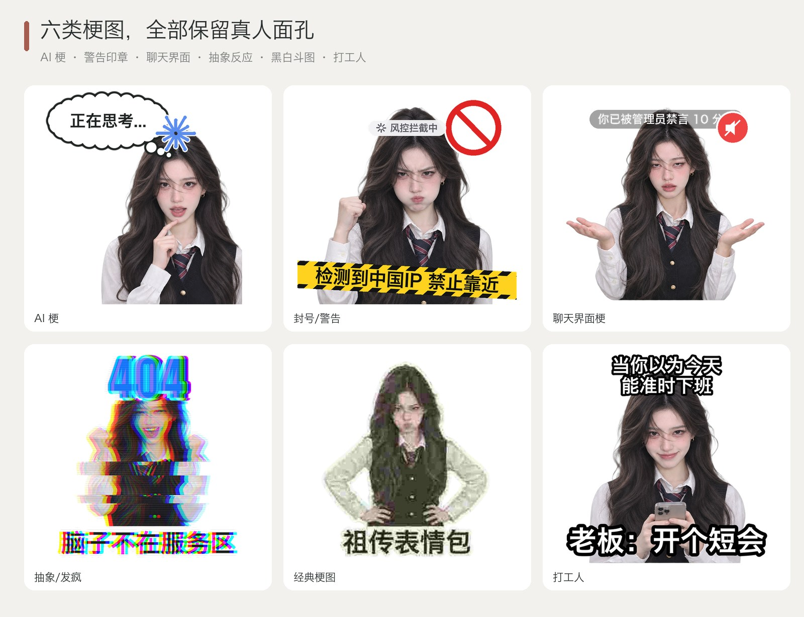

---

## 7 种对话气泡与 5 种独立单语种支持

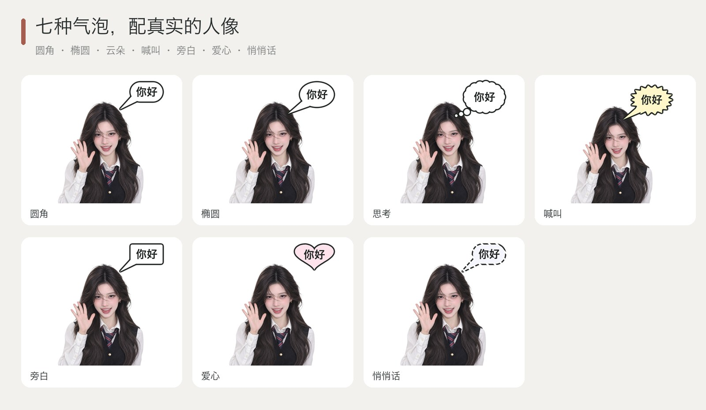
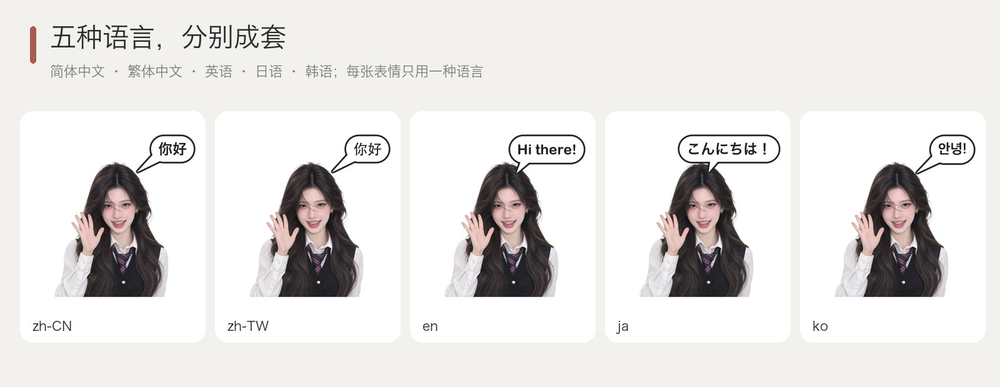

### 整组单语言成套表情包示例（全中文 / 全英文 / 全韩语 / 全日语，绝不混排）

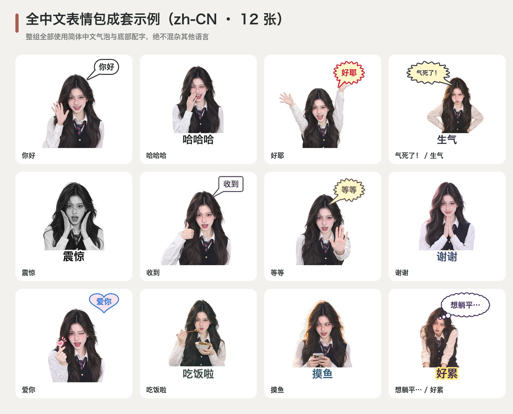


---

## 全平台自动分发与社交封面导出

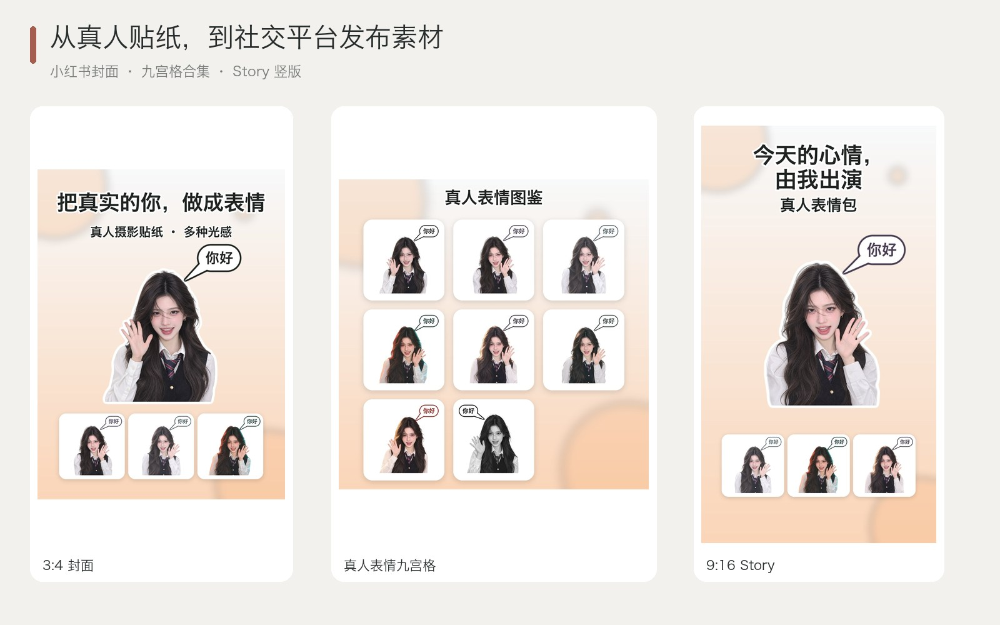

---

## 快速开始

```bash
python3 -m venv .venv
source .venv/bin/activate
pip install -e '.[dev]'

# 查看环境与真人风格库
wechat-sticker-maker doctor
wechat-sticker-maker styles
wechat-sticker-maker styles --region 韩系

# 规划并生成真人表情包
wechat-sticker-maker plan \
  --input photo.jpg \
  --output output/my-portrait-pack \
  --mode both \
  --count 16 \
  --style real-cutout \
  --language zh-CN \
  --platforms wechat,xiaohongshu,instagram,telegram

wechat-sticker-maker generate --job output/my-portrait-pack/job.json

# 单张真人梗图快速生成
wechat-sticker-maker meme -t claude -i photo.jpg -o output/thinking.gif
wechat-sticker-maker meme -t 中国ip -i photo.jpg -o output/china_ip.gif
wechat-sticker-maker meme -t 封号 -i photo.jpg -o output/ban.gif
```

## 测试

```bash
pytest -v
python scripts/smoke_test.py
```

## License

MIT License. See [`LICENSE`](LICENSE) for details.
