<p align="right">
  <strong>Language:</strong>
  <a href="README.md"><b>简体中文</b></a> |
  <a href="README.en.md"><b>English</b></a> |
  <a href="README.ko.md"><b>한국어</b></a> |
  <a href="README.ja.md"><b>日本語</b></a>
</p>

# 真人表情包展示图库

本图库只展示同一真人照片生成的实拍表情包与真人梗图。项目内置 **108 款摄影风格**（通用 18 / 韩系 30 / 日系 30 / 中式 30）、**168 套双人互动**、**22 类 220 款单人表情**、**40 款真宠表情** 与 **60 款真人梗图**；当前图库已实拍合成 **108 款风格（164 张单人 PNG + 16 张双人同框 PNG）+ 18 款真动作 GIF + 60 款真人梗图**，全部保留照片里的真实五官比例、发型和穿搭。

[返回首页](../../README.md) · [文件清单](manifest.json) · [生图提示词](prompts.json) · [质检与扩展清单](MISSING_IMAGES_CHECKLIST.md)

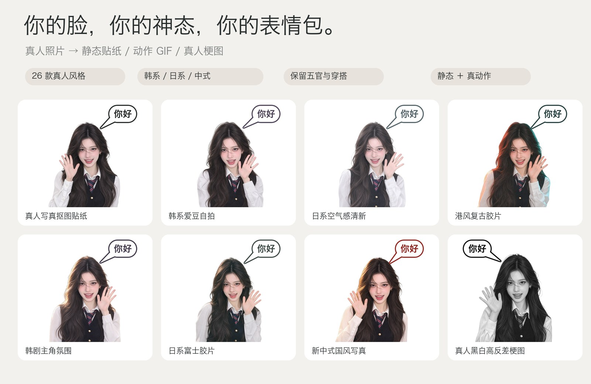

## 四个摄影系列（108 款摄影风格全量实拍）

当前已入库展示 **108 款** 720px 透明 PNG 真人贴纸（共 164 张单人实拍贴纸）。

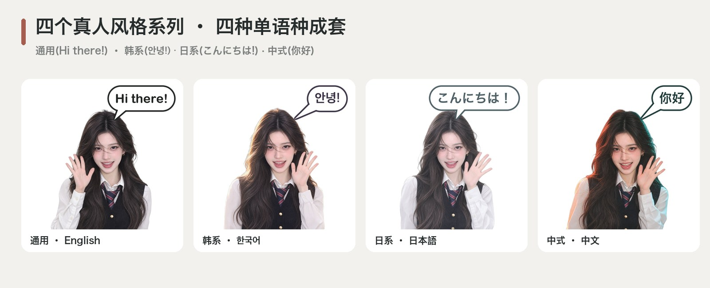

### 通用（已合成 18 款）

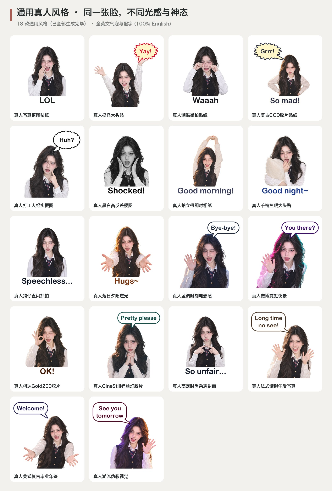

<details>
<summary>查看通用每款风格的双图对比</summary>

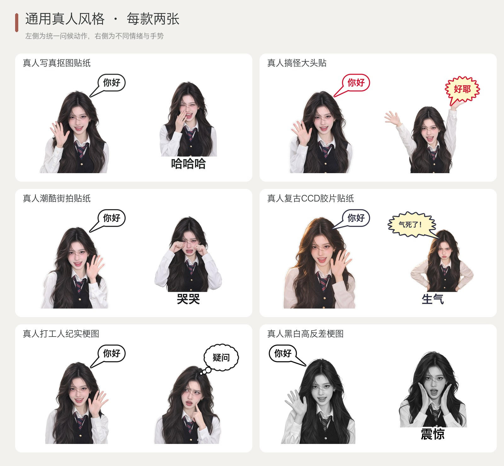

</details>

| 风格 | 首张展示 | 第二张表情 |
|---|---|---|
| 真人写真抠图贴纸 · `real-cutout` | [哈哈哈](stickers/real-cutout__04_laugh.png) | — |
| 真人搞怪大头贴 · `real-bobblehead` | [你好](stickers/real-bobblehead__01_hello.png) | [好耶](stickers/real-bobblehead__13_yay.png) |
| 真人潮酷街拍贴纸 · `real-street-cool` | [你好](stickers/real-street-cool__01_hello.png) | [哭哭](stickers/real-street-cool__06_cry.png) |
| 真人复古CCD胶片贴纸 · `real-vintage-ccd` | [你好](stickers/real-vintage-ccd__01_hello.png) | [生气](stickers/real-vintage-ccd__07_angry.png) |
| 真人打工人纪实梗图 · `real-work-emo` | [你好](stickers/real-work-emo__01_hello.png) | [疑问](stickers/real-work-emo__14_confused.png) |
| 真人黑白高反差梗图 · `real-high-contrast` | [你好](stickers/real-high-contrast__01_hello.png) | [震惊](stickers/real-high-contrast__24_shocked.png) |
| 真人拍立得即时相纸 · `real-polaroid-instant` | [早安](stickers/real-polaroid-instant__02_morning.png) | — |
| 真人千禧鱼眼大头贴 · `real-fisheye-y2k` | [晚安](stickers/real-fisheye-y2k__03_goodnight.png) | — |
| 真人狗仔直闪抓拍 · `real-paparazzi-flash` | [无语](stickers/real-paparazzi-flash__08_speechless.png) | — |
| 真人落日夕阳逆光 · `real-golden-hour` | [抱抱](stickers/real-golden-hour__12_hug.png) | [抱紧你](stickers/real-golden-hour__d38_couple_back_hug.png) |
| 真人蓝调时刻电影感 · `real-blue-hour` | [拜拜](stickers/real-blue-hour__15_bye.png) | [哥哥别躲](stickers/real-blue-hour__d109_yaoi_tie_pull_gaze.png) |
| 真人赛博霓虹夜景 · `real-cyber-neon` | [在吗](stickers/real-cyber-neon__17_are_you_there.png) | [上号开黑](stickers/real-cyber-neon__133_game_log_on.png) |
| 真人柯达Gold200胶片 · `real-film-kodak-gold` | [OK](stickers/real-film-kodak-gold__19_ok.png) | [修勾打招呼](stickers/real-film-kodak-gold__211_pet_puppy_wave.png) |
| 真人CineStill钨丝灯胶片 · `real-film-cinestill-800t` | [求求](stickers/real-film-cinestill-800t__20_please.png) | [并肩作战](stickers/real-film-cinestill-800t__d110_yaoi_back_to_back_suit.png) |
| 真人高定时尚杂志封面 · `real-vogue-editorial` | [委屈](stickers/real-vogue-editorial__23_aggrieved.png) | [就这?](stickers/real-vogue-editorial__188_sass_just_this.png) |
| 真人法式慵懒午后写真 · `real-french-effortless` | [好久不见](stickers/real-french-effortless__25_long_time_no_see.png) | — |
| 真人美式复古毕业年鉴 · `real-american-yearbook` | [欢迎欢迎](stickers/real-american-yearbook__26_welcome.png) | [极限赶DDL](stickers/real-american-yearbook__181_camp_ddl_rush.png) |
| 真人潮流伪彩视觉 · `real-thermal-ir` | [明天见](stickers/real-thermal-ir__27_see_you_tomorrow.png) | — |

### 韩系（已合成 30 款）

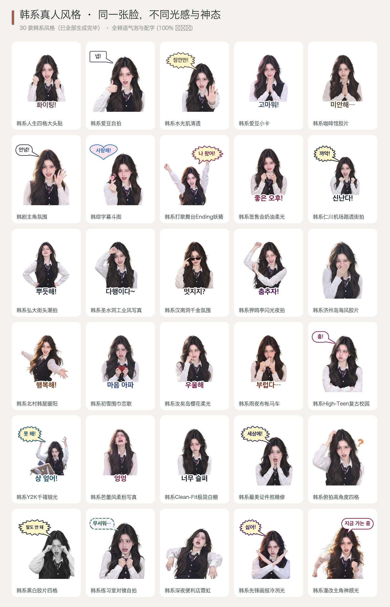

<details>
<summary>查看韩系每款风格的双图对比</summary>

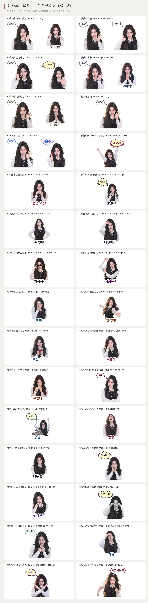

</details>

| 风格 | 首张展示 | 第二张表情 |
|---|---|---|
| 韩系爱豆自拍 · `real-kr-idol-selfie` | [你好](stickers/real-kr-idol-selfie__01_hello.png) | [收到](stickers/real-kr-idol-selfie__09_acknowledged.png) |
| 韩系水光肌清透 · `real-kr-glass-skin` | [你好](stickers/real-kr-glass-skin__01_hello.png) | [等等](stickers/real-kr-glass-skin__18_wait.png) |
| 韩系爱豆小卡 · `real-kr-photocard` | [你好](stickers/real-kr-photocard__01_hello.png) | [谢谢](stickers/real-kr-photocard__11_thanks.png) |
| 韩系咖啡馆胶片 · `real-kr-cafe-film` | [你好](stickers/real-kr-cafe-film__01_hello.png) | [对不起](stickers/real-kr-cafe-film__57_sorry.png) |
| 韩剧主角氛围 · `real-kr-drama` | [你好](stickers/real-kr-drama__01_hello.png) | [乖啦~](stickers/real-kr-drama__d37_couple_head_pat.png) |
| 韩综字幕斗图 · `real-kr-variety` | [你好](stickers/real-kr-variety__01_hello.png) | [爱你](stickers/real-kr-variety__16_love.png) |
| 韩系人生四格大头贴 · `real-purikura` | [你好](stickers/real-purikura__01_hello.png) | [加油](stickers/real-purikura__10_fighting.png) |
| 韩系打歌舞台Ending妖精 · `real-kr-music-bank` | [我回来了](stickers/real-kr-music-bank__28_im_back.png) | — |
| 韩系签售会奶油柔光 · `real-kr-fansign-soft` | [午安](stickers/real-kr-fansign-soft__29_good_afternoon.png) | [嗑死我了](stickers/real-kr-fansign-soft__147_fan_ship_otp.png) |
| 韩系仁川机场路透街拍 · `real-kr-airport-snap` | [激动](stickers/real-kr-airport-snap__30_excited.png) | — |
| 韩系弘大街头潮拍 · `real-kr-hongdae-street` | [骄傲](stickers/real-kr-hongdae-street__31_proud.png) | — |
| 韩系圣水洞工业风写真 · `real-kr-seongsu-industrial` | [松了口气](stickers/real-kr-seongsu-industrial__32_relieved.png) | — |
| 韩系汉南洞千金氛围 · `real-kr-hannam-oldmoney` | [酷](stickers/real-kr-hannam-oldmoney__33_cool.png) | — |
| 韩系狎鸥亭闪光夜拍 · `real-kr-apgujeong-glam` | [嗨起来](stickers/real-kr-apgujeong-glam__34_dance.png) | — |
| 韩系济州岛海风胶片 · `real-kr-jeju-breeze` | [嘿嘿](stickers/real-kr-jeju-breeze__35_giggle.png) | — |
| 韩系北村韩屋暖阳 · `real-kr-hanok-sunlight` | [开心](stickers/real-kr-hanok-sunlight__36_happy.png) | — |
| 韩系初雪围巾恋歌 · `real-kr-winter-snow` | [心碎](stickers/real-kr-winter-snow__37_heartbroken.png) | [只看着你](stickers/real-kr-winter-snow__d41_couple_forehead_touch.png) |
| 韩系汝矣岛樱花柔光 · `real-kr-cherry-blossom` | [emo了](stickers/real-kr-cherry-blossom__38_emo.png) | — |
| 韩系雨夜布帐马车 · `real-kr-rainy-pocha` | [酸了](stickers/real-kr-rainy-pocha__39_jealous.png) | — |
| 韩系High-Teen复古校园 · `real-kr-high-teen` | [哼](stickers/real-kr-high-teen__40_hmph.png) | — |
| 韩系Y2K千禧银光 · `real-kr-y2k-metallic` | [掀桌](stickers/real-kr-y2k-metallic__41_table_flip.png) | — |
| 韩系芭蕾风柔粉写真 · `real-kr-balletcore` | [哇哇大哭](stickers/real-kr-balletcore__42_wail.png) | — |
| 韩系Clean-Fit极简白棚 · `real-kr-clean-fit` | [好难过](stickers/real-kr-clean-fit__43_so_sad.png) | — |
| 韩系最美证件照精修 · `real-kr-id-photo` | [我的天](stickers/real-kr-id-photo__44_omg.png) | — |
| 韩系俯拍高角度四格 · `real-kr-high-angle-booth` | [问号脸](stickers/real-kr-high-angle-booth__45_question_marks.png) | — |
| 韩系黑白胶片四格 · `real-kr-bw-fourcut` | [不敢相信](stickers/real-kr-bw-fourcut__46_cant_believe.png) | — |
| 韩系练习室对镜自拍 · `real-kr-practice-mirror` | [好怕怕](stickers/real-kr-practice-mirror__47_scared.png) | — |
| 韩系深夜便利店霓虹 · `real-kr-convenience-night` | [晕倒](stickers/real-kr-convenience-night__48_faint.png) | — |
| 韩系先锋画报冷冽光 · `real-kr-magazine-dazed` | [不要](stickers/real-kr-magazine-dazed__49_no.png) | — |
| 韩系漫改主角神颜光 · `real-kr-webtoon-real` | [马上到](stickers/real-kr-webtoon-real__50_on_my_way.png) | — |

### 日系（已合成 30 款）

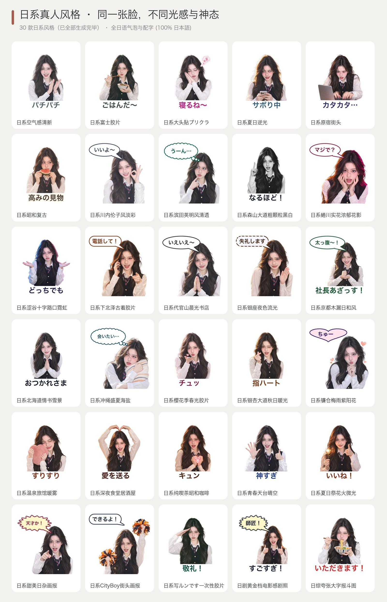

<details>
<summary>查看日系每款风格的双图对比</summary>

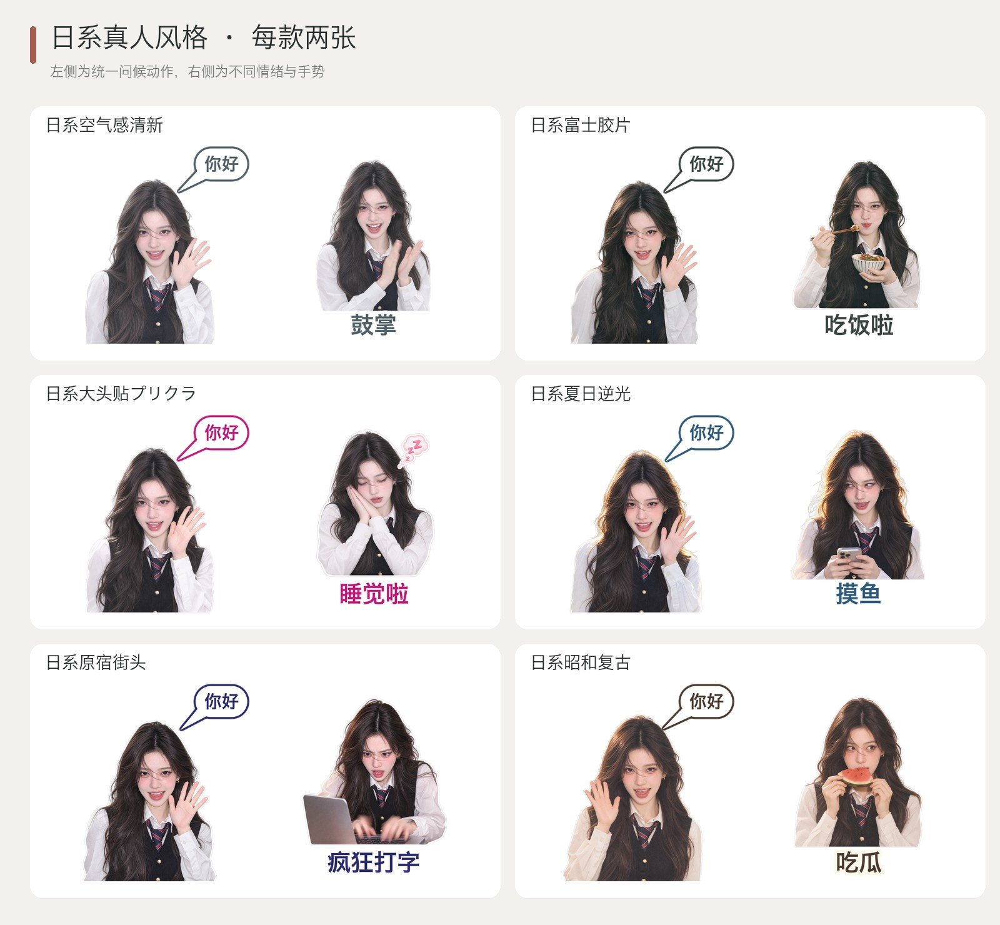

</details>

| 风格 | 首张展示 | 第二张表情 |
|---|---|---|
| 日系空气感清新 · `real-jp-airy` | [你好](stickers/real-jp-airy__01_hello.png) | [鼓掌](stickers/real-jp-airy__70_clap.png) |
| 日系富士胶片 · `real-jp-fuji-film` | [你好](stickers/real-jp-fuji-film__01_hello.png) | [吃饭啦](stickers/real-jp-fuji-film__21_eating.png) |
| 日系大头贴プリクラ · `real-jp-purikura` | [你好](stickers/real-jp-purikura__01_hello.png) | [睡觉啦](stickers/real-jp-purikura__22_sleeping.png) |
| 日系夏日逆光 · `real-jp-summer` | [你好](stickers/real-jp-summer__01_hello.png) | [摸鱼](stickers/real-jp-summer__89_slacking.png) |
| 日系原宿街头 · `real-jp-harajuku` | [你好](stickers/real-jp-harajuku__01_hello.png) | [疯狂打字](stickers/real-jp-harajuku__92_typing_fast.png) |
| 日系昭和复古 · `real-jp-showa` | [你好](stickers/real-jp-showa__01_hello.png) | [吃瓜](stickers/real-jp-showa__95_eat_melon.png) |
| 日系川内伦子风淡彩 · `real-jp-rinko-pastel` | [好的呀](stickers/real-jp-rinko-pastel__51_sure.png) | — |
| 日系滨田英明风清透 · `real-jp-hideaki-clean` | [让我想想](stickers/real-jp-hideaki-clean__52_let_me_think.png) | — |
| 日系森山大道粗颗粒黑白 · `real-jp-moriyama-bw` | [懂了](stickers/real-jp-moriyama-bw__53_got_it.png) | — |
| 日系蜷川实花浓郁花影 · `real-jp-ninagawa-vivid` | [真的吗](stickers/real-jp-ninagawa-vivid__54_really.png) | — |
| 日系涩谷十字路口霓虹 · `real-jp-shibuya-neon` | [随便](stickers/real-jp-shibuya-neon__55_whatever.png) | — |
| 日系下北泽古着胶片 · `real-jp-shimokita-vintage` | [打给我](stickers/real-jp-shimokita-vintage__56_call_me.png) | — |
| 日系代官山晨光书店 · `real-jp-daikanyama-morning` | [不客气](stickers/real-jp-daikanyama-morning__58_youre_welcome.png) | — |
| 日系银座夜色流光 · `real-jp-ginza-luxury` | [打扰了](stickers/real-jp-ginza-luxury__59_excuse_me.png) | — |
| 日系京都木漏日和风 · `real-jp-kyoto-komorebi` | [谢谢老板](stickers/real-jp-kyoto-komorebi__60_thanks_boss.png) | — |
| 日系北海道情书雪景 · `real-jp-hokkaido-snow` | [辛苦了](stickers/real-jp-hokkaido-snow__61_good_work.png) | — |
| 日系冲绳盛夏海盐 · `real-jp-okinawa-sun` | [想你了](stickers/real-jp-okinawa-sun__62_miss_you.png) | — |
| 日系樱花季春光胶片 · `real-jp-sakura-film` | [亲亲](stickers/real-jp-sakura-film__63_kiss.png) | [命中注定](stickers/real-jp-sakura-film__d74_yuri_destiny_cheek_touch.png) |
| 日系银杏大道秋日暖光 · `real-jp-autumn-icho` | [比心](stickers/real-jp-autumn-icho__64_finger_heart.png) | — |
| 日系镰仓梅雨紫阳花 · `real-jp-rainy-hydrangea` | [么么哒](stickers/real-jp-rainy-hydrangea__65_mwah.png) | — |
| 日系温泉旅馆暖雾 · `real-jp-onsen-steam` | [贴贴](stickers/real-jp-onsen-steam__66_snuggle.png) | — |
| 日系深夜食堂居酒屋 · `real-jp-izakaya-warm` | [送你爱心](stickers/real-jp-izakaya-warm__67_sending_love.png) | — |
| 日系纯喫茶昭和咖啡 · `real-jp-kissaten-retro` | [心动](stickers/real-jp-kissaten-retro__68_heart_flutter.png) | — |
| 日系青春天台晴空 · `real-jp-school-rooftop` | [666](stickers/real-jp-school-rooftop__69_six_six_six.png) | [逢考必过!](stickers/real-jp-school-rooftop__178_camp_pass_exam.png) |
| 日系夏日祭花火微光 · `real-jp-matsuri-fireworks` | [点赞](stickers/real-jp-matsuri-fireworks__71_like.png) | — |
| 日系甜美日杂画报 · `real-jp-nonno-magazine` | [天才](stickers/real-jp-nonno-magazine__72_genius.png) | — |
| 日系CityBoy街头画报 · `real-jp-popeye-cityboy` | [你可以的](stickers/real-jp-popeye-cityboy__73_you_can_do_it.png) | — |
| 日系写ルンです一次性胶片 · `real-jp-utsurundesu` | [敬礼](stickers/real-jp-utsurundesu__74_respect.png) | — |
| 日剧黄金档电影感剧照 · `real-jp-drama-subtitle` | [太强了](stickers/real-jp-drama-subtitle__75_awesome.png) | — |
| 日综夸张大字报斗图 · `real-jp-variety-telop` | [干饭人](stickers/real-jp-variety-telop__76_chow_time.png) | — |

### 中式（已合成 30 款）

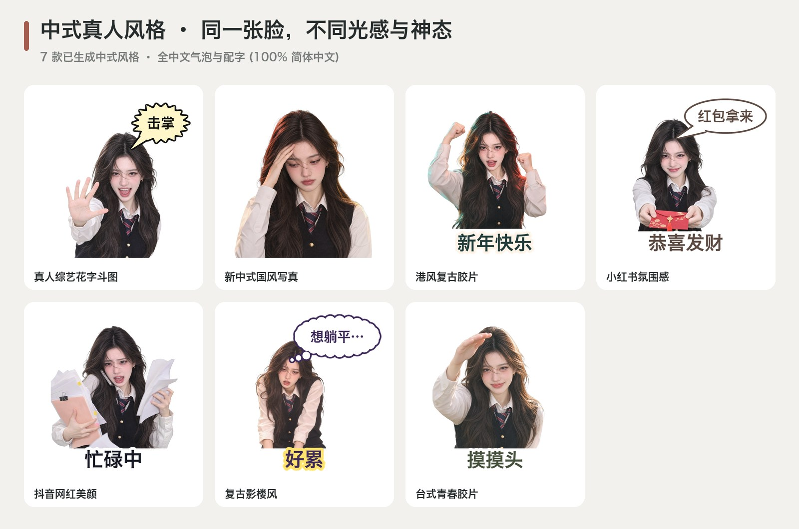

<details>
<summary>查看中式每款风格的双图对比</summary>

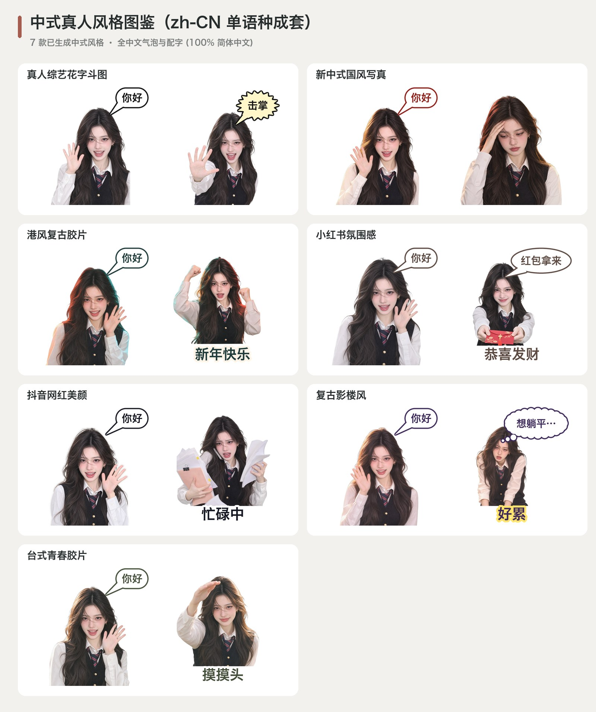

</details>

| 风格 | 首张展示 | 第二张表情 |
|---|---|---|
| 新中式国风写真 · `real-cn-new-chinese` | [你好](stickers/real-cn-new-chinese__01_hello.png) | [捂脸](stickers/real-cn-new-chinese__98_facepalm.png) |
| 港风复古胶片 · `real-cn-hk-retro` | [你好](stickers/real-cn-hk-retro__01_hello.png) | [新年快乐](stickers/real-cn-hk-retro__106_new_year.png) |
| 小红书氛围感 · `real-cn-xhs-vibe` | [你好](stickers/real-cn-xhs-vibe__01_hello.png) | [恭喜发财](stickers/real-cn-xhs-vibe__107_red_envelope.png) |
| 抖音网红美颜 · `real-cn-douyin` | [你好](stickers/real-cn-douyin__01_hello.png) | [忙碌中](stickers/real-cn-douyin__115_busy.png) |
| 复古影楼风 · `real-cn-studio-retro` | [你好](stickers/real-cn-studio-retro__01_hello.png) | [好累](stickers/real-cn-studio-retro__118_tired.png) |
| 台式青春胶片 · `real-cn-tw-youth` | [你好](stickers/real-cn-tw-youth__01_hello.png) | [摸摸头](stickers/real-cn-tw-youth__123_pat_pat.png) |
| 真人综艺花字斗图 · `real-variety-meme` | [你好](stickers/real-variety-meme__01_hello.png) | [击掌](stickers/real-variety-meme__125_high_five.png) |
| 中式江南烟雨清冷 · `real-cn-jiangnan-mist` | [饿了](stickers/real-cn-jiangnan-mist__77_hungry.png) | — |
| 中式红墙琉璃暖阳 · `real-cn-palace-redwall` | [续命咖啡](stickers/real-cn-palace-redwall__78_coffee.png) | — |
| 中式宋韵极简留白 · `real-cn-song-minimal` | [洗澡去](stickers/real-cn-song-minimal__79_bath_time.png) | — |
| 中式盛唐鎏金夜宴 · `real-cn-tang-splendor` | [买买买](stickers/real-cn-tang-splendor__80_shopping.png) | — |
| 中式敦煌大漠流沙 · `real-cn-dunhuang-sunset` | [打游戏](stickers/real-cn-dunhuang-sunset__81_gaming.png) | — |
| 中式水墨光影写真 · `real-cn-ink-wash-light` | [健身](stickers/real-cn-ink-wash-light__82_workout.png) | — |
| 中式民国复古画报 · `real-cn-republican-velvet` | [赖床](stickers/real-cn-republican-velvet__83_five_more_minutes.png) | — |
| 中式外滩流光夜色 · `real-cn-shanghai-bund` | [通勤中](stickers/real-cn-shanghai-bund__84_commuting.png) | — |
| 港风90年代TVB剧照 · `real-cn-hk-tvb-90s` | [开会中](stickers/real-cn-hk-tvb-90s__85_meeting.png) | — |
| 港风旺角雨夜霓虹 · `real-cn-hk-cyber-rain` | [加班](stickers/real-cn-hk-cyber-rain__86_overtime.png) | — |
| 台式夜市烟火霓虹 · `real-cn-tw-nightmarket` | [发工资啦](stickers/real-cn-tw-nightmarket__87_payday.png) | [走，吃火锅!](stickers/real-cn-tw-nightmarket__171_food_hotpot_call.png) |
| 中式成都竹椅茶馆 · `real-cn-chengdu-teahouse` | [赶DDL](stickers/real-cn-chengdu-teahouse__88_deadline.png) | [品一口好茶](stickers/real-cn-chengdu-teahouse__194_sass_sip_tea.png) |
| 中式重庆山城迷雾夜 · `real-cn-chongqing-cyber` | [学习中](stickers/real-cn-chongqing-cyber__90_studying.png) | — |
| 中式大理洱海慢生活 · `real-cn-dali-sunshine` | [考试周](stickers/real-cn-dali-sunshine__91_exam_week.png) | — |
| 中式草原旷野清风 · `real-cn-hulunbuir-wind` | [下班啦](stickers/real-cn-hulunbuir-wind__93_off_work.png) | — |
| 中式80年代怀旧胶片 · `real-cn-80s-factory` | [打工人](stickers/real-cn-80s-factory__94_grind.png) | — |
| 中式90年代挂历画报 · `real-cn-90s-calendar` | [躺平](stickers/real-cn-90s-calendar__96_lie_flat.png) | — |
| 中式新春贺岁红金 · `real-cn-cny-festive` | [斜眼](stickers/real-cn-cny-festive__97_side_eye.png) | [发工资啦!](stickers/real-cn-cny-festive__162_wealth_payday_joy.png) |
| 中式武侠清风江湖 · `real-cn-wuxia-breeze` | [就这？](stickers/real-cn-wuxia-breeze__99_thats_it.png) | — |
| 中式围炉煮茶禅意 · `real-cn-tea-zen` | [我没事](stickers/real-cn-tea-zen__100_im_fine.png) | — |
| 中式国潮街头撞色 · `real-cn-guochao-street` | [破防了](stickers/real-cn-guochao-street__101_broken.png) | — |
| 中式大厂打工人图鉴 · `real-cn-work-survival` | [坐等后续](stickers/real-cn-work-survival__102_popcorn.png) | — |
| 中式锦鲤好运玄学风 · `real-cn-bazi-lucky` | [我说完了](stickers/real-cn-bazi-lucky__103_mic_drop.png) | [接泼天富贵](stickers/real-cn-bazi-lucky__155_wealth_get_rich.png) |

[108 款已入库风格总览](images/styles-overview.jpg)

## 双人互动展示（168 套预设库 · 16 款实拍同框样图）

覆盖闺蜜互动（36 套）、情侣甜宠（36 套）、百合双女主（36 套）、双男主（20 套）、欢喜冤家（20 套）、亲子姐弟（20 套）共 6 大关系分类。

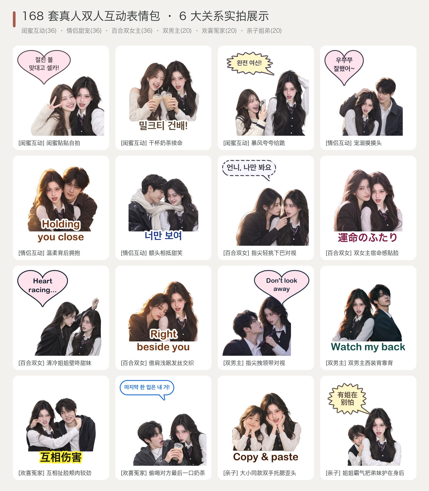

| 互动预设 | 关系分类 | 摄影风格 | 查看 PNG |
|---|---|---|---|
| `d01_bestie_cheek_selfie` · 贴贴！ | 闺蜜互动 | 韩系人生四格大头贴 (`real-purikura`) | [查看](stickers/real-purikura__d01_bestie_cheek_selfie.png) |
| `d02_bestie_milk_tea_cheers` · 奶茶续命 | 闺蜜互动 | 韩系咖啡馆胶片 (`real-kr-cafe-film`) | [查看](stickers/real-kr-cafe-film__d02_bestie_milk_tea_cheers.png) |
| `d03_bestie_hype_queen` · 绝美！ | 闺蜜互动 | 韩系爱豆自拍 (`real-kr-idol-selfie`) | [查看](stickers/real-kr-idol-selfie__d03_bestie_hype_queen.png) |
| `d37_couple_head_pat` · 乖啦~ | 情侣互动 | 韩剧主角氛围 (`real-kr-drama`) | [查看](stickers/real-kr-drama__d37_couple_head_pat.png) |
| `d38_couple_back_hug` · 抱紧你 | 情侣互动 | 真人落日夕阳逆光 (`real-golden-hour`) | [查看](stickers/real-golden-hour__d38_couple_back_hug.png) |
| `d41_couple_forehead_touch` · 只看着你 | 情侣互动 | 韩系初雪围巾恋歌 (`real-kr-winter-snow`) | [查看](stickers/real-kr-winter-snow__d41_couple_forehead_touch.png) |
| `d73_yuri_chin_lift_gaze` · 姐姐看着我 | 百合双女主 | 韩剧主角氛围 (`real-kr-drama`) | [查看](stickers/real-kr-drama__d73_yuri_chin_lift_gaze.png) |
| `d74_yuri_destiny_cheek_touch` · 命中注定 | 百合双女主 | 日系樱花季春光胶片 (`real-jp-sakura-film`) | [查看](stickers/real-jp-sakura-film__d74_yuri_destiny_cheek_touch.png) |
| `d75_yuri_cool_unnie_kabedon` · 心跳好快... | 百合双女主 | 真人高定时尚杂志封面 (`real-vogue-editorial`) | [查看](stickers/real-vogue-editorial__d75_yuri_cool_unnie_kabedon.png) |
| `d76_yuri_hair_intertwine_sleep` · 安静陪着你 | 百合双女主 | 真人落日夕阳逆光 (`real-golden-hour`) | [查看](stickers/real-golden-hour__d76_yuri_hair_intertwine_sleep.png) |
| `d109_yaoi_tie_pull_gaze` · 哥哥别躲 | 双男主/兄弟耽美 | 真人蓝调时刻电影感 (`real-blue-hour`) | [查看](stickers/real-blue-hour__d109_yaoi_tie_pull_gaze.png) |
| `d110_yaoi_back_to_back_suit` · 并肩作战 | 双男主/兄弟耽美 | 真人CineStill钨丝灯胶片 (`real-film-cinestill-800t`) | [查看](stickers/real-film-cinestill-800t__d110_yaoi_back_to_back_suit.png) |
| `d129_rival_pinch_cheeks` · 互相伤害 | 欢喜冤家/相爱相杀 | 真人综艺花字斗图 (`real-variety-meme`) | [查看](stickers/real-variety-meme__d129_rival_pinch_cheeks.png) |
| `d131_rival_steal_boba` · 最后一口归我! | 欢喜冤家/相爱相杀 | 韩综字幕斗图 (`real-kr-variety`) | [查看](stickers/real-kr-variety__d131_rival_steal_boba.png) |
| `d149_fam_copy_paste_pose` · 复制粘贴 | 亲子/姐弟兄妹萌娃 | 真人柯达Gold200胶片 (`real-film-kodak-gold`) | [查看](stickers/real-film-kodak-gold__d149_fam_copy_paste_pose.png) |
| `d150_fam_sister_shield` · 有姐在别怕 | 亲子/姐弟兄妹萌娃 | 小红书氛围感 (`real-cn-xhs-vibe`) | [查看](stickers/real-cn-xhs-vibe__d150_fam_sister_shield.png) |

## 真人动作 GIF（18 款关键帧实拍动图）

挥手、闭眼笑、擦泪、鼓腮、歪头等动作来自 AI 绘制的不同真人关键帧。Python 只负责切帧、对齐、加白边、固定配字和编码；不是让一张静态图整体晃动。

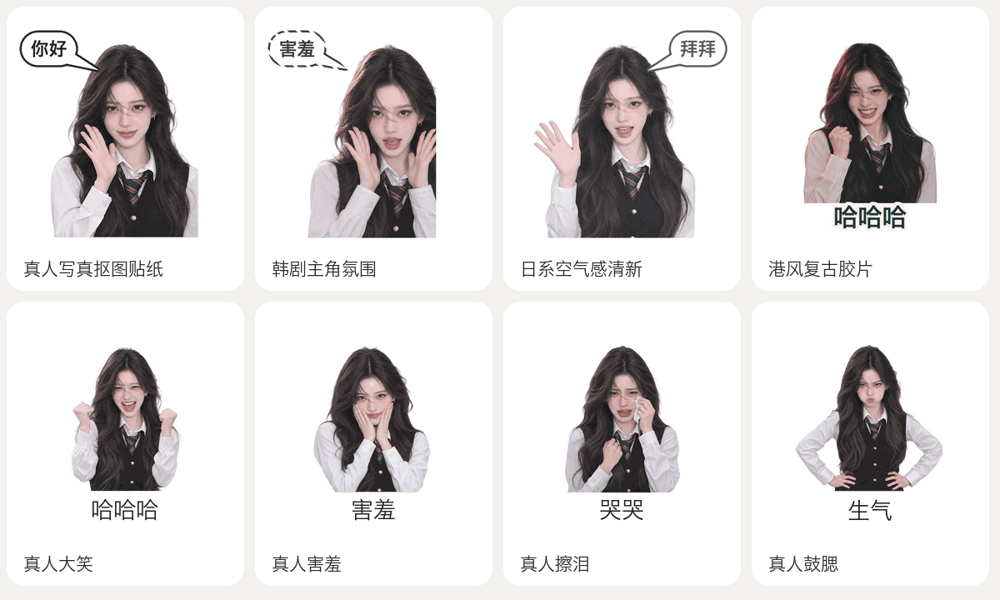

四关键帧式循环会有逐帧感，不等同于连续视频生成。

| 动作示例 | GIF |
|---|---|
| 真人写真抠图贴纸 · 你好 | [查看 / 下载](animations/real-cutout__01_hello.gif) |
| 韩剧主角氛围 · 害羞 | [查看 / 下载](animations/real-kr-drama__05_shy.gif) |
| 日系空气感清新 · 拜拜 | [查看 / 下载](animations/real-jp-airy__15_bye.gif) |
| 港风复古胶片 · 哈哈哈 | [查看 / 下载](animations/real-cn-hk-retro__04_laugh.gif) |
| 真人拍立得即时相纸 · 好耶 | [查看 / 下载](animations/real-polaroid-instant__13_yay.gif) |
| 真人落日夕阳逆光 · 爱你 | [查看 / 下载](animations/real-golden-hour__16_love.gif) |
| 韩系打歌舞台Ending妖精 · 收到 | [查看 / 下载](animations/real-kr-music-bank__09_acknowledged.gif) |
| 韩系俯拍高角度四格 · 谢谢 | [查看 / 下载](animations/real-kr-high-angle-booth__11_thanks.gif) |
| 日系川内伦子风淡彩 · 鼓掌 | [查看 / 下载](animations/real-jp-rinko-pastel__70_clap.gif) |
| 日系夏日祭花火微光 · 新年快乐 | [查看 / 下载](animations/real-jp-matsuri-fireworks__106_new_year.gif) |
| 中式江南烟雨清冷 · 摸摸头 | [查看 / 下载](animations/real-cn-jiangnan-mist__123_pat_pat.gif) |
| 中式外滩流光夜色 · 恭喜发财 | [查看 / 下载](animations/real-cn-shanghai-bund__107_red_envelope.gif) |
| 真人挥手 | [查看 / 下载](animations/photographic__01_hello.gif) |
| 真人大笑 | [查看 / 下载](animations/photographic__04_laugh.gif) |
| 真人害羞 | [查看 / 下载](animations/photographic__05_shy.gif) |
| 真人擦泪 | [查看 / 下载](animations/photographic__06_cry.gif) |
| 真人鼓腮 | [查看 / 下载](animations/photographic__07_angry.gif) |
| 真人摊手 | [查看 / 下载](animations/photographic__08_speechless.gif) |

## 真人表情分类展示（22 大类 220 款全覆盖）

统一问候样图见各风格系列；下方覆盖全部 **22 大类** 高频日常分类（含开心、难过/生气、震惊、回复、礼貌、爱意、夸奖、日常、打工学习、梗/吐槽、节日、状态、社交，以及新增的开黑电竞、追星打Call、搞钱暴富、干饭奶茶、学生考研、阴阳怪气、发疯精神状态、萌宠同框）。

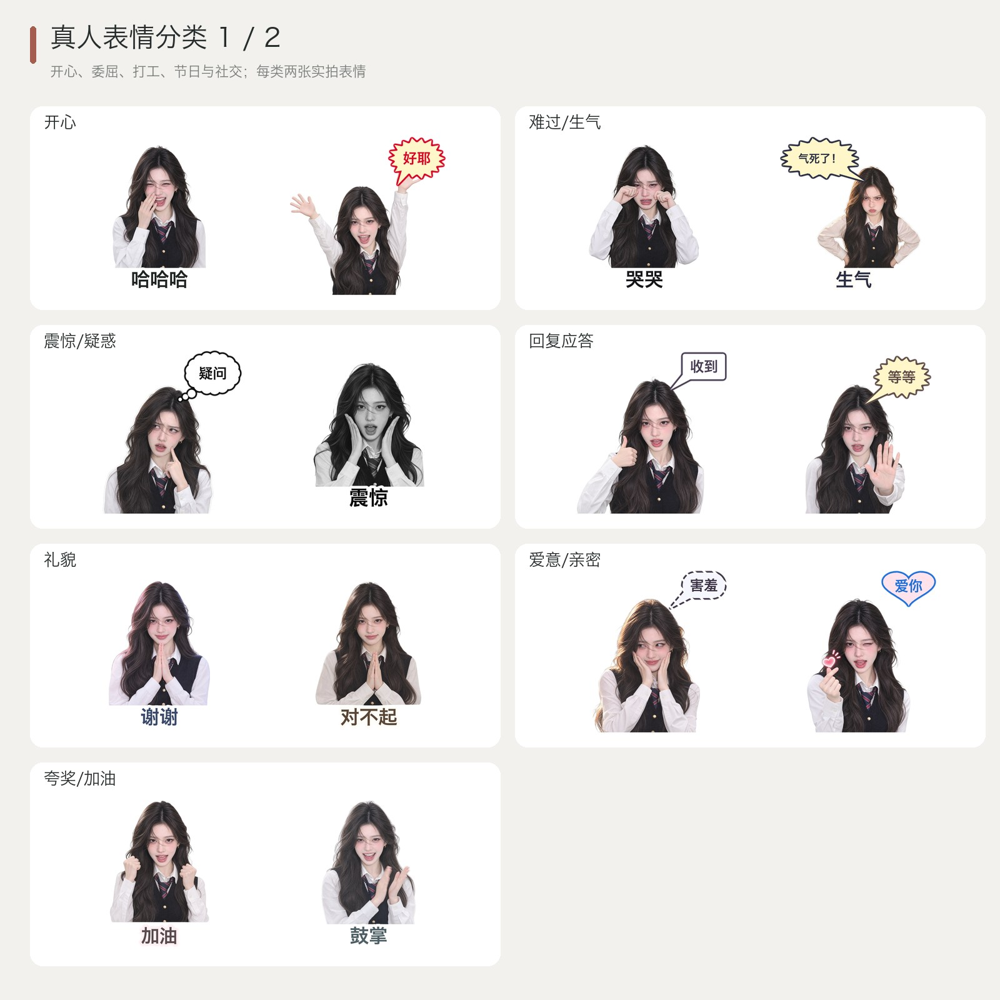

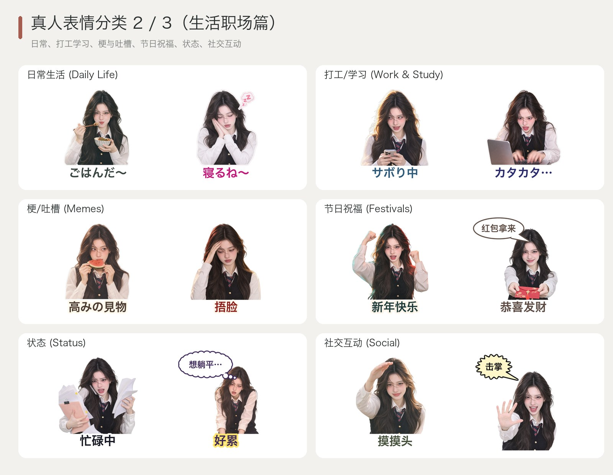

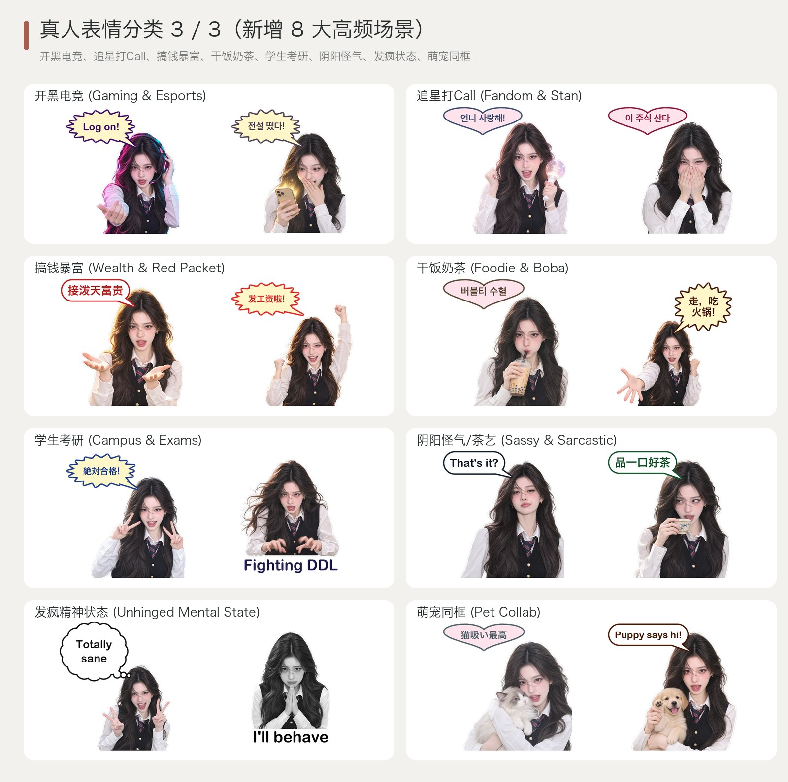

## 60 个真人梗图模板（6 大分类）

全部使用真实人像；文字、UI、印章和滤镜由项目代码叠加（0 额外 Token 即可重绘）。黑白高反差模板同样保留原本的真人面孔。

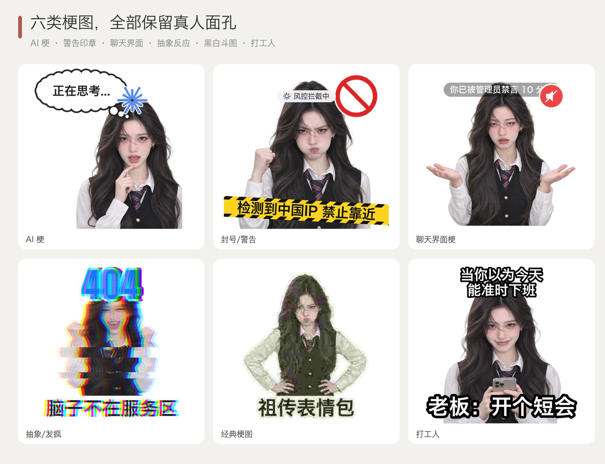

<details>
<summary>AI 梗 · 11 个模板</summary>

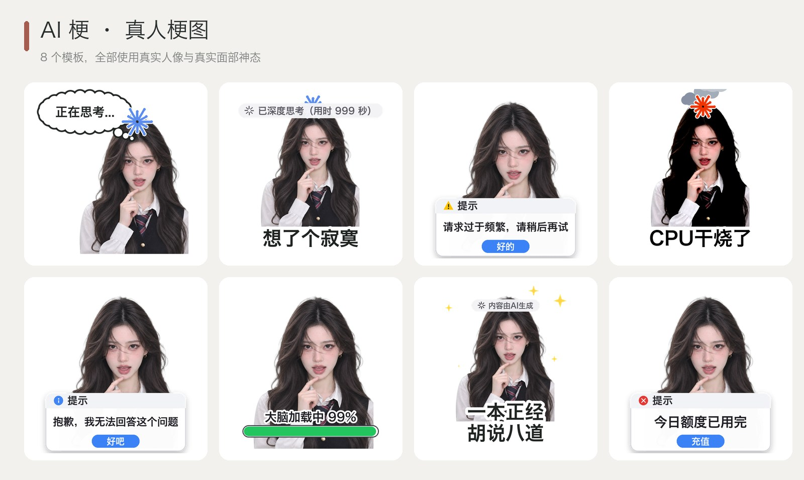

| 模板 | PNG | GIF |
|---|---|---|
| 正在思考 | [查看](memes/m01_ai_thinking.png) | [查看](memes/m01_ai_thinking.gif) |
| 想了个寂寞 | [查看](memes/m05_deep_thinking.png) | [查看](memes/m05_deep_thinking.gif) |
| 请求过于频繁 | [查看](memes/m06_rate_limited.png) | [查看](memes/m06_rate_limited.gif) |
| CPU干烧了 | [查看](memes/m07_cpu_burning.png) | [查看](memes/m07_cpu_burning.gif) |
| 我无法回答 | [查看](memes/m08_refuse.png) | [查看](memes/m08_refuse.gif) |
| 大脑加载中 | [查看](memes/m13_loading_brain.png) | [查看](memes/m13_loading_brain.gif) |
| 一本正经胡说八道 | [查看](memes/m36_ai_hallucination.png) | [查看](memes/m36_ai_hallucination.gif) |
| 额度用完了 | [查看](memes/m37_quota_exhausted.png) | [查看](memes/m37_quota_exhausted.gif) |
| 硬控我10秒 | [查看](memes/m51_hard_control_10s.png) | [查看](memes/m51_hard_control_10s.gif) |
| 智商余额不足 | [查看](memes/m56_iq_insufficient.png) | [查看](memes/m56_iq_insufficient.gif) |
| 一本正经胡说 | [查看](memes/m60_ai_hallucination.png) | [查看](memes/m60_ai_hallucination.gif) |

</details>

<details>
<summary>警告 / 印章 · 5 个模板</summary>

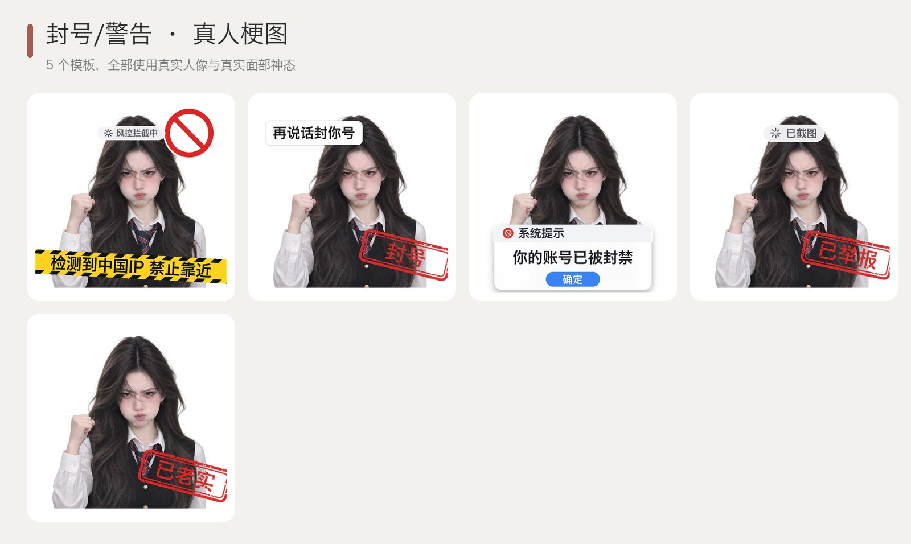

| 模板 | PNG | GIF |
|---|---|---|
| 中国IP禁止靠近 | [查看](memes/m02_china_ip_blocked.png) | [查看](memes/m02_china_ip_blocked.gif) |
| 再说话封你号 | [查看](memes/m03_ban_threat.png) | [查看](memes/m03_ban_threat.gif) |
| 账号被封了 | [查看](memes/m04_account_banned.png) | [查看](memes/m04_account_banned.gif) |
| 已截图 | [查看](memes/m38_reported.png) | [查看](memes/m38_reported.gif) |
| 已老实求放过 | [查看](memes/m45_behaving_stamp.png) | [查看](memes/m45_behaving_stamp.gif) |

</details>

<details>
<summary>聊天界面 · 8 个模板</summary>

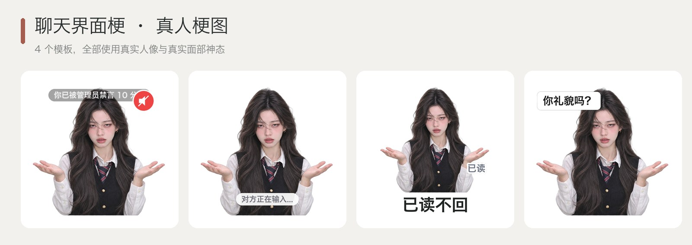

| 模板 | PNG | GIF |
|---|---|---|
| 被禁言了 | [查看](memes/m09_muted.png) | [查看](memes/m09_muted.gif) |
| 疯狂输入中 | [查看](memes/m10_typing_forever.png) | [查看](memes/m10_typing_forever.gif) |
| 已读不回 | [查看](memes/m11_read_no_reply.png) | [查看](memes/m11_read_no_reply.gif) |
| 你礼貌吗 | [查看](memes/m31_polite.png) | [查看](memes/m31_polite.gif) |
| 电量1% | [查看](memes/m42_battery_1_percent.png) | [查看](memes/m42_battery_1_percent.gif) |
| 请收款520 | [查看](memes/m43_wechat_transfer_520.png) | [查看](memes/m43_wechat_transfer_520.gif) |
| 60秒语音轰炸 | [查看](memes/m44_voice_msg_60s.png) | [查看](memes/m44_voice_msg_60s.gif) |
| 仅三天可见 | [查看](memes/m52_three_days_visible.png) | [查看](memes/m52_three_days_visible.gif) |

</details>

<details>
<summary>抽象反应 · 19 个模板</summary>

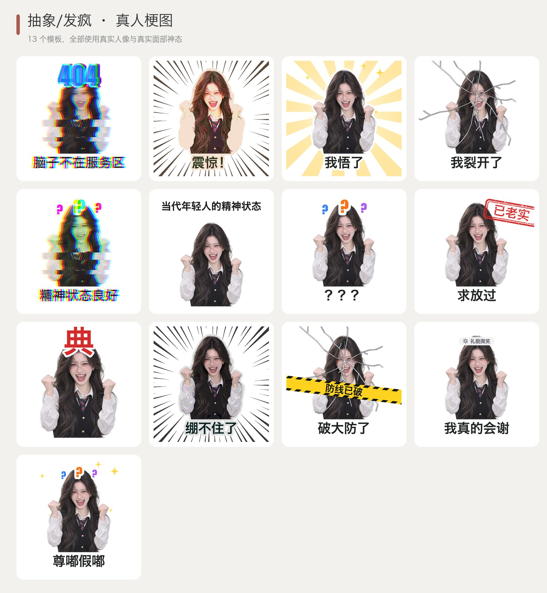

| 模板 | PNG | GIF |
|---|---|---|
| 脑子不在服务区 | [查看](memes/m12_404_brain.png) | [查看](memes/m12_404_brain.gif) |
| 震惊！ | [查看](memes/m14_shock_deepfried.png) | [查看](memes/m14_shock_deepfried.gif) |
| 我悟了 | [查看](memes/m15_enlightened.png) | [查看](memes/m15_enlightened.gif) |
| 我裂开了 | [查看](memes/m16_cracked.png) | [查看](memes/m16_cracked.gif) |
| 精神状态良好 | [查看](memes/m17_mental_state.png) | [查看](memes/m17_mental_state.gif) |
| 当代年轻人的精神状态 | [查看](memes/m21_top_bar_meme.png) | [查看](memes/m21_top_bar_meme.gif) |
| ？？？ | [查看](memes/m23_question.png) | [查看](memes/m23_question.gif) |
| 求放过 | [查看](memes/m25_behaving_now.png) | [查看](memes/m25_behaving_now.gif) |
| 典 | [查看](memes/m26_dian.png) | [查看](memes/m26_dian.gif) |
| 绷不住了 | [查看](memes/m27_cant_hold.png) | [查看](memes/m27_cant_hold.gif) |
| 破大防了 | [查看](memes/m28_big_breakdown.png) | [查看](memes/m28_big_breakdown.gif) |
| 我真的会谢 | [查看](memes/m29_thanks_sarcastic.png) | [查看](memes/m29_thanks_sarcastic.gif) |
| 尊嘟假嘟 | [查看](memes/m30_zundu.png) | [查看](memes/m30_zundu.gif) |
| ENFP快乐小狗 | [查看](memes/m39_mbti_enfp.png) | [查看](memes/m39_mbti_enfp.gif) |
| INTJ莫挨老子 | [查看](memes/m40_mbti_intj.png) | [查看](memes/m40_mbti_intj.gif) |
| 功德+1 | [查看](memes/m41_cyber_wooden_fish.png) | [查看](memes/m41_cyber_wooden_fish.gif) |
| 发疯指数999% | [查看](memes/m46_crazy_meter_999.png) | [查看](memes/m46_crazy_meter_999.gif) |
| 偷感很重 | [查看](memes/m50_heavy_stealth.png) | [查看](memes/m50_heavy_stealth.gif) |
| 确诊恋爱脑 | [查看](memes/m55_love_brain_cert.png) | [查看](memes/m55_love_brain_cert.gif) |

</details>

<details>
<summary>经典真人梗图 · 6 个模板</summary>

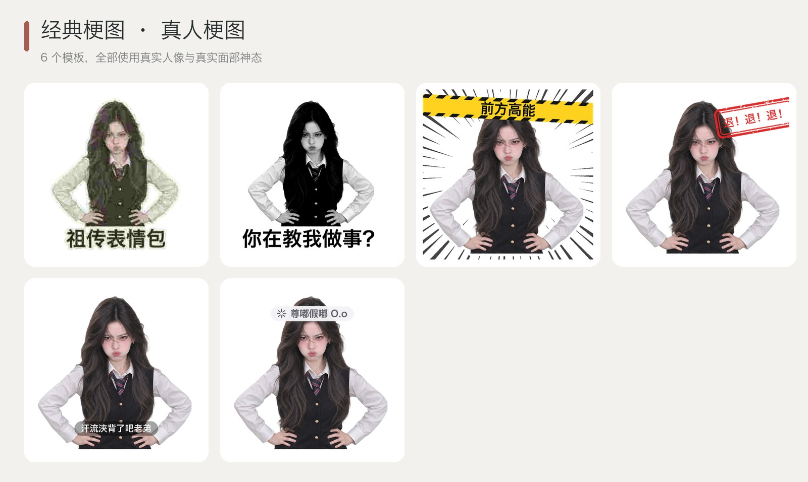

| 模板 | PNG | GIF |
|---|---|---|
| 祖传表情包 | [查看](memes/m18_patina.png) | [查看](memes/m18_patina.gif) |
| 你在教我做事？ | [查看](memes/m19_real_portrait.png) | [查看](memes/m19_real_portrait.gif) |
| 前方高能 | [查看](memes/m24_caution_hype.png) | [查看](memes/m24_caution_hype.gif) |
| 退!退!退! | [查看](memes/m47_tui_tui_barrier.png) | [查看](memes/m47_tui_tui_barrier.gif) |
| 汗流浃背了吧 | [查看](memes/m48_sweating_bro.png) | [查看](memes/m48_sweating_bro.gif) |
| 尊嘟假嘟O.o | [查看](memes/m49_zundu_jiadu.png) | [查看](memes/m49_zundu_jiadu.gif) |

</details>

<details>
<summary>打工人 · 11 个模板</summary>

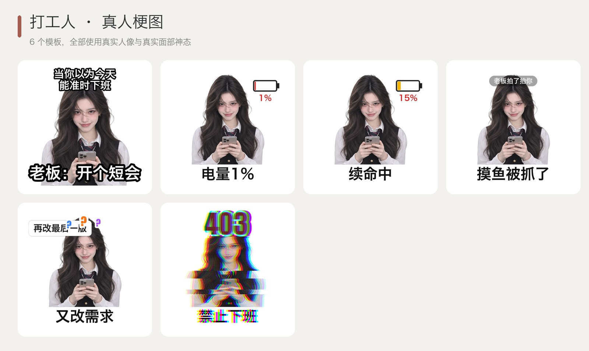

| 模板 | PNG | GIF |
|---|---|---|
| 开个短会 | [查看](memes/m20_impact_classic.png) | [查看](memes/m20_impact_classic.gif) |
| 电量1% | [查看](memes/m22_battery_low.png) | [查看](memes/m22_battery_low.gif) |
| 续命中 | [查看](memes/m32_worker_recharge.png) | [查看](memes/m32_worker_recharge.gif) |
| 摸鱼被抓了 | [查看](memes/m33_caught_slacking.png) | [查看](memes/m33_caught_slacking.gif) |
| 又改需求 | [查看](memes/m34_client_revision.png) | [查看](memes/m34_client_revision.gif) |
| 禁止下班 | [查看](memes/m35_no_leaving.png) | [查看](memes/m35_no_leaving.gif) |
| 已读不回 | [查看](memes/m53_read_no_reply.png) | [查看](memes/m53_read_no_reply.gif) |
| 泼天的富贵 | [查看](memes/m54_god_of_wealth_feed.png) | [查看](memes/m54_god_of_wealth_feed.gif) |
| 禁止画饼 | [查看](memes/m57_no_empty_promises.png) | [查看](memes/m57_no_empty_promises.gif) |
| 持证摸鱼 | [查看](memes/m58_slacking_permit.png) | [查看](memes/m58_slacking_permit.gif) |
| 光速下班 | [查看](memes/m59_clock_out_timer.png) | [查看](memes/m59_clock_out_timer.gif) |

</details>

## 气泡、配字与语言

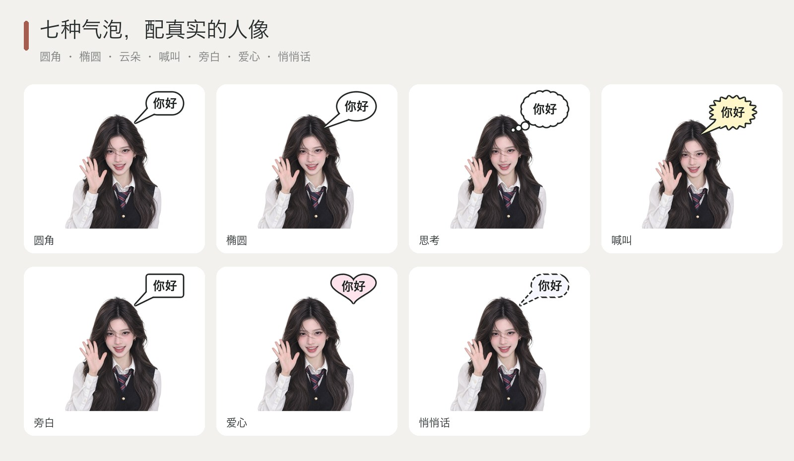

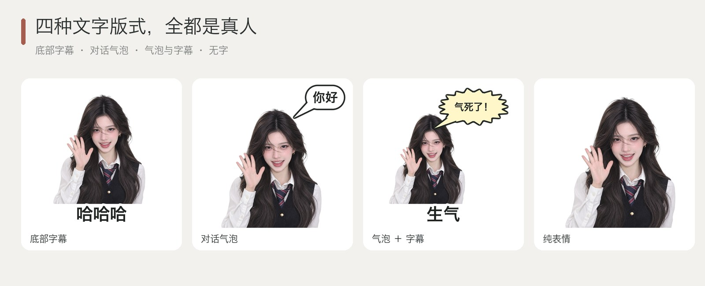

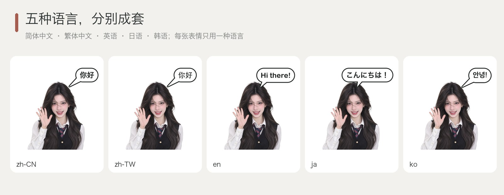

### 四大语种整套单语言表情包（每组 12 张，组内 100% 同一语言）

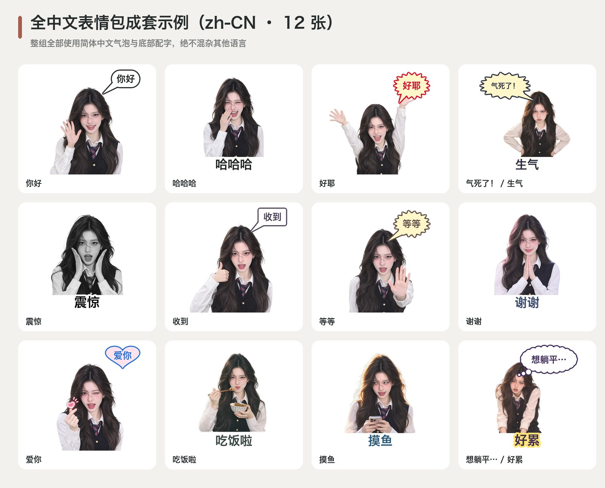

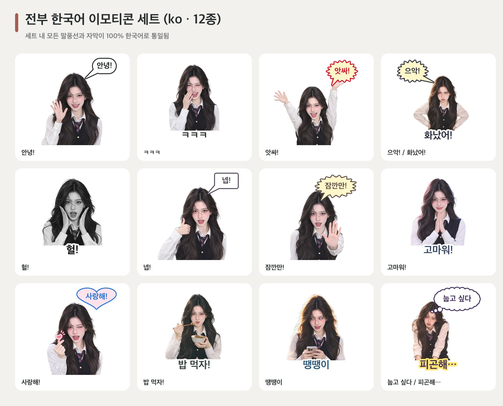

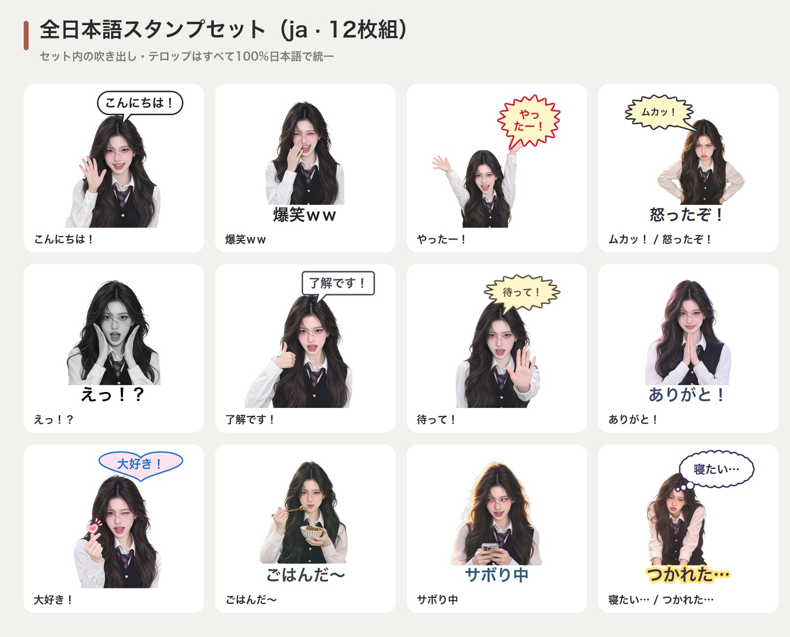

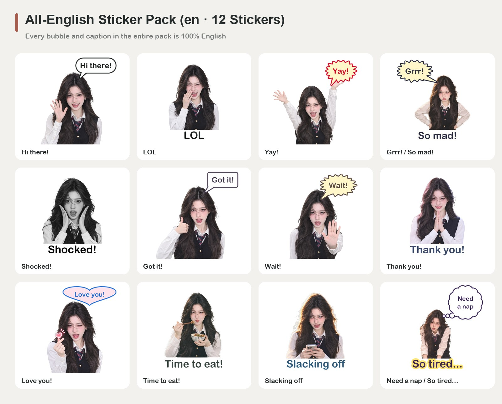

每张表情只用一种语言；上图是五套语言的并排展示。

## 真人发布素材

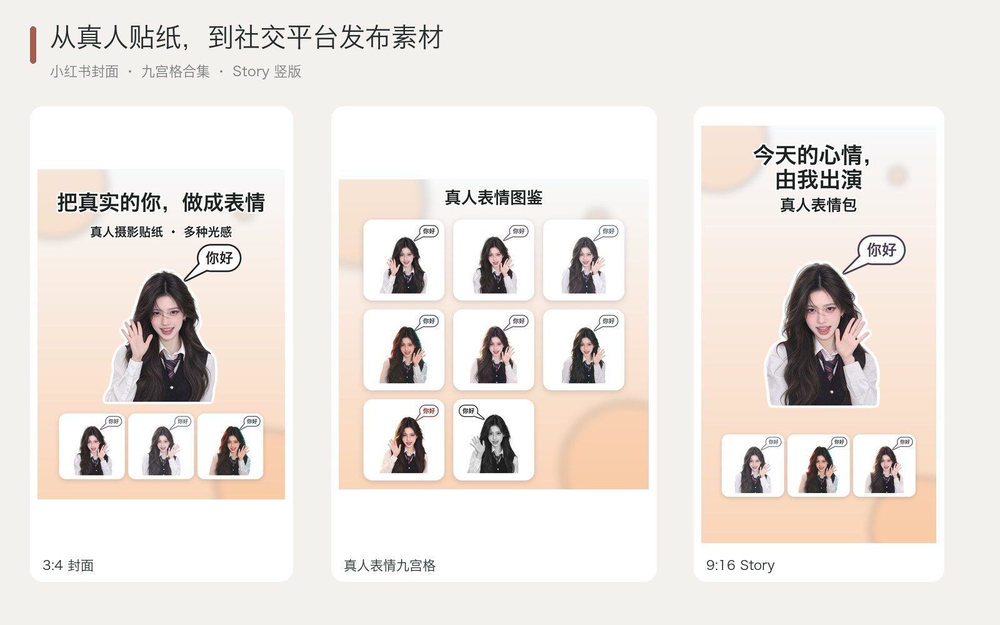

[3:4 封面](examples/xiaohongshu-cover.jpg) · [九宫格](examples/social-grid.jpg) · [9:16 Story](examples/instagram-story.jpg)

上述为展示素材，平台投递仍需复核各后台当前要求。

## 在 README 中引用

```markdown


[查看完整真人图库](docs/gallery/README.md)
```

所有单张 PNG / GIF 可从本页链接和 `manifest.json` 获取。公开图库不包含原始人物照片、生成缓存或本机路径。
